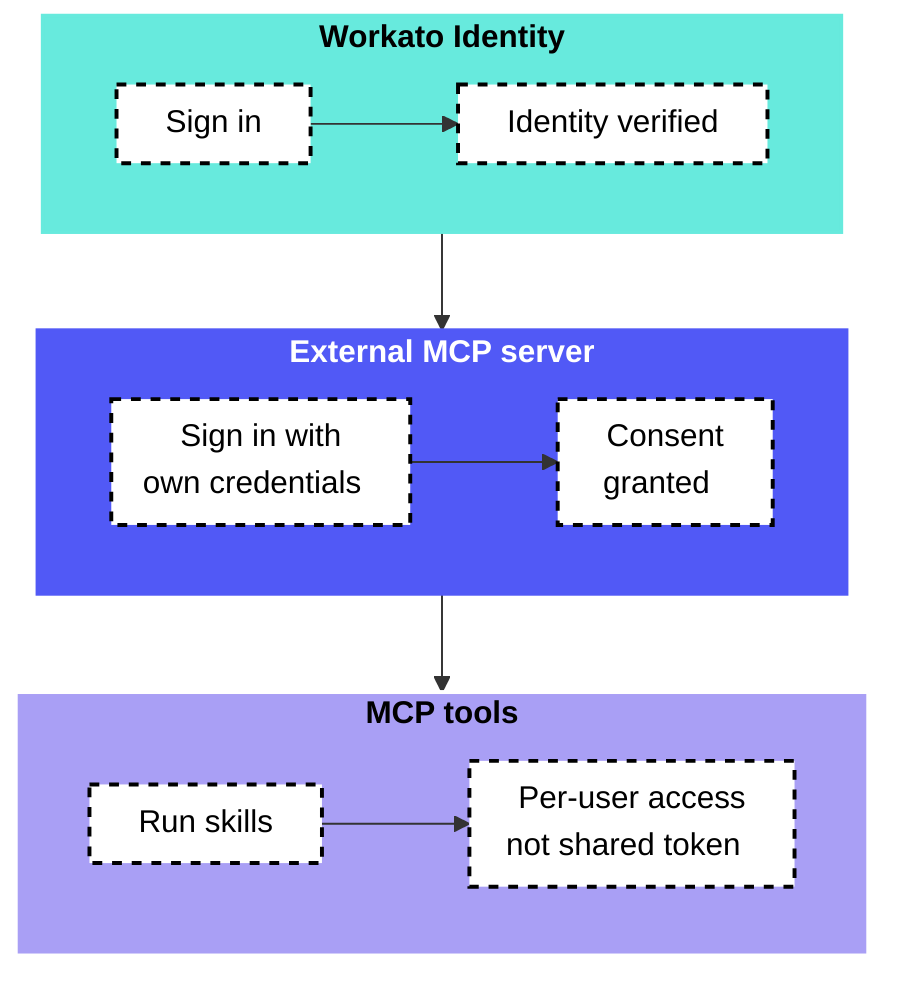

<!-- source: https://docs.workato.com/en/mcp/mcp-authentication | lastmod: 2026-11-04 -->
> Configure MCP server access with API token-based access, OAuth2 single sign-on through Workato Identity, or OpenID Connect (OIDC) and switch between access methods.

# MCP access methods

MCP supports API token–based access, OAuth2 integration with [Workato Identity](/en/workato-identity), and OpenID Connect (OIDC). Token–based access is set by default, but you can switch between access methods.

> **SWITCHING ACCESS METHODS**
> 
> The MCP token is revoked when you switch from token-based access to Workato Identity or OIDC. This means that users can no longer access the MCP server with token access.

## OAuth2 access with Workato Identity

OAuth2 access enables you to govern access within [Workato Identity](/en/workato-identity). This enables you to control MCP server access centrally without managing separate tokens. OAuth2 access with Workato Identity provides your end users with a single sign-on (SSO) experience across MCP clients like Claude, Cursor, and Windsurf.

MCP and Workato Identity integration ensures enterprise-grade security centralized access management.

> **ALL USERS MUST BE ADDED TO A USER GROUP**
> 
> You must have admin privileges to grant end-user access to an MCP server. Workspace owners, admins, and collaborators don't automatically have MCP server access. You must add all users, including yourself, to an end-user group to grant MCP access. Refer to [Workato Identity end-user groups](/en/workato-identity/user-groups) for more information.

### Use Workato Identity for access

Complete the following steps to use Workato Identity for MCP server access:

1. Sign in to your Workato account.
   
2. Go to **AI Hub > Enterprise MCP > Custom servers**. A list of your existing MCP servers displays.
   
3. Click the MCP server card where you plan to use Workato Identity.
   
4. Click **Settings > End user access**.
   
5. Go to the **Access Method** section and click the **switch method** toggle to open the **Switch User Access Method** modal.
   
   _Access Method section_
   
6. Click Workato Identity.
   
   _Click Workato Identity_
   
7. Click **Confirm**.
   

### End-user groups

Use [Workato Identity](/en/workato-identity/user-groups) to manage your end-user groups.

> **ALL USERS MUST BE ADDED TO AN END USER GROUP**
> 
> You must have admin privileges to grant end-user access to an MCP server. Workspace owners, admins, and collaborators don't automatically have MCP server access. You must add all users, including yourself, to an end-user group to grant MCP access.

#### End-user group MCP server access

You can provide access to specific MCP servers after you create a user group with [Workato Identity](/en/workato-identity/user-groups).

Complete the following steps to grant a user group access to an MCP server:

1. Sign in to your Workato account.
   
2. Go to **AI Hub > Enterprise MCP > Custom servers** and select the MCP server where you plan to add a user group.
   
3. Click **Settings > End user access**.
   
4. Ensure that the access method is set to Workato Identity.
   
5. Click **Add end-user groups**.
   
   _Click **Add end-user groups**_
   
6. Select the checkboxes for the end-user groups you plan to provide with access to the MCP server.
   
7. Click **Next**.
   
8. Click **Edit tool access** and select the checkboxes for the tools users are allowed to access as part of this group.
   
   _Select the checkboxes for the tools users are allowed to access_
   
9. Click **Add end user groups**.
   

## API token access

API token authentication enables you to develop and test without SSO configuration. Admins can manage tokens in the MCP server **Settings > End user access** page. MCP servers use token-based access by default. Tokens are generated automatically when you create a new MCP server with token-based access selected.

Admins can create multiple tokens to improve access control for individual users, enforce quotas, and maintain audit trails. Each token must have a unique name.

### Use token access

Complete the following steps to use token access:

1. Sign in to your Workato account.
   
2. Go to **AI Hub > Enterprise MCP > Custom servers**. A list of your existing MCP servers displays.
   
3. Click the MCP server card where you plan to use token access.
   
4. Click **Settings > End user access**.
   
5. Ensure that the access method is set to **Token-based access**.
   
6. Go to the **MCP Tokens** section.
   
7. Click **Create new token**.
   
8. Enter a unique name for the token in the **Token name** field.
   
   _Enter a unique name for the token in the **Token name** field_
   
9. Click **Create token**.
   
10. Click **Copy** to copy the generated token.
    

### Generate and revoke a token

You can refresh an existing token to reset access. Your previous token is no longer valid after you refresh your token.

Complete the following steps to refresh an existing token:

1. Sign in to your Workato account.
   
2. Go to **AI Hub > Enterprise MCP > Custom servers**. A list of your existing MCP servers displays.
   
3. Click the MCP server card where you plan to refresh a token.
   
4. Click **Settings > End user access**.
   
5. Go to **MCP Tokens** and click the ellipsis (...) for the MCP token you plan to refresh.
   
   _Go to **MCP Tokens** and click the ellipsis (...)_
   
6. Click **Refresh token**.
   
7. Click **Refresh token** again when prompted in the confirmation modal.
   
   > **MCP CLIENT IMPACT**
   > 
   > A token becomes invalid when you refresh it. MCP clients using the token lose access to the server and stop working.
   
8. Copy the refreshed token and update your connections where appropriate.
   

### Delete a token

You can delete an existing token to completely remove access to MCP clients using this token.

Complete the following steps to delete an existing token:

1. Sign in to your Workato account.
   
2. Go to **AI Hub > Enterprise MCP > Custom servers**. A list of your existing MCP servers displays.
   
3. Click the MCP server card where you plan to delete a token.
   
4. Click **Settings > End user access**.
   
5. Go to **MCP Tokens** and click the ellipsis (...) for the MCP token you plan to delete.
   
   _Go to **MCP Tokens** and click the ellipsis (...)_
   
6. Click **Delete token**.
   
7. Click **Delete token** again when prompted in the confirmation modal.
   
   > **MCP CLIENT IMPACT**
   > 
   > MCP clients using the token lose access to the server and stop working.
   

## OIDC access

OIDC enables authentication and profile retrieval for MCP servers. You must configure an OIDC server in your identity provider (IdP) to use OIDC authentication for your MCP server. The OIDC server must have a profile configured. An OIDC profile stores the connection details for an OIDC server in your IdP, including how Workato retrieves the IdP's public keys and which audience values it accepts. Workato uses these details to validate incoming requests and to retrieve profile information.

MCP servers support the following OIDC authentication methods:

- Client credentials using JSON Web keys (JWK)
- Auth code grant

Complete the following steps to use OIDC for MCP server access:

1. Sign in to your Workato account.
   
2. Go to **AI Hub > Enterprise MCP > Custom servers**. A list of your existing MCP servers displays.
   
3. Click the MCP server card where you plan to use OIDC.
   
4. Go to **Settings > End user access**.
   
5. Go to the **Access Method** section and click the **switch method** toggle to open the **Switch User Access Method** modal.
   
6. Click **OpenID Connect**.
   
   _Click **OpenID Connect**_
   
7. Click **Confirm**.
   
8. Use the **OpenID connect profile** drop-down menu to select the OIDC profile you plan to use. Your OIDC profile, including OAuth scopes and either auth code grant or JWK client credentials authentication, must be configured in your IdP.
   
   > **GLOBAL OAUTH SCOPES ARE FETCHED ONLY FOR AUTH CODE GRANT**
   > 
   > Global OAuth scopes are fetched automatically for OIDC profiles using auth code grant authentication. You must manually select global OAuth scopes for OIDC profiles using JWK authentication.
   
   Refer to the [OpenID documentation](https://openid.net/developers/how-connect-works/) for more information.
   
9. Go to the **Global OAuth scopes** section and click **\+ Add scope** to add global OAuth scopes if your OIDC profile uses JWK authentication. Global OAuth scopes are fetched automatically for OIDC profiles using auth code grant authentication.
   
10. Click **Save**.
    

### Edit OIDC access

You can change the OIDC profile the MCP server uses and update the scopes assigned to an OIDC profile that uses JWK authentication.

Complete the following steps to edit your OIDC access method:

1. Sign in to your Workato account.
   
2. Go to **AI Hub > Enterprise MCP > Custom servers**. A list of your existing MCP servers displays.
   
3. Click the MCP server card where you plan to make edits.
   
4. Go to **Settings > Authentication**. **Authentication** only displays under **Settings** when OIDC is enabled.
   
5. Apply your edits.
   
6. Click **Save**.
   

## Proxy MCP server authentication

Proxy MCP servers support API token and OAuth authentication. You can provide multiple parameters in the header, for example the client ID and client secret. Refer to [Create a proxy MCP server](/en/mcp/mcp-servers#create-a-proxy-mcp-server) for more information.

Proxy server OAuth authentication requires users to first sign in with Workato Identity. Users are then redirected to the external system, such as Salesforce or Snowflake, to sign in with their own credentials. This ensures each user's actions are tied to their personal account, not a shared token.

Proxy MCP servers support API token authentication. You can provide multiple parameters in the header, for example the client ID and client secret. Refer to [Create a proxy MCP server](/en/mcp/mcp-servers#create-a-proxy-mcp-server) for more information.

---
