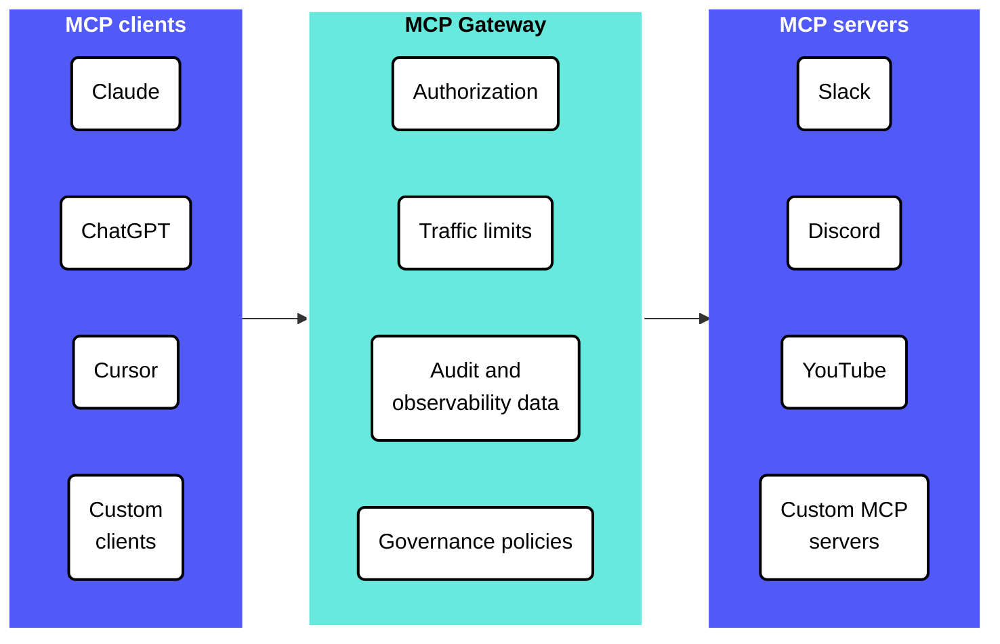

<!-- source: https://docs.workato.com/en/mcp/mcp-gateway | lastmod: 2026-11-04 -->
> The MCP Gateway governs MCP servers across your organization, enforcing authorization, traffic limits, audit data, and governance policies.

# MCP Gateway

The MCP Gateway governs MCP interactions across your organization, including MCP servers you compose in Workato, Workato prebuilt MCP servers, and third-party servers integrated by proxy. The MCP Gateway enforces authorization, manages traffic limits, captures audit and observability data, and applies governance policies uniformly across the entire MCP estate.

Gateway is the central enforcement point for all MCP traffic. Every client connection passes through it, and every tool invocation is authenticated, authorized, and rate-limited before reaching the runtime.

## Authentication and access control

Each MCP server uses:

- **Authentication**: End users must authenticate to provide their identity to the MCP server. OpenID Connect (OIDC) enables authentication and profile retrieval for agents and MCP servers.
  
- **Authorization**: Establishes what the authenticated user is allowed to do, both at the server level and in the underlying tool's backend.
  

|  | **Methods** | **Use** |
| --- | --- | --- |
| **Authentication** | • API token • Username and password for Workato Identity\](/en/workato-identity.md) • SSO (external IdP) • OpenID connect (OIDC) | **API token:** Single shared credential. Development, testing, headless service access. **Username and password:** End user signs in with Workato Identity credentials. **SSO:** End user signs in through their IdP, such as Okta, federated to Workato Identity. **OIDC:** End users, agents, or MCP servers are authenticated through an OIDC server configured in your IdP. |
| **Authorization** | • End-user groups • Verified User Access (OAuth 2.0) | **End-user groups:** Server-level authorization determines which MCP servers a user can reach. **Verified User Access:** Per-user authorization to the underlying tool's backend connection. |

## Authentication

Each MCP server uses one of the following access methods:

- **API token (default)**: This method uses a Workato-issued token. Workato recommends this method for development, testing, or scenarios that don't require SSO. Revoking a token immediately disconnects all clients using it.
  
- **Username and password (Workato Identity)**: End users authenticate with their [Workato Identity](/en/workato-identity) username and password when connecting from MCP clients, such as Claude, Cursor, or Windsurf.
  
- [**SSO (external IdP)**](/en/workato-identity/saml-sso#workato-identity-saml-based-sso): End users authenticate through your organization's identity provider, such as Okta, federated to Workato Identity. This provides a single sign-on experience across MCP clients in which users sign in once through their organization's IdP to access Claude, Cursor, Windsurf, and other MCP clients.
  
- [**OIDC**](/en/mcp/mcp-authentication#oidc-access): Provides an identity verification layer built on top of OAuth 2.0 protocol. OIDC enables authentication and profile retrieval without managing passwords. Workato OIDC lets you configure which MCP servers Workato Identity is allowed to authenticate. You must create an OIDC configuration for each profile and audience in a workspace. You can share OIDC configurations across environments.
  

Refer to [MCP access methods](/en/mcp/mcp-authentication) for more information.

## Authorization

Workato MCP provides authorization at two layers:

- **Server-level authorization with end-user groups**: Controls which MCP servers a user can access.
  
- **Tool-level authorization with subgroups**: Controls which tools users can access within an MCP server.
  
- **Per-user backend authorization with verified user access**: Controls what the user can do on the underlying tool after accessing an MCP server.
  

### End-user group server-level authorization

End-user groups provide server-level authorization and determine which MCP servers each authenticated user can access. You can manage groups in [Workato Identity](/en/workato-identity).

> **ALL USERS MUST BE ADDED TO A USER GROUP**
> 
> Workspace owners, admins, and collaborators aren't automatically granted MCP server access. You must add all users, including yourself, to an end-user group. Admin privileges are required to grant end-user access.

Refer to [User group MCP server access](/en/mcp/mcp-authentication#user-group-mcp-server-access) for more information.

### End-user group tool-level authorization

You can manage MCP server tools access to determine the specific tools a user is allowed to access. Tool-level role-based access control (RBAC) allows you to restrict individual tools to specific subgroups of the MCP server's end user groups. This means that a user must have server-level access and membership in a tool's configured groups to invoke that tool.

Tool groups are a subset of the MCP server's end-user groups. A group can't be assigned to a tool unless it's already assigned to the MCP server.

## Verified user access per-user backend authorization

End-user groups govern access to the MCP server. [Verified user access](/en/mcp/verified-user-access) governs access to the underlying tools. OAuth 2.0 authentication propagates the user's identity to the underlying tool's backend connection after the end user is authenticated to the MCP server. This ensures backend calls to Salesforce, Gmail, and other tools execute under the calling user's identity and permissions rather than a shared service account.

## MCP verified user access

Verified user access works through runtime user connections and allows each end user to authenticate with their own credentials when accessing a tool that requires authentication. This ensures that workflows perform actions using the identity and permissions of the individual user. Refer to [MCP verified user access](/en/mcp/verified-user-access) for more information.

## Traffic management

No rate limits or usage quotas are enforced on requests to your MCP server by default. You can add custom rate limits, usage quotas, and IP restrictions to your MCP server.

Rate limits cap how quickly requests can be made, acting as a throttling mechanism to prevent bursts of traffic. For example:

**Hourly throttling**

- Time interval: `1 hour`
- Tool calls: `5,000`
- Result: The MCP server accepts up to 5,000 tool calls per hour across all users. This prevents sudden spikes that could overwhelm your backend systems.

Usage quota controls the total cumulative consumption over a period of time, restricting the capacity quota to manage overall resource consumption. For example:

**Monthly usage quota**

- Time interval: `1 month`
- Tool calls: `1,000,000`
- Result: Your MCP server has a monthly usage quota of 1 million tool calls. All requests are blocked until the monthly quota resets.

**Platform quotas.** The following quotas apply to every MCP server and can't be changed from the MCP server settings:

| Description | Quota | Notes |
| --- | --- | --- |
| Maximum number of access tokens created for a single MCP Server (API key) | 50 | NA |
| Maximum entries per IP allowlist or blocklist | 500 | Applies to the allowed-IP and blocked-IP lists independently. |
| Rate limit for refreshing the tool list from an upstream MCP server | 1 request per 60 seconds | NA |
| Synchronous tool-execution timeout. After this window elapses, the call detaches and continues in the background. | 30 seconds | Not configurable. |
| Total tool-execution timeout, including any background continuation after the synchronous phase. | 300 seconds | Set in the recipe settings. Requests that exceed this timeout don't return a response to the MCP client. |

**Dynamic client registration (DCR) quotas.** Dynamic client registration (DCR) requests, made by MCP clients to register with the Workato MCP server, are subject to the following rate quotas:

| Description | Quota |
| --- | --- |
| Hourly rate limit for DCR requests per workspace in the US Data Center | 100,000 requests per hour |
| Daily rate limit for DCR requests per workspace in the US Data Center | 400,000 requests per day |
| Weekly rate limit for DCR requests per workspace in the US Data Center | 500,000 requests per week |

Refer to [Configure MCP server quotas](/en/mcp/mcp-server-access-and-configuration#configure-mcp-server-limits) for more information.

## Proxy to third-party MCP servers

Proxy servers enable MCP clients to connect to remote third-party MCP servers through Workato. This lets you expose any MCP server’s tools, resources, and prompts through your own MCP server.

Refer to [Create a proxy MCP server](/en/mcp/mcp-servers#create-a-proxy-mcp-server) and [Proxy MCP server authentication](/en/mcp/mcp-authentication#proxy-mcp-server-authentication) for more information.

## Observability

Observability for MCP runs is provided at the server-level with activity logs and at the tool-level with execution traces.

### Dashboard

Workato provides an [MCP servers dashboard](/en/mcp/dashboard) with visual metrics and server status for all MCP servers and an individual [server-level dashboard](/en/mcp/mcp-server-access-and-configuration#mcp-server-level-dashboards) for each MCP server. These metrics help you understand how effectively your MCP servers are performing, whether tools are being used as expected, and how users are engaging with them. This enables you to monitor MCP servers at a granular level so that degraded server health and errors don't go undetected.

### Server-level logs

Server-level logs show activity for every tool call an MCP server receives. Each entry captures the calling user, authentication method, source IP, user agent, tool name, invocation inputs and outputs, duration, and success or failure status. Logs can be filtered by time period, log type, log level, data fields, and recipe ID.

You can stream logs to any Security Information and Event Management (SIEM) app.

Refer to [View MCP server logs](/en/mcp/mcp-server-access-and-configuration#view-mcp-server-logs) for more information.

### Tool execution traces

Each tool invocation produces a recipe job in the recipe's job history. The job shows the full step-by-step execution, including actions, connections, input and output between steps, and any errors encountered. The calling user's identity, including the user name, user email, and user group IDs, is propagated into the job context. This enables backend actions the recipe takes to be attributed to the user that initiated the MCP call.

### End-to-end traceability

Server-level logs and tool execution traces provide end-to-end traceability for any MCP interaction. The activity log captures every request entering the Gateway. The recipe job history captures every downstream action the request triggered. Both layers obtain the calling user identity to allow a single MCP tool call to be traced from the Gateway, through the recipe execution, and into the backend systems it touched, all linked by the user that initiated it.

## Governance

MCP provides RBAC permissions and an audit trail for administrative actions.

### RBAC permissions

Granular RBAC permissions are used to assign user privileges to create, edit, delete, and manage MCP servers. Refer to [Manage your workspace collaborators with role-based access control](/en/user-accounts-and-teams/role-based-access/#manage-your-workspace-collaborators-with-role-based-access-control) for more information.

### Audit trail

Every administrative action is logged with the actor, the resource, and the change set:

- **Servers**: Created, renamed, or deleted
- **Tools**: Added, removed, started, or stopped
- **Policy changes**: IP allow and deny lists, rate limits, and usage quotas

_Activity audit_

### Design-time governance with AIRO

MCP supports design-time governance with [AIRO](/en/airo). This enables you to identify MCP servers that aren't following governance guidelines.

Complete the following steps to use design-time governance with AIRO:

1. [Upload a playbook to AIRO](/en/airo/knowledge/manage#upload-playbooks) with MCP server governance guidelines. Alternatively, you can attach the playbook to a new AIRO chat.
   
   _Upload MCP governance guidelines to AIRO_
   
2. [Start a chat with AIRO](/en/airo/chat#start-a-new-chat) and ask it to identify MCP servers that aren't following your governance guidelines.
   
   _Ask AIRO to review MCP servers_

---
