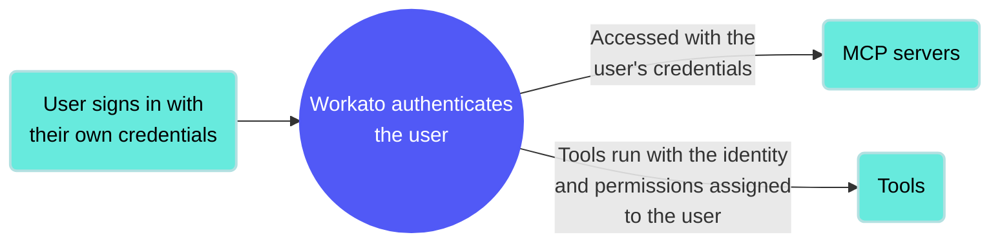

<!-- source: https://docs.workato.com/en/mcp/mcp-runtime | lastmod: 2026-07-07 -->
> The MCP Runtime is the Workato-hosted layer that operates your MCP servers, handles client traffic, and runs each tool with the user's own identity.

# MCP Runtime

The MCP Runtime is the layer that hosts and operates your MCP servers. Workato runs the MCP servers, handles client traffic, and executes each tool invocation. Your team doesn't provision or maintain any infrastructure.

## MCP Runtime key features

- **Hosted by Workato**: Every MCP server runs on Workato's managed runtime.
- **User identity and context**: Verified user access works through [runtime user connections](/en/features/runtime-user-connections) and allows each end user to authenticate with their own credentials when accessing a tool that requires authentication. This ensures that workflows perform actions using the identity and permissions of the individual user. Refer to [MCP verified user access](/en/mcp/verified-user-access) for more information.

---
