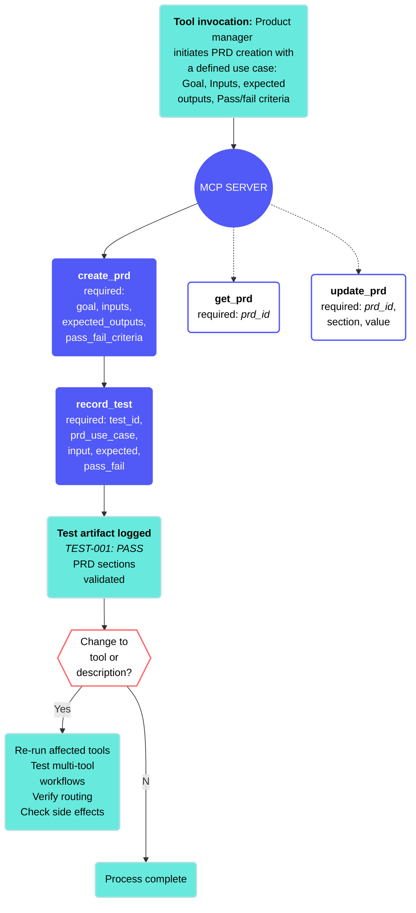

<!-- source: https://docs.workato.com/en/mcp/mcp-server-design | lastmod: 2026-09-08 -->
> Learn best practices for designing MCP servers, including how they differ from traditional APIs, tool scope, error handling, and LLM reasoning.

# MCP server design

An MCP server is a collection of tools that enable large language models (LLMs) to access data and perform actions in your systems. MCP server design is the process of planning and structuring your MCP for AI agents to interact with your applications.

## MCP servers vs traditional APIs

Understanding the differences between MCP servers and traditional APIs can help you design effective MCP servers. Traditional APIs are built for human developers who read documentation, make deliberate choices, and write code to handle the response. MCP servers are built for LLMs that discover what your server can do from the descriptions you write, and act on these descriptions through inference rather than logic.

APIs work well with granular parameters and flexible operations. MCP servers work well with clear descriptions, consistent behavior, and focused tools.

## MCP server design best practices

Workato recommends the following best practices for MCP server design:

**Strategic design**:

- **Clarity over completeness**: Make your server easy to understand, rather than including exhaustive detail.
- **Cohesion over convenience**: Group capabilities by logical categories rather than convenient grouping.
- **Explicitness over inference**: Define all behavior explicitly.
- **Determinism over cleverness**: Consistent, predictable behavior is easier for an LLM to interpret than adaptive logic. Build tools that behave the same way every time, regardless of context.
- **Treat failure as normal**: Return errors that are specific enough for an LLM to recover gracefully when things go wrong.

**Design for LLM reasoning**:

- Write a detailed description to help the LLM choose the correct tool
- Use semantic outcomes rather than error codes
- Define pagination, dependencies, and quotas explicitly
- Provide a narrow and cohesive scope for the MCP server

**Make it actionable**:

- Start with 3-5 core tools
- Limit your MCP server to 5-8 tools
- Don't combine unrelated domains
- Test with real user requests
- Iterate based on tool selection accuracy

## Define the MCP server scope

Defining your MCP server scope means deciding which capabilities belong together in a single server. A well-scoped server serves a specific functional domain, operates on related objects, and completes meaningful units of work. A poorly scoped server is harder for an LLM to interpret and more likely to require ongoing adjustments.

Use the following steps to define your scope before building:

- **Identify what belongs in your server**: Group capabilities that share a functional domain, operate on related objects, and require similar permissions. Avoid adding unrelated capabilities for convenience or combining operations that require different authentication.
  
- **Choose a server type**: MCP servers generally fall into one of three categories:
  
  - **Base servers**: Handle core operations like CRUD, queries, and lookups, such as customer data management.
  - **Process servers**: Orchestrate multi-step workflows, such as order fulfillment.
  - **Data servers**: Support analytics and reporting, such as sales pipeline analysis.
- **Validate your scope**: Ensure that your MCP server passes the following tests:
  
  - **Elevator pitch**: Can you describe the MCP server's purpose in one sentence? The scope may be too broad if you can't provide a succinct description.
  - **LLM reasoning**: Can an LLM infer when to use this MCP server only by the name? Simplify the scope if it requires extensive explanation.
  - **Completeness**: Can 3-5 primary use cases be completed using only this server? The scope may be too narrow if most workflows require multiple servers.
- **Use tool count as a signal**: Use 5-8 tools per MCP server. 8-12 tools is reasonable. Consider splitting the MCP server into separate domains if you have more than 15 tools.
  

Use the following table as a reference to avoid common scope mistakes:

| ❌ Not recommended | ✅ Recommended |
| --- | --- |
| Exposing individual API endpoints directly as MCP tools, such as `get_customer`, `post_customer`, and `put_customer`. | Designing MCP servers that group tools around the workflows an LLM needs to complete. |
| A single server handling unrelated domains like HR, IT, and Sales. | A separate MCP server per domain, each built around a specific set of related workflows. |
| Tool names that require prefixes to avoid conflicts, such as `sales_search_items` and `support_search_items`. This is a sign that the MCP server is covering too many domains. | A focused MCP server where each tool name is unambiguous, such as `search_items`. |
| 20+ tools in one server | 5-8 focused tools per server |

### Plan your MCP server scope

Consider the following principles when you plan your MCP server scope:

- **[Identify the MCP server purpose](#identify-the-mcp-server-purpose)**
- **[Choose the MCP server type](#choose-the-mcp-server-type)**

#### Identify the MCP server purpose

Your MCP server should include capabilities that serve a specific functional domain, operate on related objects, share similar permissions, and complete meaningful units of work. Don't include unrelated capabilities for convenience, operations requiring different authentication, or functionality that blurs conceptual boundaries.

#### Choose the MCP server type

Determine what type of MCP server you need for your use case:

- **Base Servers**: Core operations
  
  - **Uses**: CRUD operations, queries, lookups
  - **Example**: Customer data management
- **Process Servers**: Workflow orchestration
  
  - **Uses**: Multi-step business processes
  - **Example**: Order fulfillment workflow
- **Data Servers**: Analytics and insights
  
  - **Uses**: Aggregations, reports, analysis
  - **Example**: Sales pipeline analytics

## MCP server descriptions

Your MCP server description is automatically shared with your LLM when you connect the MCP server. You can update the description for your specific use cases and to include any tool customization you perform. An accurate MCP server description helps your LLM know when to use specific tools.

Use the following guidelines to write effective MCP server descriptions:

### Write a detailed MCP server description

Provide a detailed MCP server description that includes the following information:

- Primary domain
- Main objects handled
- Core operations
- Explicit exclusions

✅ Recommended - Use a defined domain and operations, object handling, and explicit exclusion. For example:

```plaintext

Manages sales opportunities, accounts, and contacts within a CRM system.
Provides tools to search, create, update, and analyze sales data, including
pipeline tracking and deal reporting. Does not handle customer support
tickets, marketing campaigns, or administrative configuration.
```

❌ Not recommended - A comprehensive MCP with multiple domains and wide-ranging operations. For example:

```plaintext
Manages sales opportunities, accounts, and contacts.
Provides tools to search, create, update, and analyze sales data, including
pipeline tracking and deal reporting. Provides tools to process customer support
tickets, manage marketing campaigns, and configure administrative settings, including customer visibility, team member visibility, and custom branding.
```

## Define MCP server input and output

Defining clear input handling and output structure can help your LLM identify which tool to use, validate input, and provide the correct output.

### Input handling

Provide instructions that explicitly validate the input. For example:

✅ Recommended - Explicit validation

```python
def create_customer(name: str, email: Optional[str] = None):
    if not name:
        return {"error": "Name is required"}
    if email and not is_valid_email(email):
        return {"error": "Invalid email format"}
    # Proceed with creation
```

❌ Not recommended - Implicit defaults

```python

def create_customer(name: str = "", email: str = "noreply@acme.com"):
    # Creates customer with placeholder values
```

Provide detailed information to enable LLMs to handle optional fields correctly. For example:

✅ Recommended - Skip semantics

```python
def update_customer(id: str, **fields):
    updates = {}
    if "email" in fields:
        updates["email"] = fields["email"]
    if "phone" in fields:
        updates["phone"] = fields["phone"]
    # Only update explicitly provided fields
```

❌ Not recommended - Implicit defaults for optional fields.

```python
def update_customer(id: str, email: str = None, phone: str = None):
    # Always updates email and phone, even when not intended
```

### Output structure

Explicitly define pagination in your output structure. For example:

✅ Recommended - Clear truncation signal

```json
{
  "results": [...],
  "has_more": true,
  "cursor": "eyJwYWdlIjogMn0="
}
```

❌ Not recommended - Silent truncation.

```json

{
  "results": [...]
}
```

Ensure that you use consistent field names for your output structure. For example:

✅ Recommended - Use consistent conventions

```json
// All tools use same field names
{"customer_id": "90876", "email_address": "user@acme.com"}
```

❌ Not recommended - Inconsistent naming

```json
// Different tools use different names
{"customerId": "90876", "email": "user@acme.com"}
{"customer_id": "45674", "user_email": "user@acme.com"}
```

### Error handling

Ensure that you define semantic errors for your MCP server. This enables users and LLMs to understand what went wrong. For example:

✅ Recommended - Semantic meaning

```json
{
  "error": "No customers found matching 'Acme Corp'",
  "error_type": "not_found",
  "retry": false
}
```

❌ Not recommended - Technical codes

```json
{
  "error_code": 404,
  "message": "ERR_NOT_FOUND"
}
```

Ensure that you map errors consistently so LLMs understand how to handle errors. For example:

| Error category | When to use | LLM response |
| --- | --- | --- |
| `not_found` | Resource doesn't exist | Ask for different criteria |
| `not_permitted` | Authorization failure | Inform user of limitations |
| `invalid_input` | Bad parameters | Request clarification |
| `temporary_failure` | Transient issue | Retry the operation |

### Apply required field conventions

Ensure that you apply required field conventions to each tool in your MCP server:

- **Use consistent casing**: Match your underlying API style
- **Error field naming**: Use lowercase `error` field
- **Pagination flags**:
  - `has_more`: For standard pagination
  - `has_more_chunks`: For streamed responses
  - Don't mix styles in one server

## Design effective MCP server tools

Design your MCP server around specific tool use cases. Start with the workflow you plan to enable, then determine what tools are needed, what data each tool returns, and how the tools interact. Each component is interconnected, and understanding these relationships helps you design MCP servers that are efficient, reliable, and composable. Refer to [MCP server tool design](/en/mcp/mcp-server-tool-design) for comprehensive MCP server tool design principles, including data strategy and developer experience considerations.

MCP servers typically include the following components:

- **Tools**: Define what actions (skills) the AI agent can perform.
- **Tool architecture**: Specifies how tools are structured and interact with other tools and apps.
- **Data strategy**: Controls what information is returned to the AI agent.
- **Tool descriptions**: Determines how the AI agent understands and uses each tool.

## Test your MCP server

Test your MCP server to ensure that tools are selected accurately. For example:

| User request | Expected tool | Pass/Fail |
| --- | --- | --- |
| `Find customers named Acme` | `search_customers` | ✅ |
| `Get customer ID 123` | `get_customer` | ✅ |
| `Create a new customer` | `create_customer` | ✅ |

Test for multi-turn conversation LLM responses. For example:

```plaintext
Turn 1: "Find customers"
→ LLM should ask for search criteria

Turn 2: "All customers in California"
→ LLM should use the previous context + the new filter to provide a list of customers in California

Turn 3: "Show me the first one"
→ LLM should provide the first customer from the California results
```

Test multi-tool workflows to ensure composability. For example:

```plaintext
1. search_products(query="laptop") → returns product IDs
2. get_product_details(id="45678") → returns full info
3. check_inventory(id="90876") → returns availability
```

You should also test for edge cases to understand how your MCP server performs in different scenarios. For example:

| Test case | Expected behavior |
| --- | --- |
| Missing required parameter | Clear error message |
| Exceeded quota (>100 results) | Return 100 results + `has_more: true` |
| Permission denied | Semantic `not permitted` error |
| Empty results | Clear `no results` message |

## PRD creation and tool validation example use case

The following example use case provides an overview of how to apply the test process when working with an MCP server that exposes tools to create and validate product requirement documents (PRDs).

A product manager needs to create a structured PRD for a new feature. The MCP server provides tools to define, store, and retrieve PRDs. Each tool must be validated against a documented contract, and each use case in the PRD must be tested using a structured artifact before the PRD is published. The PRD-driven test process ensures that every tool behaves predictably, that inputs and outputs match the PRD's defined requirements, and that future changes to a tool or its description can be verified.

The process begins by mapping each PRD section, such as goal, inputs, expected outputs, and pass/fail criteria, to a specific tool invocation. Each tool is then verified against its contract before a test artifact is recorded. Regression testing should be performed after any change to confirm that tool behavior and routing remain consistent.

**Workflow outline**

- **Define the PRD use case**: The product manager identifies the feature and documents the goal, inputs, expected outputs, and pass/fail criteria using the **create\_prd** tool.
- **Verify tool contracts**: Confirm that each tool, such as **create\_prd**, **get\_prd**, and **update\_prd**, has a one-line purpose, required and optional parameters, expected response shape, and error behaviors.
- **Record test artifact**: The team uses the **record\_test** tool to log a structured artifact for each tool invocation, capturing the input, expected output, actual result, and pass/fail status.
- **Validate PRD sections**: Each section of the PRD, such as goal, inputs, expected outputs, and pass/fail criteria, is verified against the tool's response to confirm the output matches the defined requirements.
- **Regression testing (optional)**: Test changes to tool descriptions, or parameters, and affected test artifacts. Verify multi-tool workflows and check for unintended side effects.

The following diagram illustrates this workflow:



---
