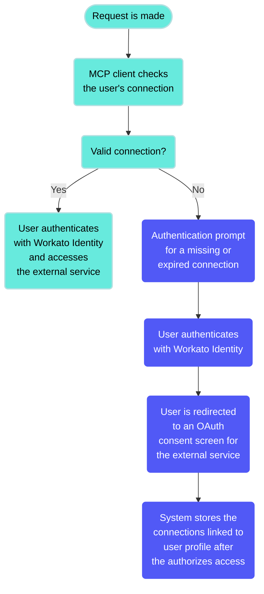

<!-- source: https://docs.workato.com/en/mcp/verified-user-access | lastmod: 2026-09-14 -->
> Learn how MCP verified user access uses runtime user connections so each end user authenticates to external tools with their own credentials.

# MCP verified user access

Verified user access works through [runtime user connections](/en/features/runtime-user-connections) and allows each end user to authenticate with their own credentials when accessing a tool that requires authentication. This ensures that workflows perform actions using the identity and permissions of the individual user. MCP verified user access supports [Recipe functions](/en/connectors/recipe-functions/guides/walkthrough)

You can use verified user access with proxy MCP servers. This allows you to route requests to external systems like Salesforce or Snowflake with each user authenticating with their own credentials. Users are prompted to sign in to the external system the first time they connect, and Workato handles the rest automatically. Refer to [Create a proxy MCP server](/en/mcp/mcp-servers#create-a-proxy-mcp-server) for more information.

MCP verified user access only supports the following recipe types:

- [Recipe functions](/en/connectors/recipe-functions/guides/walkthrough) that use OAuth 2.0 authorization code grant. Recipe functions that use [long actions](/en/recipes/long-actions) aren't supported for MCP verified user access.
- [API recipes](/en/api-mgmt/api-recipes/walkthrough#step-1-create-the-recipe) that use OAuth 2.0 authorization code grant.

MCP verified user access requires end-users to [authenticate with Workato Identity](/en/mcp/mcp-authentication#oauth2-authentication-with-workato-identity). Refer to [MCP Workato Identity access method and end-user group configuration](/en/mcp/verified-user-access-configuration#mcp-workato-identity-access-method-and-end-user-group-configuration) for more information.

> **MCP VERIFIED USER ACCESS DOESN'T SUPPORT TOKEN AUTHENTICATION**
> 
> MCP tools that require verified user access with a token-based access method are unsupported. Token authentication is supported for MCP tools that don't use verified user access.

## MCP verified user access authentication workflow

The MCP client checks the user's connection when a request is made. The MCP server verifies if the user has a valid connection to the required external service. The user receives an authentication prompt if the connection is missing or expired. The prompt includes a Workato-generated connection setup link that redirects the user to the Workato Identity login page.

The user is redirected to the external application that requires authorization after authentication with Workato Identity. Users must complete authorization sequentially if multiple applications require authorization. For example, the user is redirected to an OAuth consent screen for the external service, such as Jira or Salesforce. The system stores the connections linked to user's profile after the user authorizes access.

## Limitations

MCP verified user access has limitations for supported recipe type, connection type, and authentication methods. Refer to the following sections for more information.

### MCP verified user access and recipe functions

[Recipe functions](/en/connectors/recipe-functions/guides/walkthrough) that use [long actions](/en/recipes/long-actions) aren't supported for MCP verified user access.

Recipe functions in MCP verified user access tools have specific configuration requirements due to inherited authentication from parent recipes. You must manually select the identity for recipe functions with verified user access enabled.

MCP verified user access tools only support Recipe functions that use OAuth 2.0 authorization code grant.

**Example scenarios**

**Recipe function identity requirements**

- Scenario: An MCP tool with verified user access enabled uses a recipe function.
- Impact: The tool becomes unavailable and displays a warning icon.
- Resolution: You must select the identity to enable the tool.

**Recipe function connection type mismatch**

- Scenario: Recipe functions use the parent recipe connection, which allows any connection type. MCP server tools with verified user access only support OAuth 2.0 authorization code grant.
- Impact: Tools may be configured with incompatible authentication types, leading to failures.
- Resolution: You must verify that parent recipe connections use OAuth 2.0 authorization code grant before you use MCP verified user access with recipe functions.

### MCP verified user access with nested recipe functions

Verified user access only supports the first-level parent recipe when a recipe is exposed as a tool. Verified user access doesn't extend to the second-level recipe functions nested within the parent recipe. This means that the nested function executes using the service account credentials instead of prompting the user to authenticate with their own account if your parent recipe calls a recipe function that requires user authentication to an external service.

For example, you can expose a recipe as a tool that calls a nested recipe function:

- **First level (parent recipe)**
  
  - Verified user access is fully supported
  - User connections are properly surfaced for authentication
  - Users are prompted to authenticate with their own credentials
- **Nested level (recipe functions called within the parent recipe)**
  
  - Verified user access **isn't** fully supported
  - Any actions using verified user access automatically revert to the **service account**
  - User connections within the nested recipe function **aren't surfaced** to the end user for authentication

This limitation applies to recipe functions called from within a recipe exposed as a tool and recipe functions called from within a skill.

### MCP verified user access authentication type

MCP verified user access tools don't support developer API tokens. Token authentication is supported for MCP tools that don't use verified user access. Your MCP tools display a warning and become unavailable if you switch from verified user access to developer token authentication.

### MCP verified user access and API recipes

MCP verified user access tools only support [API recipes](/en/api-mgmt/api-recipes/walkthrough#step-1-create-the-recipe) that use OAuth 2.0 authorization code grant.

## Quotas

Your workspace has a combined runtime user connection (RUC) and verified user access (VUA) quota of 100,000 per workspace. The parent connection quota is 500 per workspace.

## More resources

- [MCP verified user access configuration](/en/mcp/verified-user-access-configuration)
- [Create an SDK connection for MCP verified user access](/en/developing-connectors/sdk/guides/walkthrough#create-an-sdk-connection-for-mcp-verified-user-access)
- [Recipe functions](/en/connectors/recipe-functions/guides/walkthrough)
- [Workato Identity](/en/workato-identity)

---
