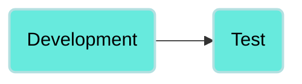
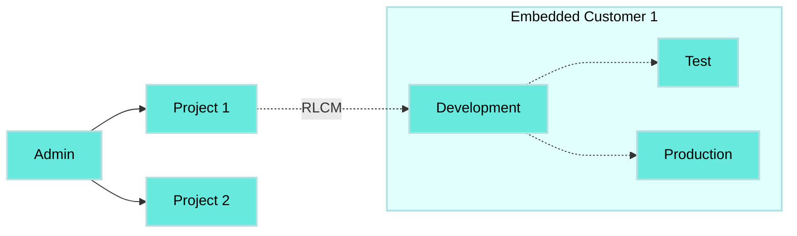

<!-- source: https://docs.workato.com/en/oem/embedded-environments/deploy-environment | lastmod: 2026-10-28 -->
> Deploy projects and recipes between Embedded Environments and review deployment history using the Deployments tab.

# Deploy assets

You must have deployment permission to deploy a project within an environment. Refer to [Collaborator roles and Environments](/en/oem/embedded-environments/environment-roles) for more information.

The **Deployments** tab is only visible to collaborators that have access to more than one environment _and_ deploying permissions in at least two environments. This allows collaborators to deploy and review deployment history when they click the **Deployments** tab.

_Deployments tab visible and usable_

Collaborators with access to two or more environments _without_ deploying permissions in at least two environments can see the **Deployments** tab as locked. In this case, collaborators can see a lock icon and a message that they need permission to access deployments.

Collaborators with access to only one environment cannot see the Deployments tab.

_Deployments tab not visible_

The **Deployments** tab also displays deployment history, providing a comprehensive view of all past deployments. This functionality is particularly useful for revisiting and redeploying a previous version of your project or recipe. You can revert your deployment to an earlier state by selecting the version you plan to revert to and re-deploying it.

_Deployment history_

To re-deploy a past deployment, click on the deployment you plan to re-deploy and click **Deploy**.

_Redeploy a previous deployment_

## Deployments workflow

You can only deploy from Development to Test and from Development to Production.

We recommend that you use **Deploy entire project** when using Embedded Environments.

## Deploy a project

Complete the following steps to deploy a project to an environment:

1. Log in to your Workato account, click **Resources** in the left-side navigation menu, and then click **Projects**.
   
2. Select the project you plan to deploy.
   
3. Click **Deployments > Deploy project**.
   
4. Select **Test** or **Production** as the target environment. Alternatively, you can download the package.
   
   _Deploy to Test environment_
   
5. Optional. Summarize your changes in the **Notes** field.
   
6. Click **Next**.
   
7. Select **Deploy entire project** or **Customize deployment** as the deployment type.
   
   > **DEPLOY ENTIRE PROJECT RECOMMENDATION**
   > 
   > We recommend that you select **Deploy entire project** when using Environments.
   
   _Select deployment type_
   
8. Click **Next**. Environments begins to detect changes in the deployment.
   
9. Review the changes. You can click specific changes to view a side-by-side comparison of the previous version and the new version.
   
   _Deployment comparison_
   
10. Click **Deploy**.
    

## Deploy a project build programmatically

You can deploy your project programmatically. Refer to [Understanding project deployment](/en/workato-api/projects#understanding-project-deployment) for more information.

> **PROJECT-BASED PACKAGE RECOMMENDATION**
> 
> Deployments from Embedded Partners to Embedded Customers are done through [Recipe Lifecycle Management (RLCM)](/en/recipe-development-lifecycle#recipe-lifecycle-management). We recommend that you use a project-based package.

---
