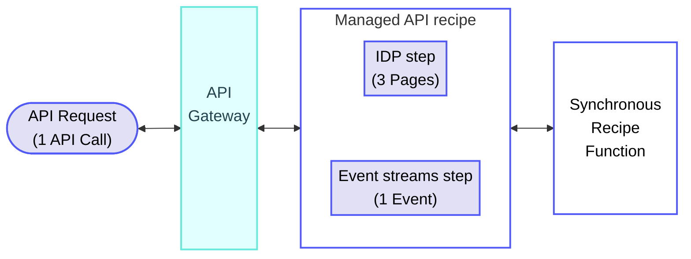
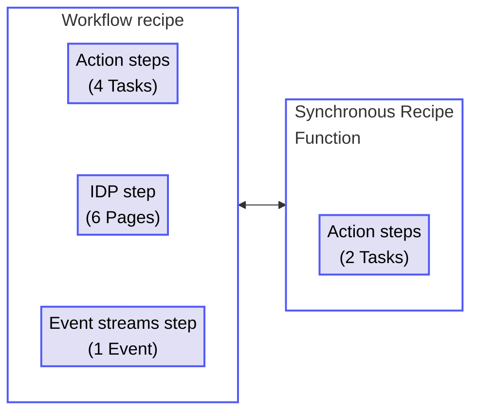
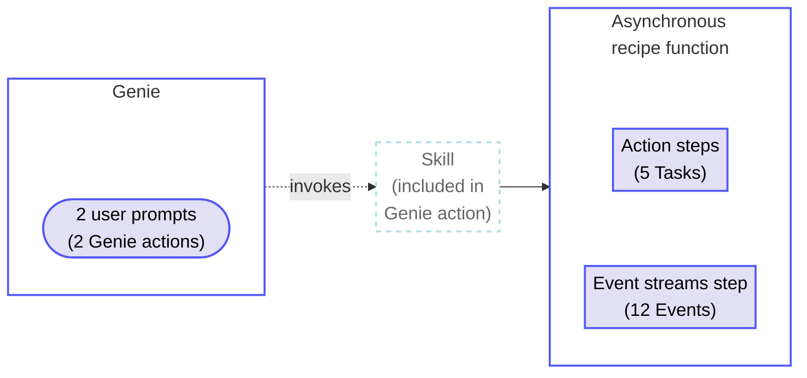

<!-- source: https://docs.workato.com/en/pricing/estimate | lastmod: 2026-09-16 -->
> Estimate Workato usage across common scenarios that combine multiple asset types, with flow diagrams, breakdown tables, and rule notes.

# Estimate usage

This page demonstrates how you can estimate usage for a range of use cases that use multiple asset types. These scenarios show how usage from different assets combines into a total usage count. Refer to [Understand usage](/en/pricing/usage-metrics) for the underlying model.

## Estimate usage for your own use case

Complete the following steps to calculate usage for use cases that combine multiple asset types:

1. Identify every asset type involved in the use case.
   
2. Identify the usage metric for each asset. Refer to the [usage metrics table](/en/pricing/usage-metrics#metrics) for the full list.
   
3. Add IDP pages or Event streams events on top of the asset's usage metric, when used.
   
4. Sum the usage across all metrics to calculate the total usage per use case execution.
   

## Example use cases

The following examples demonstrate how usage is calculated for common use cases.

### New supplier onboarding

A global retailer onboards thousands of suppliers each year. When a new supplier submits onboarding documents through the supplier portal, an API endpoint receives the submission and kicks off automated compliance review.

Total usage: 1 API Call + 3 Pages + 1 Event

| Asset | Metric | Usage |
| --- | --- | --- |
| Managed API recipe (receives submission) | API Calls | 1 |
| IDP (3-page compliance certificate) | Pages | 3 |
| Recipe function (validates supplier data, synchronous) | API Calls | 0 |
| Event streams (publishes to audit trail) | Events | 1 |
| **Total** |  | **1 API Call, 3 Pages, 1 Event** |

Synchronous recipe function calls are part of the API Call and don't add extra usage. Refer to [Managed API calculation rules](/en/pricing/usage-metrics/api-platform#usage-calculation-rules) for more information.

### Procure-to-pay invoice processing

A procurement team processes invoices from thousands of global suppliers. A scheduled recipe fetches new invoices from the ERP, extracts line items, validates against purchase orders, and routes approved invoices for payment.

Total usage: 6 Tasks + 6 Pages + 1 Event

| Asset | Metric | Usage |
| --- | --- | --- |
| Workflow recipe (fetches + routes invoice, 4 action steps) | Tasks | 4 |
| IDP (6-page invoice) | Pages | 6 |
| Recipe function (validates against PO, 2 action steps) | Tasks | 2 |
| Event streams (publishes payment-approved event) | Events | 1 |
| **Total** |  | **6 Tasks, 6 Pages, 1 Event** |

Asynchronous recipe function calls run as independent workflows and are measured in Tasks, contributing to the overall task count.

### AI-assisted quality review and recall

A quality manager receives an alert about a potential defect in a supplier's product. They use a Genie to investigate across SAP and supplier records, then prompt the Genie to initiate a recall. The Genie invokes a skill that asynchronously calls a recipe function to notify affected store locations through Event streams.

Total usage: 2 Genie actions + 5 Tasks + 12 Events

| Asset | Metric | Usage |
| --- | --- | --- |
| Genie (2 user prompts) | Genie actions | 2 |
| Skill (invokes the recall recipe function) | Non-billable | Included in the Genie action |
| Asynchronous recipe function (initiates recall, 5 action steps) | Tasks | 5 |
| Event streams (notifies 12 store locations) | Events | 12 |
| **Total** |  | **2 Genie actions, 5 Tasks, 12 Events** |

Skills invoked by a Genie are included in the Genie action and aren't counted separately. Recipe functions called asynchronously from a skill run as independent workflows, so their action steps and Event streams still contribute to usage.

---
