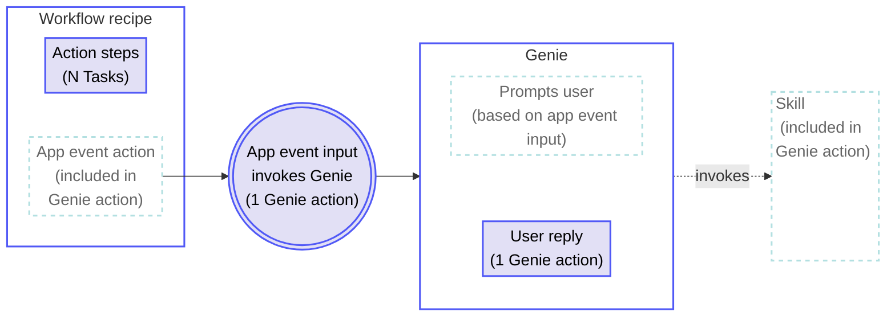
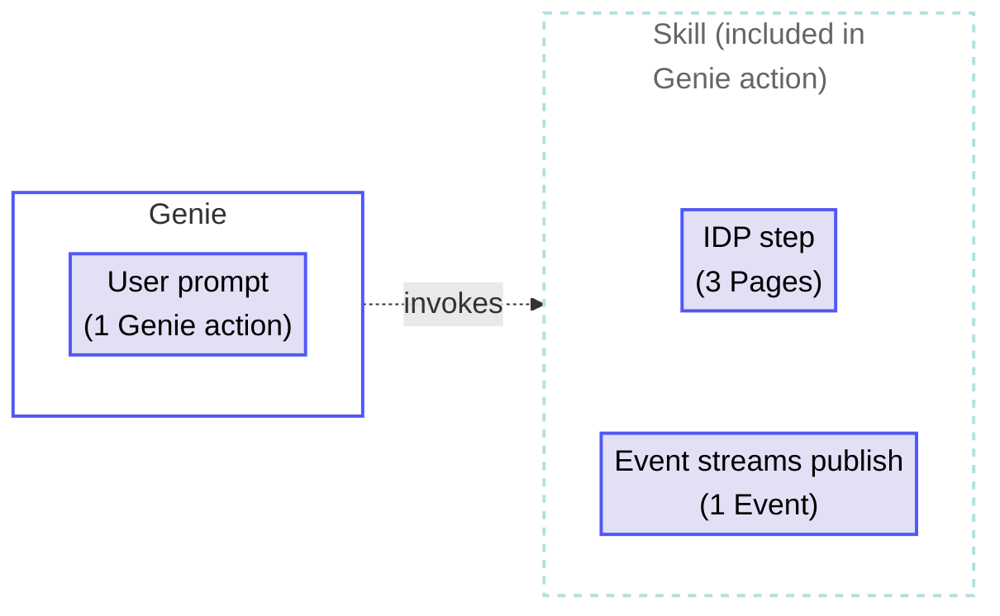

<!-- source: https://docs.workato.com/en/pricing/usage-metrics/agent-studio | lastmod: 2026-09-16 -->
> Learn how Workato calculates Agent Studio usage from Genie actions, including prompt counting and additive product capability rules.

# Genie usage

Workato measures Genie usage in Genie actions. Each input prompt sent to the Genie counts as one Genie action. A prompt can be sent by a user or a system, such as an App event or another Genie.

Reasoning, knowledge retrieval, and handoffs to other Genies are all included in the Genie action. These internal operations are part of the Genie's response to a prompt and aren't counted separately.

## Genie calculation rules

Genie usage calculations follow the general [usage calculation rules](/en/pricing/usage-metrics#rules), where successfully executed operations count toward usage and failed actions are excluded.

Workato uses the following additional rules to calculate Genie usage:

- Workflow recipes that send an App event to a Genie are billed as Tasks for their action steps.
- An App event invocation of a Genie counts as a Genie action.
- Skills directly invoked by a Genie are included in the Genie action and aren't counted separately.
- The following operations remain billable when included in a skill:
  - **IDP**: Contributes to Pages.
  - **Event streams**: Contributes to Events.
  - **Recipe functions**: Recipe functions called from a skill are billed as Tasks.

## Genie usage examples

The following examples demonstrate how Workato calculates usage for different types of Genie interactions. These examples focus on how Genie actions are counted.

### Skill call

**Chat interaction**

_Simple task_

**Explanation**

- The user sends one prompt to a Genie which contributes to Genie actions.
- The Genie executes a skill to retrieve the 10 newest leads from Salesforce and returns the information to the chat interface. Skill execution is included in the Genie action.

#### Usage totals

- **Genie actions**: 1
- **Total usage**: 1 Genie action

### Skill and reasoning

**Chat interaction**

_Skill and reasoning tasks_

**Explanation**

- The user sends an initial prompt to a Genie about how to prioritize addressing new leads, which contributes to Genie actions.
- The Genie uses a skill to get leads and tasks from Salesforce and reasoning to generate a list of the highest priority new leads. Skill execution and reasoning are included in the Genie action.
- The user sends a follow-up prompt to the Genie asking it to identify the lead to address first, which contributes to Genie actions.
- The Genie uses reasoning to identify the highest priority lead, `Oscar Anderson`. Reasoning is included in the Genie action.

#### Usage totals

- **Genie actions**: 2
- **Total usage**: 2 Genie actions

### Skill, reasoning, and knowledge retrieval

**Chat interaction**

_Skill, reasoning, and knowledge retrieval tasks_

**Explanation**

- The user sends an initial prompt to a Genie asking it to generate a quote for a lead, `Oscar Anderson`, which contributes to Genie actions.
- The Genie uses a skill to retrieve details about `Oscar Anderson` from Salesforce, retrieves knowledge on the company's Standard Operating Procedures (SOPs) from its knowledge base, and uses reasoning to generate a quote. Skill execution, knowledge retrieval, and reasoning are included in the Genie action.
- The user sends a follow-up prompt to the Genie asking it to apply a 30% discount to the quote, which contributes to Genie actions.
- The Genie uses reasoning and knowledge retrieval to compare the requested discount to the company's SOPs. It identifies that all discounts require a justification and discounts higher than 20% require approval. Reasoning and knowledge retrieval are included in the Genie action.
- The user sends a follow-up prompt with the justification, which contributes to Genie actions.
- The Genie uses reasoning and knowledge retrieval to identify errors in the justification. It edits the original justification and sends it back to the user for confirmation. Reasoning and knowledge retrieval are included in the Genie action.
- The user sends a prompt to the Genie confirming the quote, which contributes to Genie actions.
- The Genie invokes a skill that moves the quote through the approval workflow. Skill execution is included in the Genie action. The skill invokes a recipe function that consumes 2 Tasks.

#### Usage totals

- **Genie actions**: 4
- **Tasks**: 2
- **Total usage**: 4 Genie actions, 2 Tasks

### Genie triggered by an App event

**Overview**

Total usage: N Tasks + 2 Genie actions

**Explanation**

- A workflow recipe runs with N action steps, contributing N Tasks. A separate App event action step sends a prompt to a Genie, which contributes 1 Genie action. The App event action step doesn't contribute to Tasks.
- The Genie initiates a chat message to a user based on the prompt.
- The user replies to the Genie's message, which contributes another Genie action.
- Based on the user's reply, the Genie invokes a skill. The skill's execution is included in the Genie action when directly invoked by a Genie.

#### Usage totals

- **Workflow recipe Tasks**: N
- **Genie actions**: 2 (1 from the App event action, 1 from the user reply)
- **Total usage**: N Tasks + 2 Genie actions

### Genie with IDP and Event streams in a skill

**Overview**

Total usage: 1 Genie action + 3 Pages + 1 Event

**Explanation**

- The user sends a prompt to a Genie asking it to summarize an incoming 3-page invoice PDF, which contributes to Genie actions.
- The Genie uses a skill to:
  - Run IDP on the 3-page document, contributing to Pages.
  - Publish 1 message to an Event stream to notify downstream systems, contributing to Events.
  - Return the summary to the user.
- Skill execution is included in the Genie action when directly invoked by a Genie. IDP and Event streams operations within the skill remain billable.

#### Usage totals

- **Genie actions**: 1
- **Pages**: 3
- **Events**: 1
- **Total usage**: 1 Genie action, 3 Pages, 1 Event

---
