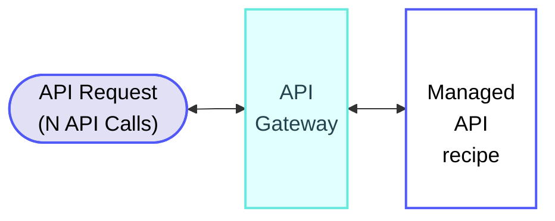
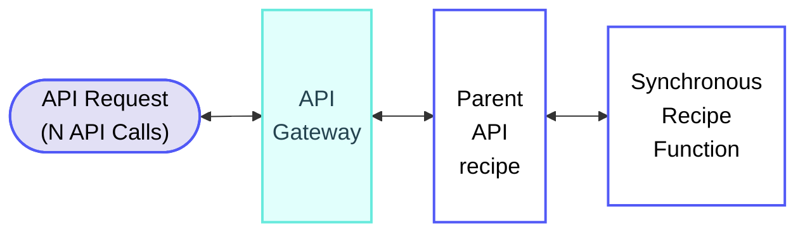
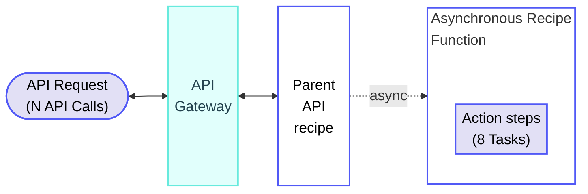

<!-- source: https://docs.workato.com/en/pricing/usage-metrics/api-platform | lastmod: 2026-09-14 -->
> Learn how Workato measures Managed API usage in API Calls, including calculation rules and examples.

# Managed API usage

Workato measures Managed API usage in API Calls. Each API request fulfilled by a Managed API is measured as an API Call, so a quick response counts as one API Call, and longer-running responses count as more.

The number or type of steps inside a Managed API recipe don't contribute to usage. A Managed API recipe with few steps and one with many consume the same number of API Calls when their response times are equal. This differs from workflow recipes, where each action step contributes to usage.

> Some plans measure Managed API usage in [Tasks](/en/recipes/tasks) rather than API Calls. Refer to your contract or contact your Customer Success Representative for more information.

## How API Calls are measured

The following diagram demonstrates how requests to a Managed API are measured.

Total usage: N API Calls per successful request

## Managed API calculation rules

Managed API usage calculations follow the general [usage calculation rules](/en/pricing/usage-metrics#rules), where successful calls count toward usage and failed calls are excluded.

Workato uses the following additional rules to calculate Managed API usage:

- The recipe must execute completely without internal errors.
- The job must finish as designed, even if it returns expected errors such as `4xx` or `5xx` status codes defined in the recipe logic.
- Cached API responses count toward API Call usage the same way as non-cached responses.
- Synchronous recipe function calls are part of the API Call and don't add extra usage. Asynchronous recipe function calls run as independent workflows measured in Tasks.
- A Managed API recipe with IDP steps or Event streams publishes contributes Pages or Events on top of API Calls.

## Managed API usage examples

The following examples demonstrate how Workato calculates usage for API Calls in different scenarios.

### Managed API: API recipe

**Overview**

**Managed API recipe**

_Managed API recipe_

**Explanation**

Managed APIs contribute to usage as API Calls. Each request to a Managed API counts as N API Calls, where N depends on the response time and your metering interval.

Managed APIs don't contribute to Tasks, even if the recipe contains steps that would otherwise be eligible.

#### Usage totals

- **Total usage per request**: N API Calls

### Recipe function called synchronously from an API recipe

**Overview**

**API recipe**

_API recipe calls a recipe function synchronously_

**Recipe function**

_Recipe function called synchronously_

**Explanation**

An API recipe in this example calls a recipe function synchronously. The recipe function must execute as part of the end-to-end execution of the API request because it's synchronous. It's considered a continuation of the same API request and doesn't contribute any additional usage separately.

#### Usage totals

- **Total usage per request**: N API Calls

### Recipe function called asynchronously from an API recipe

**Overview**

**API recipe**

_API recipe calls a recipe function asynchronously_

**Recipe function**

_Recipe function called asynchronously_

**Explanation**

An API recipe in this example calls a recipe function asynchronously. The recipe function executes independently of the original API request because it's asynchronous. It's considered an independent workflow and measured in Tasks.

The total usage is N API Calls plus the Tasks the asynchronous recipe function incurs (8 in this example).

#### Usage totals

- **API recipe**: N API Calls
- **Recipe function**: 8 Tasks
- **Total usage per request**: N API Calls + 8 Tasks

---
