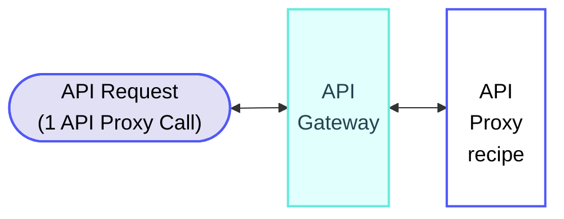
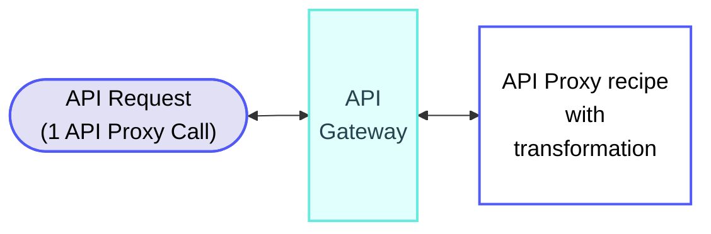

<!-- source: https://docs.workato.com/en/pricing/usage-metrics/api-proxy | lastmod: 2026-09-17 -->
> Learn how Workato measures API Proxy usage in API Proxy Calls, including calculation rules and examples.

# API Proxy usage

Workato measures API Proxy usage in API Proxy Calls. Each successful request to an API Proxy counts as one API Proxy Call, whether or not transformation is applied. Response time does not affect the count.

API Proxy requests consume fewer credits per call than Managed API requests, because proxying a request is a lighter operation than running a full Managed API.

## How API Proxy Calls are measured

The following diagram demonstrates how requests to an API Proxy are measured.

Total usage: 1 API Proxy Call per request

## API Proxy calculation rules

API Proxy usage calculations follow the general [usage calculation rules](/en/pricing/usage-metrics#rules), where successful calls count toward usage and failed calls are excluded.

Workato uses the following additional rules to calculate API Proxy usage:

- The job must finish as designed, even if it returns expected errors such as `4xx` or `5xx` status codes defined in the recipe logic.
- Cached API responses from GET requests count toward API Proxy Call usage the same way as non-cached responses.

## API Proxy usage examples

The following examples demonstrate how Workato calculates API Proxy usage.

### API Proxy recipe

**Overview**

**API Proxy recipe**

_API Proxy recipe_

**Explanation**

API Proxies contribute to usage as API Proxy Calls. Each request to an API Proxy counts as 1 API Proxy Call. Response time does not affect the count.

#### Usage totals

- **Total usage per request**: 1 API Proxy Call

### API Proxy recipe with transformation

**Overview**

**API Proxy recipe with transformation**

_API Proxy recipe with transformation_

**Explanation**

API Proxies with transformation contribute to usage as API Proxy Calls. Each request counts as 1 API Proxy Call. Response time does not affect the count.

#### Usage totals

- **Total usage per request**: 1 API Proxy Call

---
