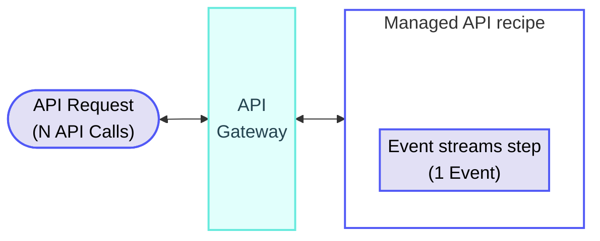
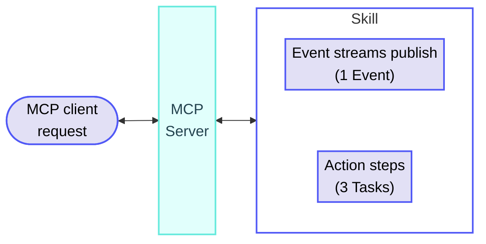

<!-- source: https://docs.workato.com/en/pricing/usage-metrics/event-streams | lastmod: 2026-09-14 -->
> Learn how Workato measures Event streams usage in Events, including calculation rules, counting, and example scenarios.

# Event streams usage

Workato measures Event streams usage in Events. Event streams usage is added on top of the usage of the asset it runs in, such as a workflow recipe's Tasks, an API recipe's API Calls, or a skill's Tasks.

> Some plans count publish steps as Tasks within your workflow usage instead of measuring them separately as Events. Additionally, Event streams API usage is non-billable on some plans. Refer to your contract or contact your Customer Success Representative for more information.

## Event streams calculation rules

Event streams usage calculations follow the general [usage calculation rules](/en/pricing/usage-metrics#rules), where successful publishes count toward usage and failed actions are excluded.

Workato uses the following additional rules to calculate Events:

- **Publishing counts as usage.** Each published message counts as 1 Event. This applies whether the publish happens inside a recipe (or other asset) or through the `publish` and `batch publish` endpoints of the Event streams API.
- **A batch publish counts each message.** Each message in the batch counts as 1 Event.
- **Failed publishes don't count.** A publish that fails doesn't count as an Event. A publish that succeeds on retry counts.
- **Consuming does not count as usage.** Consumed messages, including messages received by an Event streams trigger or through the `consume` endpoint of the Event streams API, don't count as Events.

## Event streams usage examples

The following examples demonstrate how Workato calculates usage for Event streams in different scenarios.

### Messages consumed (triggers)

**Recipe**

_Messages consumed (triggers)_

**Explanation**

Event streams triggers only consume messages, and consumed messages don't count as Events. The recipe's action step contributes 1 Task.

#### Usage totals

- **Tasks**: 1
- **Events**: 0
- **Total usage per job**: 1 Task, 0 Events

### Published messages (actions)

**Recipe**

_Publishing messages (actions)_

**Explanation**

Event streams usage is calculated in addition to Tasks. The total usage for this job is the total Tasks + total Events.

#### Usage totals

- **Tasks**: 1
- **Events**: 1
- **Total usage per job**: 1 Task, 1 Event

### Batch publish from a workflow recipe

**Recipe**

_Batch publish from a workflow recipe_

**Explanation**

A workflow recipe searches for records in Salesforce, then uses the batch publish action to publish 50 messages to an Event streams topic. The Salesforce search counts as 1 Task. The batch publish action doesn't count as a Task, but each of the 50 messages in the batch counts as 1 Event.

#### Usage totals

- **Tasks**: 1
- **Events**: 50 (one per message in the batch)
- **Total usage per job**: 1 Task, 50 Events

### Event streams in a Managed API recipe

**Overview**

Total usage: N API Calls + 1 Event

**Recipe**

_Managed API recipe with Event streams action_

**Explanation**

Event streams usage is calculated in addition to API Calls. A Managed API recipe doesn't contribute Tasks. The total usage for this job is the sum of all Events plus the API Calls incurred by the Managed API recipe.

#### Usage totals

- **Events**: 1
- **Total usage per job**: 1 Event, plus the API Calls incurred by the Managed API recipe

### Event streams in a skill invoked over MCP

**Overview**

Total usage: 3 Tasks + 1 Event

**Explanation**

Each of a skill's executed action steps counts as 1 Task when invoked over MCP. Events are counted on top of the skill's Tasks when it publishes to an Event streams topic. In this example, the skill publishes 1 message and executes 3 action steps.

#### Usage totals

- **Tasks**: 3
- **Events**: 1
- **Total usage per invocation**: 3 Tasks + 1 Event

### Failed event in a workflow recipe

**Recipe**

_Recipe with failed Event streams action_

**Explanation**

The failed Event streams **Publish a message to SFDC Opportunity Changed Event topic** action (Step 5) doesn't count as an Event. All successfully executed workflow steps still count as Tasks.

#### Usage totals

- **Tasks**: 3
- **Events**: 0
- **Total usage per job**: 3 Tasks, 0 Events

### Event streams API

The following table demonstrates how Workato calculates usage for calls made through the Event streams API. Usage is calculated exactly as it is for the preceding asset-based scenarios: publishes count, consumes don't. This applies to both [public](/en/workato-api/pubsub) and [developer](/en/workato-api/event-streams) Event streams APIs.

| Endpoint | Description | Messages consumed/published | Total usage |
| --- | --- | --- | --- |
| Consume endpoint | Doesn't contribute to Events. | 35 messages consumed individually, A batch of 50 messages consumed | 0 Events |
| Publish endpoint | Contributes to Events. Each message counts as 1 Event. | 28 messages published individually | 28 Events |
| Batch publish endpoint | Contributes to Events. Each message counts as 1 Event. | 100 messages published as part of first batch, 100 messages published as part of second batch, 66 messages published as part of third batch | 266 Events |
| Multiple endpoints | Sum of all Events for a topic. | 250 messages published using the publish endpoint, 100 messages published using the batch publish endpoint, 208 messages consumed using the consume endpoint, Attempted publishing 20 messages using the batch publish endpoint that failed | 350 Events |

---
