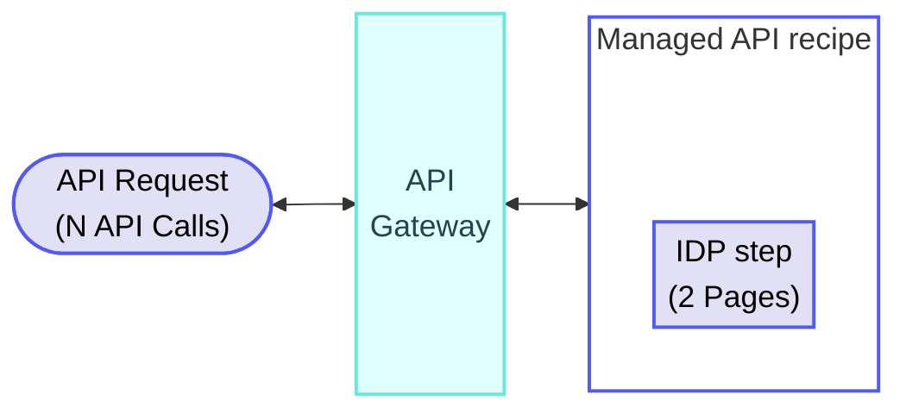
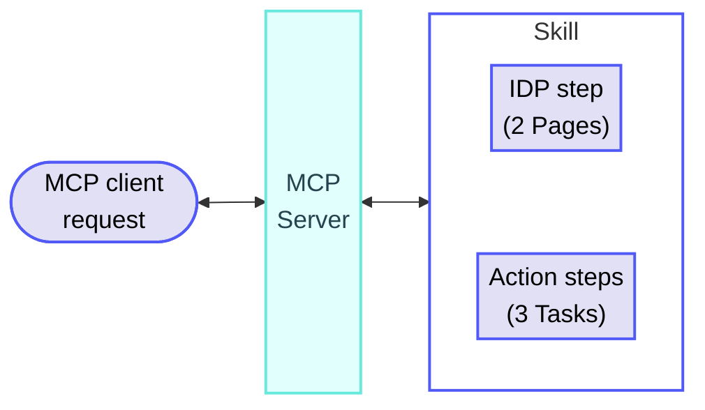

<!-- source: https://docs.workato.com/en/pricing/usage-metrics/idp | lastmod: 2026-09-14 -->
> Learn how Workato measures Intelligent Document Processing usage in Pages, with calculation rules and example scenarios.

# IDP (Intelligent Document Processing) usage

Workato measures IDP usage in Pages. IDP usage is added on top of the usage of the asset it runs in, such as a workflow recipe's Tasks, an API recipe's API Calls, or a skill's Tasks.

## IDP calculation rules

IDP usage calculations follow the general [usage calculation rules](/en/pricing/usage-metrics#rules), where successful pages count toward usage and failed processing attempts are excluded.

Workato applies the following additional rules to calculate Pages:

- Each page, whether standalone or part of a multi-page document, counts as 1 Page.
- A failed IDP action doesn't count. Pages from a successful retry count.

## IDP usage examples

The following examples demonstrate how Workato calculates IDP usage in different scenarios.

### IDP within a workflow recipe

**Recipe**

_IDP within a workflow_

**Explanation**

Each page, whether standalone or part of a multi-page document, counts as 1 Page. In this example, the document contains 3 pages. The total Pages for a job is the sum of all Pages.

IDP usage is calculated in addition to Tasks. The total usage of a workflow recipe job is the total Tasks + total Pages.

The IDP step itself doesn't count as a Task. This recipe contains one eligible action step outside the loop, which counts as 1 Task. A `Repeat for each` loop runs the `Create a new record in IDP_INVOICE_LINES` action once per line item in the document. Each iteration counts as 1 Task.

#### Usage totals

- **Tasks**: 1 + N, where N is the number of iterations of the `Repeat for each` loop
- **Pages**: 3
- **Total usage per job**: 1 + N Tasks, 3 Pages

### IDP within a Managed API recipe

**Overview**

Total usage: N API Calls + 2 Pages

**Recipe**

_IDP step within a Managed API recipe_

**Explanation**

Each page, whether standalone or part of a multi-page document, counts as 1 Page. In this example, the document contains 2 pages.

IDP usage is calculated in addition to API Calls. The total usage of this job is the total Pages plus the API Calls incurred by the Managed API recipe.

#### Usage totals

- **Pages**: 2
- **Total usage per job**: 2 Pages, plus the API Calls incurred by the Managed API recipe

### IDP within a skill invoked over MCP

**Overview**

Total usage: 3 Tasks + 2 Pages

**Explanation**

Each of a skill's executed action steps counts as 1 Task when invoked over MCP. Pages are counted on top of the skill's Tasks when it includes an IDP step. In this example, the skill processes a 2-page document and executes 3 action steps.

#### Usage totals

- **Tasks**: 3
- **Pages**: 2
- **Total usage per invocation**: 3 Tasks + 2 Pages

### Failed IDP operation

**Recipe**

_Failed IDP step within a workflow_

**Explanation**

Each page, whether standalone or part of a multi-page document, counts as 1 Page. In this example, the document contains 2 pages. The total Pages for a job is the sum of all Pages.

A failed IDP action doesn't count as Pages. In this example, the IDP action fails on the first attempt but succeeds after a retry.

IDP usage is calculated in addition to Tasks, but no workflow steps in this recipe qualify as Tasks.

#### Usage totals

- **Tasks**: 0
- **Pages**: 2
- **Total usage per job**: 0 Tasks, 2 Pages

---
