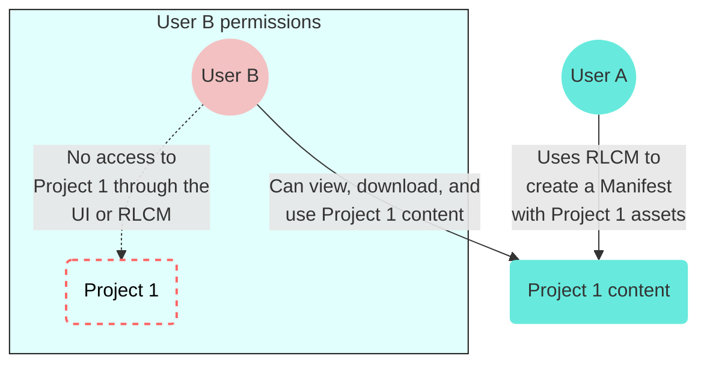

<!-- source: https://docs.workato.com/en/recipe-development-lifecycle/rdlc-guide-planning | lastmod: 2026-08-07 -->
> Plan recipe lifecycle management in Workato by defining environments, promotion criteria, and team roles before moving assets between stages.

# Planning for lifecycle management

Before starting to use lifecycle management in Workato, it is recommended that you spend some time thinking about and documenting the process you want to use. If you have already done so, you may move on to our next chapters:

- **Planning for lifecycle management** _(current)_
- [Exporting: Packaging recipes and dependencies](/en/recipe-development-lifecycle/export)
- [Importing: Deployment](/en/recipe-development-lifecycle/import)
- [Working with external source control systems](/en/recipe-development-lifecycle/rdlc-guide-source-control)

> **EXPLORE ENVIRONMENTS FOR ENHANCED FUNCTIONALITY**
> 
> Enhance your recipe development experience by integrating Recipe Lifecycle Management (RLCM) with Environments.
> 
> Environments are built on the same principles as RLCM and offer a seamless deployment experience across unified workspaces. Refer to [Environments](/en/features/environments) for more information.

* * *

## Defining environments, promotion criteria, and responsibilities

This planning process for lifecycle management is recommended to include:

- Defining the software lifecycle stages
- Identifying how many different workspaces you need to support
- Identifying individual roles/responsibilities (for example, who manages a workspace, who develops, tests, or deploys, and who should be responsible for moving assets between stages)

You should document the criteria for moving recipes across stages: for example, what tests must be run before promotion. Your organization may already have standards in some areas, but these may have to be adapted to the terminology and features used in the Workato environment.

An example of a typical software lifecycle includes the use of 3 environments: a development, staging (QA), and a live production environment.

_Set up with dev, test, and production environments_

* * *

## Using workspace features

Workato’s [Workspace and collaboration](/en/user-accounts-and-teams/team-collaboration) features are designed to give organizations the ability to do development within a shared workspace and also to provide the ability to have oversight and monitoring of development.

A workspace admin can organize a workspace and invite other members, and set their roles and permissions. In Workato, a single account manages a single workspace. Within a workspace, users can see other users’ recipes (if given permission to do so) and the workspace admin can view recipes across the workspace.

Once a user has been invited to and joined a workspace, that user will have both an individual and a workspace account. It is recommended that the workspace account be used for development work.

Workspaces can optionally be configured to use [SAML-based Single-Sign On](/en/user-accounts-and-teams/single-sign-on). It is recommended that this be enabled if possible, so that users can login using their standard corporate accounts, and so that uniform login policies can be applied from the SAML identity provider (a directory system).

## Organizing accounts

Each development lifecycle stage should take place within a different Workato account, usually a workspace account with multiple users. The simplest organization of accounts is just to have one workspace account per stage.

### Multiple workspaces

When there are a large number of recipes in use, or when multiple distinct departments or groups work on recipes within a single stage (for example: each department does its own development), then there are a couple of ways to segment accounts further. One is to use distinct accounts for each group + stage. For example, like this:

_A workspace account is created for each department_

### Multiple folders

Another possibility is to segment one or more of the workspace accounts so that different users access different folders, like this:

_Folders are created in each environment for distinct departments_

This can be convenient, but may complicate role management, for reasons described in the next section.

## Role management

A workspace admin creates a new workspace and invites users. Only one account can be the owner, but you can assign the **Environment admin** role to other users. An **Environment admin** effectively has the same permissions as the owner within a specific environment. Most workspace members shouldn't be environment admins. Instead, assign more limited roles.

Use project roles when you plan to control access to specific projects and their folders. For example, some members may need access to one project, while others need access to another. If you need to manage access more broadly at the environment level, such as granting import and export privileges or setting permissions that standard roles don't provide, create a custom environment role.

You can also create [custom roles](/en/user-accounts-and-teams/role-based-access/#creating-custom-roles) to segment the actions users can perform. For example, some users may create and manage connections, while others use the connections without changing them.

##### RLCM Privileges

The Recipe lifecycle management privilege can indirectly provide collaborators with access to assets that are normally restricted by their assigned permission scope. This is because the RLCM privilege grants access to all manifests within a workspace. This means that a collaborator with this privilege can view assets in a manifest, even if they wouldn't normally have access to the project that contains these assets.

For example:

- `User A` creates `Project 1` and builds a manifest with RLCM and exports it
- `User B` has the RLCM permission but no access to `Project 1`
- `User B` can't access `Project 1` in the UI, or use RLCM to build a manifest package with `Project 1` assets

`User B` can view, download, and use the export package that `User A` created, which contains the `Project 1` content

> **CREATE PROJECTS PRIVILEGE REQUIREMENT**
> 
> You must have the **create projects** privilege to import or export `All projects`.

Workato recommends regularly deleting manifests if you do not plan to provide access to the contents of these files to other users of Recipe lifecycle management (RLCM). This practice helps maintain the security and privacy of your data.

For enhanced security, you can use the [Deployment](/en/features/environments/deploying-projects-to-an-environment) feature. This feature leverages the export-import functionality to facilitate the transfer of assets, making it a more secure and efficient method to move assets across your environments.

## Folders

It is also worth thinking about how recipes should be organized into folders, and what naming conventions should be used for this. As mentioned earlier, you may want to use folders together with custom roles so that members within a workspace can be assigned responsibility for recipes within a particular folder or folders.

_Example of recipes in a folder_

You should try to avoid having a large number of recipes all placed in the root (Home) folder, which is the default location. Workato recommends that if you have more than 5-10 recipes, these should be organized into folders, and that each folder should also be restricted to a small manageable number (10 or so maximum) of related recipes.

Folders are also the unit that is used for import and export of assets, so recipes and related objects such as connections should be placed together in a folder if they are to be migrated across accounts together.

If you are planning to move assets across accounts, for example from development to test, you might want to establish a rule that the folder names and structure are the same in the accounts for different stages, although this is not required by Workato.

## Connections

Connections can be scoped into folders in Workato. By default, their scope is the Home folder. However, when preparing to use Lifecycle Management, you may want to associate the connections required by the recipes in a folder you plan to export to that folder.

This can be done by visiting the App Connections tab and dragging the corresponding connections into a folder shown on the left-hand side of the page. This will help organize your connections and ensure that the correct connections are used for each exported folder.

_App connections can be organized and managed by folders_

Assigning connections to folders also makes it possible to restrict access to connections by workspace members. Only those connections in folders to which a workspace member has access will be visible and usable by that member.

## Project properties

Project properties are available only at the project level in the specific project where you create and maintain them. You can deploy these properties to another folder.

However, if you have created project properties, but have not used them in any active recipes, Workato does not include them in your manifest and you cannot export them using the recipe lifecycle management tool.

When Workato exports project properties, it exports only the **Property name** and does not include the `Value` of the property. Because of this, if you import a package containing project properties into a folder where project properties with the same names already exist, Workato does not override the value of the existing properties.

For example, consider a situation where a folder named **Customer onboarding** contains a project property named **client\_email** whose value is `paula@example.com`. If you import a package into **Customer onboarding** that also contains the property **client\_email** with the value `judefeeney@example.com`, **client\_email**'s value is still `paula@example.com`.

_Include project properties in a package_

## Lookup tables

If you plan to export a lookup table (LUT) as part of your package, you must use the lookup table in a recipe. The recipe lifecycle management tool does not export lookup tables that are not included in recipes.

Whether scoped to a specific project or globally, a lookup table cannot have the same name as another lookup table in the same workspace. Because of this, when you import a recipe with a lookup table, Workato follows this logic:

- **If a lookup table with this name does not exist in the target workspace**, the lookup table from the package is created. It inherits its scope (project or global) from the source workspace.
  
- **If a lookup table with this name already exists in the target workspace**, the structure of the lookup table (and content, if you choose to import it) overwrites the existing lookup table. However, its scope (project or global) does not change and matches the scope of the original lookup table. We recommend that you check the scope before and after importing a lookup table into your workspace.
  

_Overwrite or ignore lookup table data_

---
