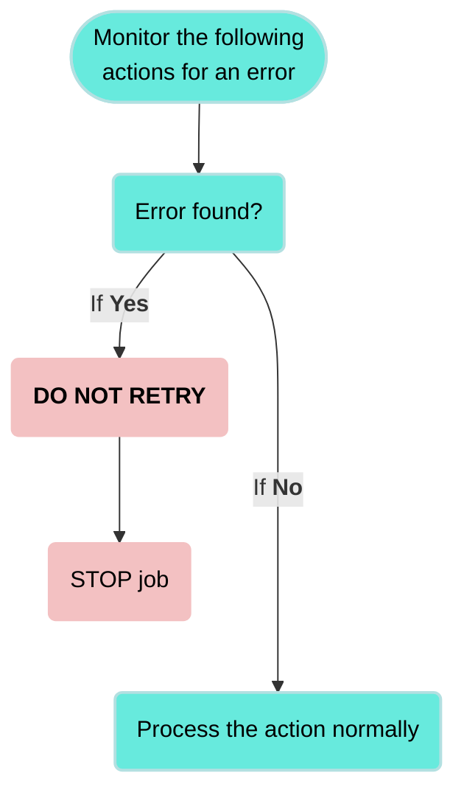

<!-- source: https://docs.workato.com/en/recipes/best-practices-error-handling | lastmod: 2026-10-28 -->
> Learn how to handle errors and monitor Workato recipes using monitor blocks, conditional actions, stop actions, and custom alerts.

# Error handling and monitoring

Effective error handling helps your recipes run consistently and recover from failures. Workato provides structured tools to help you detect issues, respond to errors, and minimize downtime.

This guide outlines key strategies for managing errors in your recipes. It explains how to monitor for failures, prevent invalid operations, and send targeted alerts when issues occur. You can use these approaches to handle errors efficiently and reduce recipe downtime.

> **SUMMARY**
> 
> - Error monitoring steps check action completion and allow retrying or skipping to next steps when errors occur.
> - Conditional actions (`IF` condition steps) allow you to validate input data to prevent errors.
> - Stop actions halt the recipe when issues arise, reducing unnecessary operations.
> - Custom error emails send notifications with error details, including a descriptive filename attachment and relevant job and recipe URLs.

[Video](https://www.youtube.com/embed/Ear7VCBqoxs?rel=0&rel=0)

## Error types

Workato categorizes errors based on their origin and how recipes can respond to them. Understanding these categories helps you build recipes that handle failures efficiently and minimize job disruption.

### User errors

User errors result from misconfigurations, invalid inputs, or missing data in your recipe. Workato highlights these issues in the recipe editor or during execution with error messages. Common examples include:

- Missing fields
- Invalid datapills or values
- Authentication failures
- On-prem agent misconfiguration or connection failure

Recipes can catch and respond to these errors with monitor blocks. You can retry the action, skip it, or run alternate steps to continue the workflow.

### Platform-side errors

These errors originate from the Workato platform and may include service interruptions, internal exceptions, or timeout issues. Workato may not display detailed messages for these errors. Instead, they often appear as internal errors with reference IDs for support.

### Structured error identifiers

Job errors include a stable field, `error_type_id`, for consistent, automated handling across user and platform errors. Refer to [Error type IDs](/en/recipes/error-type-id) for more information.

## Error handling tools in Workato

Workato provides tools to help you identify, manage, and recover from recipe errors. You can validate inputs, stop jobs when data is invalid, and define how recipes respond when failures occur. Use the following methods to improve reliability, reduce downtime, and handle unexpected conditions:

- Handle errors step
  
- Monitor critical actions and define fallback logic for failures. You can retry steps, log issues, or run alternate paths when errors occur. [Learn more](#monitor-errors-with-the-handle-errors-step).
  
- Conditional actions
  
- Validate inputs and prevent invalid operations before they cause errors. Use IF, ELSE IF, and ELSE to branch logic based on specific conditions. [Learn more](#conditional-actions-for-error-handling).
  
- Stop job
  
- End a job early when conditions indicate invalid data or an unrecoverable issue. Use this step to avoid unnecessary processing and surface errors clearly. [Learn more](#stop-step).
  
- Error datapills
  
- Use error datapills to log or report details such as the failed step, error message, or retry count. [Learn more](#on-error-datapills).
  
- Custom error alerts
  
- Notify teams about failures by sending emails with job context and error data. You can trigger alerts from within a recipe or at the workspace level with RecipeOps. [Learn more](#send-custom-error-alerts).
  
- RecipeOps triggers
  
- Use the **Job failed** and **Recipe stopped by Workato** triggers to monitor failures across recipes. [Learn more](/en/recipes/monitor-errors-recipeops).
  
- Error logging and reporting
  
- Use the activity audit log to track execution history, identify recurring failures, and investigate issues. [Learn more](/en/features/activity-audit-log#activity-audit-log).
  
- Job history and debugging
  
- Use [job reports](/en/recipes/jobs#viewing-job-reports) to trace errors and debug failures. Job debug tracing displays HTTP request and response details to help identify root causes. [Learn more](/en/recipes/job-debug-tracing).
  

### Monitor errors with the handle errors step

The **Handle errors** step lets you monitor a group of actions for errors. If any monitored step fails, Workato runs a separate error-handling block. You can use this step to recover from issues like temporary network timeouts by retrying failed actions. If retries don't resolve the error, you can define corrective steps, such as logging, notifying users, or deleting partial records.

_Handle errors step_

The **Handle errors** step includes two blocks:

- **Monitor actions for error**: Add the steps you plan to monitor for failures. If these steps succeed, Workato skips the error-handling block.
- **On error**: Add the steps to run when a failure occurs. You can also configure retry behavior by setting the number of retry attempts and the wait time between them. If retries fail, Workato runs the remaining steps in this block.

#### Add and configure a handle errors step

Complete the following steps to add and configure an error-handling step in your recipe:

1. Click `+` **Add step**, then select **Handle errors**.
   
   _Add handle errors step_
   
2. Add the actions you plan to monitor inside the **Monitor actions for error** block.
   
   _Add actions to monitor for errors_
   
3. Click the **On error** block to open its configuration panel.
   
   _Configure errors step_
   
4. Configure how Workato handles errors. By default, Workato doesn't retry failed actions and immediately runs the **On error** steps when it encounters an error. Use the following settings to enable retries and define their behavior:
   
   1. Specify how many times to retry failed actions in the **Retry actions in Monitor block?** field. Workato allows up to three retries.
      
      _Configure how to handle errors_
      
   2. Set the delay in the **Time interval between retries** field. You can choose a value between one and ten seconds.
      
   3. Optional. Enable the **Retry IF** toggle to retry only when a specific condition is true.
      
      _Retry only if specified condition is true_
      
5. Add the steps you plan to run when a monitored action fails to the **On error** block. These may include logging, sending alerts, or stopping the job. If retries are enabled, Workato runs these steps only after all retries fail. If retries are disabled, Workato runs them immediately.
   
   _Add steps to handle errors when a monitored action fails_
   
   > **MONITOR API RECIPE REQUEST TIMEOUTS**
   > 
   > If an [API recipe](/en/api-mgmt/api-recipes/) includes a [Handle errors](/en/recipes/steps#handle-errors-step) step, the **Monitor actions for error** block doesn't trigger when the API request [times out](/en/recipes/recipe-job-errors#timeouts). In these cases, the job terminates immediately, and Workato doesn't run the **On error** steps.
   

The recipe runs the **Monitor actions for error** block within the **Handle errors** step. It then continues with the next step, even if no error occurs and the recipe doesn't trigger the **On error** block.

#### On error datapills

When you add a **Handle errors** step to your recipe, Workato generates error-related datapills if an error occurs. This enables you to configure your recipe to handle errors differently depending on the error type, recipe step, or app causing the error.

Workato generates the following on error datapills:

| Datapill | Description | API names |
| --- | --- | --- |
| Error type | The type of error that occurred. | `error[type]`, `error[error_type]` |
| Error message | A message describing the error. | `error[message]`, `error[error_message]`, `error[msg]` |
| Retry count | The number of times Workato tried to rerun the actions in the **handle errors** block. | `error[retry_count]`, `error[retries]` |
| Error UUID | The Universally Unique Identifier (UUID) of the error. This is a 128-bit label used to identify the error. This key is optional and only displays a value if you provide the key. | `error[uuid]`, `error[error_id]` |
| Errored step number | The step on which the error occurred. | `error[line_number]`, `error[step_number]`, `error[step]` |
| Errored app | The app that caused the error. | `error[adapter]`, `error[app]`, `error[application]` |
| Errored action | The action on which the error occurred. | `error[action]`, `error[action_name]`, `error[operation]` |
| Inner message | Unprocessed error message that may include a response from the third-party service or details returned directly from the client. The format and content may change without notice. | `error[inner_message]` |

> **INNER MESSAGE IS UNSTABLE**
> 
> Use the Inner message datapill with caution. This value isn't reliable for automation logic due to the following risks:
> 
> - **Unstable format**: The structure and content may change without warning.
> - **Direct from source**: Captures the original error from the external system.
> - **No sanitization**: Workato doesn't alter or clean up the message content.
> - **Transparency-focused**: Intended for logging and transparent reporting of third-party error messages.

For example, you can use the **Log message** action to output datapills like Error type (Step 6), Error message (Step 6), or Errored app (Step 6) in your job logs. This provides clear context to support error tracking and testing.

_Log job error context using on error datapills_

#### Structured error fields

Workato exposes structured error data that you can reference in the **On error** block when a monitored action fails. Use these fields in conditions or subsequent steps to automate your error-handling logic:

| Field | Description |
| --- | --- |
| `error_type_id` | Stable identifier for the error type. For example: `err.http.response.client_error.not_found`. |
| `error_type` | Display name for the error. For example: `Not Found`. |
| `error_id` | Unique identifier for the specific error instance. |
| `error_message` | High-level summary of what occurred. |
| `http_response` | Structured data including status code, headers, and body. |

### Conditional actions for error handling

IF conditions enable you to control how your recipe responds to different types of errors. You can add them inside an **On error** block or elsewhere in the recipe to respond based on the type or cause of the error. For example:

- If the errored app is NetSuite, notify the finance team and log the issue.
- If the error message includes `Authentication failed`, notify your IT or security team.
- If retry count is greater than `1`, create a support ticket and stop the job.

You can also use conditions to prevent errors, such as checking if a required input field is empty before you send data to a destination system. If the field is blank, stop the job and log the issue to avoid processing invalid data.

#### Example: Prevent errors with conditional checks

You can use an IF condition to validate inputs before you run further actions. This helps prevent failures caused by missing or invalid data.

The following example demonstrates how to check if a Zendesk ticket includes a subject before you update the ticket or add a comment:

1. Click `+` **Add step**, then select **IF condition**.
   
   _IF condition_
   
2. Map a datapill to **Data field**, such as the ticket Subject (Step 1) datapill.
   
   _Set up IF condition_
   
3. Choose the `is present` condition in the **Condition** field to ensure the field contains a value.
   
4. Add the **Update ticket** step to the **Yes** path. This ensures the update only runs when the subject exists.
   
5. Add a **Stop job** step to the **No** path to stop the recipe when the input is missing. This prevents unnecessary steps and surfaces the issue early. Refer to the [Stop job](#stop-step) section for details.
   
   _Add a stop job step_
   

You can also use **ELSE IF** and **ELSE** branches to handle additional conditions.

### Stop jobs

Use the **Stop job** step to end a recipe early when a condition for invalid data or a critical error is met. This action ends the job before it performs additional steps and displays the failure in the job report.

You can add the **Stop job** step inside a conditional branch to end the job when specific criteria are met, such as if a required field is empty or all retries fail.

_Stop job step_

#### Add failure context

You can include a message or use datapills to provide detailed failure information. Use **On error** datapills when you stop jobs in error handling logic to report details such as the error type, message, or affected app. For example:

_Use datapills to surface detailed failure messages_

#### Example: Stop job when a required record is missing

The following recipe checks whether a Zendesk organization ID exists after searching for an organization. The recipe sends an alert and stops the job if the ID isn't found.

_Recipe using the Stop job step to send email and end the job. [Example recipe](https://www.workato.com/recipes/480360)_

Each job follows one of two paths:

- If the Zendesk organization ID isn't found, the recipe sends an email notification and stops the job.
- If the Zendesk organization ID is found, the recipe updates the organization in Zendesk.

This recipe marks jobs with errors to alert the recipe owner. This allows the recipe owner to review and retry the failed job if necessary.

_Configuring the Stop step's error message. [Example recipe](https://www.workato.com/recipes/480360)_

### Send custom error alerts

Use the [Email by Workato - Send email](/en/connectors/email-by-workato#send-email-action) action to notify your team when an error occurs. You can add this step inside an **On error** block or later in the recipe, depending on how you plan to route alerts.

_Set up custom error emails_

Include [On error datapills](#on-error-datapills) to add context such as the error type, message, app, and retry count. These details help teams quickly understand and respond to failures.

You can also include the Recipe URL (Properties), Job URL (Properties), and Job created at (Properties) [datapills](/en/recipes/data-pills-and-mapping#default-datapills) to link directly to the failed job. Expand the **Recipe data** menu and open the **Properties** datatree to access these fields.

_Map datapills into your email message to surface important error-related details_

This setup gives your team actionable context in each alert. The message surfaces job metadata and specific error details to help recipients investigate and resolve issues efficiently.

> **ERROR NOTIFICATION EMAILS**
> 
> Workato also sends platform-generated error emails for recipe failures and critical issues. Refer to the [Error notification emails](/en/recipes/error-notifications) section for more information.

---
