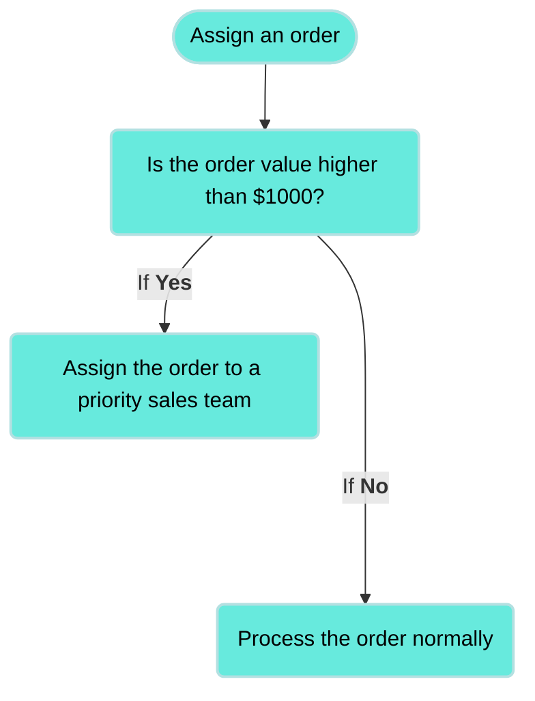
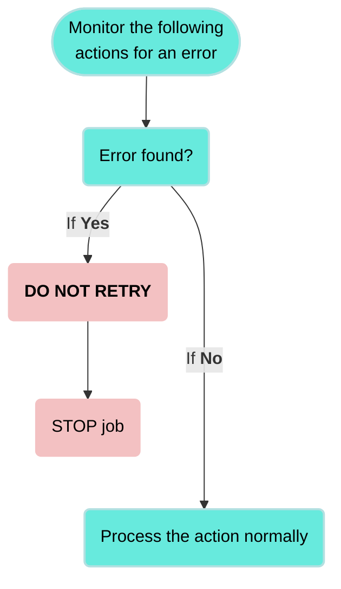

<!-- source: https://docs.workato.com/en/recipes/building-recipes | lastmod: 2026-07-07 -->
> Learn how to design Workato recipes by planning the goal, data flow, apps, triggers, actions, logic, and error handling.

# Recipe design

Recipe design is the process of planning and structuring an automation workflow to achieve a specific goal. A recipe is a sequence of steps that integrate different applications and process data automatically.

The following considerations can help you design successful recipes that require minimal adjustments over time:

- **Goal**: What is the goal of the recipe? Define what the recipe does.
- **Data flow**: What data needs to be processed? Identify the information you need to transfer between apps or modify.
- **Apps**: Which apps need to interact? Determine which apps send, receive, or process the data.
- **Error handling**: How should the workflow handle errors? Plan for potential issues to avoid failures.

Build your first recipe with this video guide

[Video](https://www.youtube.com/embed/H4MMLklNpPU)

## Considerations for recipe design

A recipe follows a structured flow that defines when it runs, what actions it takes, how data moves, and how errors are managed. Each component is interconnected, and understanding these relationships helps you design recipes that are efficient, reliable, and maintainable.

A recipe typically uses the following components:

- **Trigger**: Defines when the recipe starts running.
- **Action**: Specifies what tasks the recipe performs.
- **Data flow**: Controls what data moves between apps.
- **Logic and conditions**: Determines how different scenarios, such as missing targeted data are handled.
- **Error handling**: Ensures the recipe can recover from failures.

### Define a clear trigger

Every recipe starts with a **trigger**. A trigger listens for an event in an application and starts the recipe when the specified conditions are met. Triggers define when an automation runs and what initial data is available for the workflow. Choose from the following trigger types:

- **Event-based triggers**: The recipe runs in response to an event, such as a new employee is added in Workday.
  
- **Scheduled triggers**: The recipe runs at a fixed time, such as every night at 12 AM.
  

### Plan actions and data flow

An action defines what the recipe does after it is triggered. Each action interacts with an application to modify or retrieve data. A recipe can have one or multiple actions, depending on the automation’s complexity. Consider the following questions when you design your recipe:

- **Which applications need to interact?**
- **What data needs to move between the apps?**
- **How should data be formatted and structured?**

Recipes frequently contain the following actions:

- **Create a new record**
  - For example: Create a new Jira user when an employee is added to Workday.
- **Update an existing record**
  - For example: Update an employee’s permissions in Okta when their role changes.
- **Send a notification**
  - For example: Email the IT team when a new hire’s accounts are set up.

### Conditional logic and loops

Recipes can be **dynamic** and can make decisions based on incoming data.

- **Conditional statements** (If-Else) control the workflow based on specific conditions.
- **Loops** process multiple records in a single execution.

Example: If an order value is above $1,000, assign it to a priority sales team, otherwise, route it normally.

An [IF condition](/en/features/if-conditions) lets you make decisions based on specific conditions. You can control your recipe workflow by executing different actions depending on whether a condition you specify is true or false.

### Error Handling

Your recipe must handle errors effectively to prevent failures from stopping the entire recipe. Make a plan for how your recipe should handle the following types of errors:

- Missing or invalid data, such as an empty field.
- Duplicate records.
- API failures, such as server disruption to a connected app. For example, the recipe can retry the action a configurable number of times before logging an error if the issue is a temporary API failure.

## Learn more about recipe components

Customize your recipe with the different types of triggers, actions, and other steps.

Use triggers to configure your recipe to run...

- On a [scheduled interval](/en/features/scheduler)
- [Each time](/en/recipes/triggers#real-time-triggers) an event occurs
- Only for events that meet a [specific condition](/en/recipes/triggers#trigger-conditions)
- When a [specific number of events occur](/en/recipes/triggers#batch-triggers)

Use steps to define your recipe logic, such as to...

- Configure [if/else conditions](/en/recipes/steps#if-condition-step)
- Repeat actions using a [Repeat while](/en/recipes/loops) or [Repeat for each](/en/recipes/repeat-for-each) loop
- Configure how the recipe [handles an error](/en/recipes/steps#handle-errors-step)
- Instruct the recipe to [ignore a step](/en/recipes/steps/skip-step#skip-step)

## Modify the data in your recipe

- Move data between apps using [datapills](/en/recipes/data-pills-and-mapping)
- Use [formulas](/en/formulas/formula-mode) to transform data

## Expand your automation possibilities

- Move data between [two instances of an app](/en/features/secondary-connectors)
- [Move data from files](/en/handling-files-and-attachments)
- [Reuse logic](/en/features/callable-recipes/walk-through) from another recipe
- Add a step for [human approval](/en/workflow)
- [Create a template](/en/features/message-template) for frequently-used messages

## After you create your recipe

- [Test your recipe](/en/recipes/start-and-stop#test-mode)
- [Start your recipe](/en/recipes/start-and-stop)
- [See a report](/en/recipes/jobs) on your recipe after it runs

---
