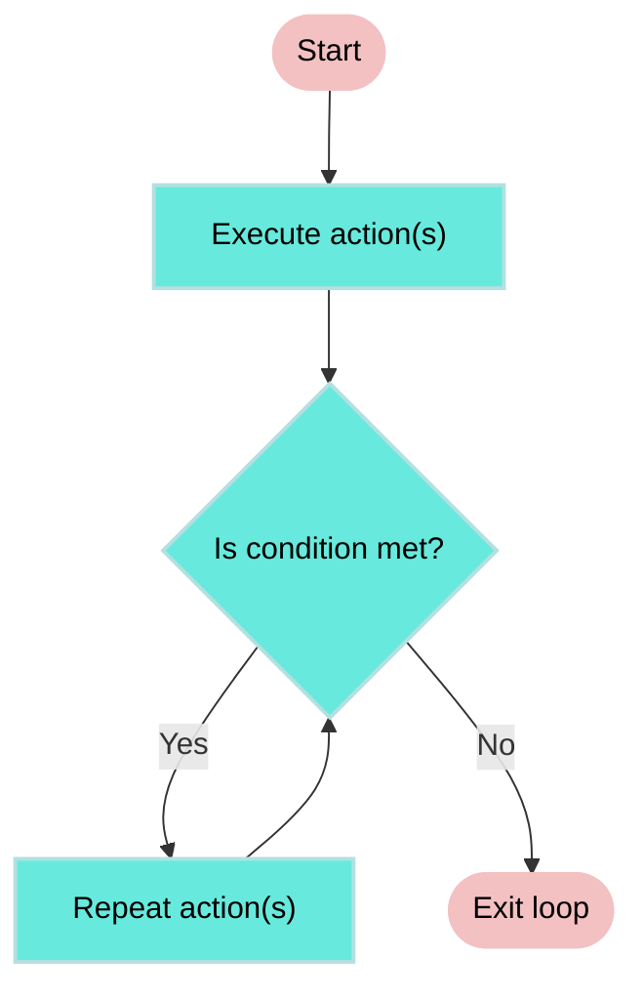
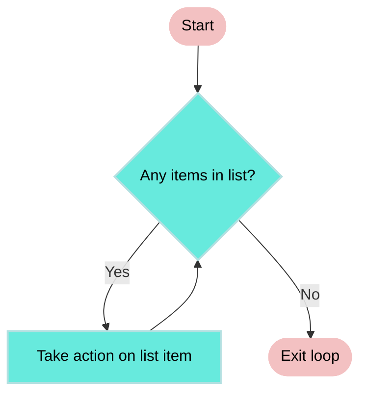

<!-- source: https://docs.workato.com/en/recipes/steps | lastmod: 2026-07-07 -->
> Learn how recipe steps in Workato define automation logic with actions, IF conditions, Repeat steps, and error handling.

# Steps

Recipe steps define the core logic of a recipe. Steps enable you to create, update, or search within a target app. Steps also include control flow statements, such as **IF conditions** or repeating actions with **Repeat** steps . Utility steps support error handling, stopping jobs, invoking reusable logic, or transforming data.

> **SUMMARY**
> 
> - Recipes consist of steps that enable you to create, update, or search within a target app, or define business logic with control flow statements.
> - Use the **IF condition** step to create conditional branches:
>   - The **IF condition** evaluates an initial condition and runs actions when the condition is true.
>   - The **ELSE IF condition** adds conditional branches evaluated only if the previous conditions fail.
>   - **ELSE** runs actions when no preceding conditions are met.
> - **Repeat** steps allow you to handle list items, and **Repeat in Batches** manages high-speed data transfers in smaller batches.
> - The **Call recipe function** step allows you to trigger another recipe for reusable logic.
> - The **Stop job** step allows you to end a job early in case of business logic errors.
> - Use the **Handle errors** step to monitor and manage errors in actions, similar to a try/catch block in programming.

_Various recipe steps available in recipe editor_

## Action step

Actions perform operations in your target app, such as create, update, or search actions on records. Each action requires specific input fields and returns an output data tree, which you can use to map data into subsequent steps.

Reorder steps in your recipe with drag-and-drop (video)

[Video](https://www.youtube.com/embed/yNI6FALpJx4)

### Example: Action step

This example demonstrates a **Search organizations** action in a Zendesk integration. The input fields allow you to search for a Zendesk organization using the following criteria:

- **Name**: Search by organization name.
- **Tags**: Search by a comma-separated list of tags.
- **Page number**: Specify the page to retrieve results from when paginating.
- **Maximum results**: Limit the number of results returned in a single request.

In this case, the **Search organizations** action searches for an organization by **Name**.

_Searching Zendesk organizations by Salesforce account name. [Example recipe](https://www.workato.com/recipes/480358)_

Zendesk returns the data for matching organizations when the **Search organizations** action completes. The output data tree displays the available fields, which you can map to subsequent steps.

For example, the **Update organization** action uses the ID (Properties) datapill from the **Search organizations** output to identify which Zendesk organization to update. The ID (Properties) datapill uniquely identifies the organization to ensure that the correct record is updated.

_Updating Zendesk organization identified by ID. [Example recipe](https://www.workato.com/recipes/480358)_

## IF control statement

An [**IF control statement**](/en/features/if-conditions) directs a recipe to run specific actions based on specified conditions. It allows you to create conditional branches and execute different steps depending on the evaluated conditions. You can include additional branches using **ELSE IF** and a final **ELSE** branch to handle multiple outcomes efficiently, eliminating the need for nested conditions.

For more details on the available conditions, refer to our [Conditions documentation](/en/features/conditions).

### Example: Managing Zendesk tickets with conditional logic

The following recipe manages Zendesk tickets using conditional steps:

- **IF** the ticket's type contains `Bug`, the workflow updates the ticket’s **Priority** to `High` and assigns it to the development team.
- **ELSE IF** the ticket's type contains `Feature Request`, the workflow updates the ticket’s **Status** to `Pending` and assigns it to the product management team.
- **ELSE** the workflow updates the ticket’s **Status** to `Closed`.

_Recipe using conditional steps to manage Zendesk tickets_

In this example, only one branch executes for each ticket, ensuring efficient and targeted processing.

## Repeat control statements (loops)

A **Repeat control statement** allows you to repeat a set of steps based on specific criteria. Workato provides two types of Repeat control statements:

- [Repeat while](/en/recipes/loops) _Repeats_ one or more actions _while_ a condition is met. The loop ends automatically when the condition is no longer met. For example, you can repeat the process of retrieving the next page of Google Drive search results while there are pages left to retrieve.
- [Repeat for each](/en/recipes/repeat-for-each) _Repeats_ one or more actions _for each_ item in a list. The loop ends automatically when all items in the list are processed. For example, you can repeat the process of downloading each Google Drive file in a list of search results.

> **REPEAT FOR EACH IN BATCHES**
> 
> The **Repeat for each** control statement processes list items one at a time by default or in batches. To repeat items in batches, refer to [Repeat for each in batches](/en/recipes/repeat-for-each#repeat-for-each-in-batches).

The following diagrams illustrate the logic of **Repeat while** and **Repeat for each** loops:

**Repeat while loop:**

**Repeat for each loop:**

### Combine Repeat while and Repeat for each

You can combine [Repeat while](/en/recipes/loops) and [Repeat for each](/en/recipes/repeat-for-each) control statements in the same recipe to handle complex use cases. For example, a recipe can use a **Repeat while** loop to query contacts in Salesforce using an SOQL query while there are more pages of results. Within the **Repeat while** loop, a **Repeat for each** loop retrieves contact details for each record in the current page of search results.

## Call Recipe Function action

The [Recipe Functions - Call Recipe Function](/en/connectors/recipe-functions/actions/call-recipe-function-asynchronously) action allows you to trigger another recipe, known as a recipe function. Recipe functions enable you re-use logic across multiple recipes to reduce duplication and simplify maintenance.

Refer to the [Recipe Functions documentation](/en/connectors/recipe-functions) for more information.

## Stop job step

The **Stop job** step ends a job to prevent further processing. Use it when the recipe meets a condition that prevents it from completing its intended actions.

You can mark the job as **Failed** or **Successful** and add an error message if needed.

Refer to the [Stop job](/en/recipes/best-practices-error-handling#stop-step) section in the error handling guide for more information.

## Handle errors control statement

The **Handle errors** control statement allows you to monitor a group of steps for errors. If any step in the monitored block fails, you can retry it, log the issue, send alerts, or run corrective steps.

This control statement includes two blocks:

- **Monitor block**: Add the actions you plan to monitor for errors. If all actions succeed, Workato skips the **Error** block.
- **Error block**: Add the steps to run when a monitored step fails. You can configure retries with a set number of attempts and time intervals. If all retries fail, Workato runs the remaining steps in this block.

Refer to the [Monitor errors with the handle errors step](/en/recipes/best-practices-error-handling#monitor-errors-with-the-handle-errors-step) section to learn how to use and configure this step, including retry behavior and conditional retries.

---
