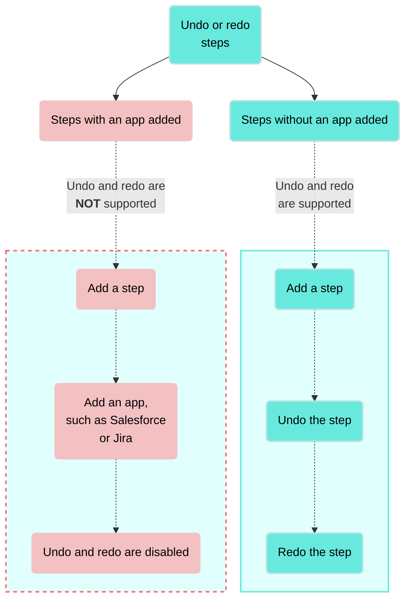

<!-- source: https://docs.workato.com/en/recipes/steps/undo-redo | lastmod: 2026-10-01 -->
> Learn how to undo or redo the ten most recent step changes in a Workato recipe, such as adding, deleting, or skipping steps.

# Undo or redo steps

The undo and redo feature allows you to revert the ten most recent changes to steps in your recipe or re-apply the ten most recent reversions.

> **PRIVATE BETA**
> 
> This feature is in private beta. Private beta features are available in production to select users. Contact your Customer Success Manager to enable this feature.
> 
> Workato may update feature functionality or change availability without prior notice during the private beta.

You can undo or redo the following step changes:

- Add a step
- Delete a step
- Paste a step
- Add a comment to a step
- Skip a step
- Mask step data

Other changes to recipe steps, such as changing an action or updating the configuration of the step, resets the recipe history. This means that you can't use the undo or redo feature to return the step to a previous state. For example, if you click **\+ Add step** and select **Add in action** or **IF condition**, you can either click the undo button or use the `command` + `z` keyboard shortcut to undo adding the step. However, if you click **\+ Add step** and **Add in action** or **IF condition** and then add an app, such as Salesforce or Jira to the action or condition, undo is disabled. You must manually delete steps that have apps or configured app actions from your recipe.

> **DIALOG DECISIONS ARE APPLIED AUTOMATICALLY TO UNDO AND REDO**
> 
> A dialog appears if a modification to a step affects more than the current step in your recipe. For example, if you paste over a step with a trigger that contains data, the dialog provides options on how to proceed, such as `Only paste actions` or `Paste trigger and actions`. Workato remembers your selection and automatically applies it when you undo or redo changes to the step later in your recipe development.

## Undo or redo step changes

You can use the undo and redo buttons in the recipe editor or keyboard shortcuts to undo or redo supported changes to the steps in your recipe.

Click the `←` undo (back) arrow to undo a change to a step.

Click the `→` redo (forward) arrow to redo a change to a step.

_Recipe editor buttons_

Alternatively, you can use the following keyboard shortcuts to undo or redo a change to a step:

- **Mac**
  - Undo
    
  - `command`\+ `z`
    
  - Redo
    
  - `command`\+ `shift` + `z`
    

- **Windows**
  - Undo
    
  - `Ctrl` + `z`
    
  - Redo
    
  - `Ctrl` + `shift` + `z`
    

Refer to [Recipe keyboard shortcuts](/en/recipes/keyboard-shortcuts#keyboard-shortcuts-for-recipe-design) for a complete list of supported keyboard shortcuts for recipe design.

---

---
url: 'https://docs.workato.com/en.md'
description: >-
  Documentation for Workato, the enterprise AI control and execution plane for
  building and governing AI agents, MCP servers, and integrations on a unified
  orchestration platform.
---

---

---
url: 'https://docs.workato.com/ja.md'
description: >-
  Workatoのドキュメント。Workatoは、統合オーケストレーションプラットフォーム上でAIエージェント、MCPサーバー、および連携を構築し、ガバナンスするためのエンタープライズAI制御および実行プレーンです。
---

---
