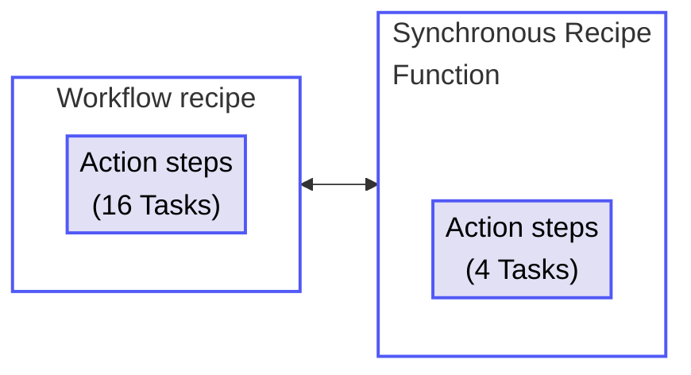

<!-- source: https://docs.workato.com/en/recipes/tasks | lastmod: 2026-10-23 -->
> Learn what a Task is in Workato, how Tasks are counted across recipe actions and jobs, and the rules that determine Task usage.

# Tasks usage

Workato measures workflow recipe usage in Tasks. A Task is a single action step that a recipe executes. Every action a recipe runs counts as a Task, regardless of which app it uses. Triggers and control flow steps don't count as Tasks.

A recipe [job](/en/recipes/jobs) may consist of multiple Tasks. The number of Tasks executed in a job depends on the recipe logic.

> Some plans measure workflow recipe usage in [Business actions](/en/pricing/usage-metrics/recipes) rather than Tasks. Refer to your contract or contact your Customer Success Representative for more information.

## Task calculation rules

Workato uses the following rules to calculate Tasks:

- Triggers don't count as Tasks, regardless of the connector that provides them.
- Action steps count as 1 Task each. This applies to all connectors, including platform, community, SDK custom connectors, and Workato utility connectors.
- Control flow steps don't count as Tasks. This includes `IF` conditions, `Repeat for each` and `Repeat while` loops, `Stop job`, and `Handle errors` steps. Steps nested inside them are counted per execution and skipped branches don't count. Looped steps contribute one Task per iteration.
- Successfully executed steps still count even when a job fails partway through.
- Mocked actions configured during testing with [Test Automation](/en/test-automation) count as Tasks.
- IDP and Event streams steps don't count as Tasks. They're measured in [Pages](/en/pricing/usage-metrics/idp) and [Events](/en/pricing/usage-metrics/event-streams) on top of the recipe's Tasks.
- A bulk or batch action counts as 1 Task, regardless of how many records the action processes.
- AI by Workato action steps count as more than one Task each. Refer to your contract for details.
- Synchronous recipe function calls inherit the calling recipe's usage metric. Both the call itself and the recipe function's action steps count as Tasks when a workflow recipe makes a synchronous call. Any other recipe function invocation runs as an independent workflow measured in Tasks.

The following table summarizes how recipe step types are counted towards usage:

| Step | Count |
| --- | --- |
| [Trigger](/en/recipes/triggers) and [trigger conditions](/en/recipes/triggers#trigger-conditions) | Not counted |
| [Action in an app](/en/recipes/actions) | 1 Task per step |
| Action inside a [`Repeat for each`](/en/features/list-management#list-repeat-action) or `Repeat while` loop | 1 Task per iteration |
| Control flow ([`IF`](/en/features/if-conditions), [error handlers](/en/recipes/best-practices-error-handling), `Stop job`) | Not counted |
| [Bulk or batch action](/en/features/batch-processing) | 1 Task per action |
| Failed action that succeeds on retry | 1 Task (only the successful attempt counts) |
| Call to a recipe function from a workflow recipe | 1 Task per call. The recipe function's own action steps also count as Tasks. |

## Task usage examples

The following examples demonstrate how Workato counts Tasks in different recipe scenarios.

### Simple recipe

**Recipe**

_Simple recipe with three actions_

**Explanation**

The trigger doesn't count as a Task. Each action step counts as 1 Task.

#### Usage totals

- **Total Tasks per job**: 3 (Step 2 + Step 3 + Step 4)

### Recipe with conditional actions

**Recipe**

_Recipe with conditional actions_

**Explanation**

Conditional statements don't count as Tasks. The nested steps inside the IF condition count only if the branch executes.

The **Search customers in NetSuite** step counts as 1 Task regardless of the number of customers returned.

Other control statements, such as conditional actions with else branches, action blocks with error monitors, `Stop job`, and `Repeat for each`, also don't count as Tasks.

#### Usage totals

- **Total Tasks per job**: 2 or 3, depending on whether the condition resolves to true

### Recipe with a loop

**Recipe**

_Recipe with repeated actions_

**Explanation**

Actions inside a `Repeat for each` block run once per item in the list, and each run counts as 1 Task.

For example, a list of 5 rows produces a total of 11 Tasks.

#### Usage totals

- **Total Tasks per job**: `1 + (2 × number of rows)`

### Recipe with a bulk action

**Recipe**

_Recipe with a bulk action_

**Explanation**

A bulk action counts as 1 Task regardless of how many records the action processes.

#### Usage totals

- **Total Tasks per job**: 1

### Recipe with a failed step and error retry

This example shows how Workato counts Tasks when a step fails and the recipe enters its error retry path.

**Recipe**

_Recipe with error monitor and retry_

**Explanation**

In this example, the recipe fails on the 4th step, **Create customer in NetSuite**. The [error retry](/en/recipes/steps#monitor-errors-with-retry) block attempts to retry steps 3, 4, and 5.

The recipe executes the **On error** step (Step 7), **Send email via Gmail**, if the retry fails. Step 3 executed twice (once on the initial run, once on the retry), so it counts as 2 Tasks. Step 7 also counts as 1 Task.

Steps 3, 4, and 5 all count as Tasks if the action block succeeds on the second attempt. Step 3 executed twice, so it counts as 2 Tasks.

#### Usage totals

- **Total Tasks per job**: 3 (if the retry fails and the On error step executes)
- **Total Tasks per job**: 4 (if the recipe succeeds on the second try)

> **MAXIMUM NUMBER OF RETRIES**
> 
> You can configure an action block to retry up to 3 times. Refer to [Actions with error handling](/en/recipes/steps#auto-retry) for more information.

### Workflow recipe calls a recipe function

**Overview**

Total usage: 20 Tasks

**Workflow recipe**

_Workflow recipe_

**Recipe function**

_Recipe function_

**Explanation**

A recipe function called from a workflow recipe contributes its steps to the calling recipe's Tasks.

In this example, the workflow recipe consumes 16 Tasks across its action steps (including the call to the recipe function). The recipe function consumes 4 Tasks. The total is the sum of both.

#### Usage totals

- **Workflow recipe**:
  - **Tasks**: 16
- **Recipe function**:
  - **Tasks**: 4
- **Total usage per job**: 20 Tasks

---
