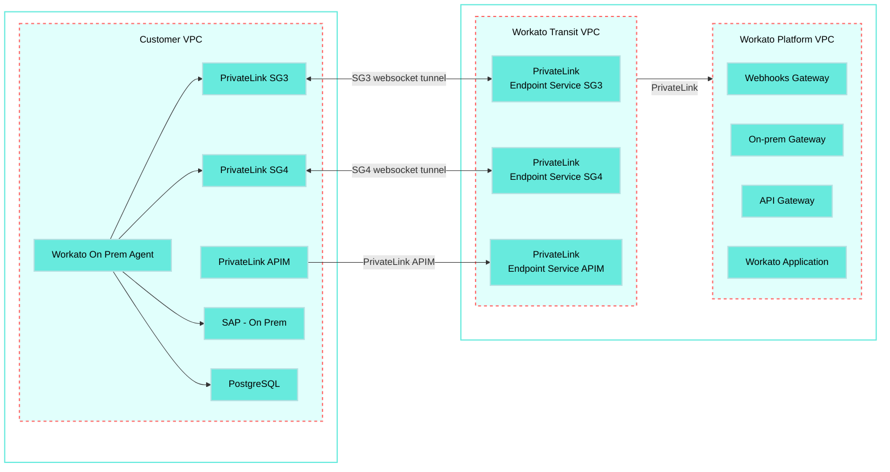

<!-- source: https://docs.workato.com/en/security/data-protection/private-link-aws | lastmod: 2026-10-07 -->
> Configure AWS PrivateLink to create a private connection between the Workato cloud and an AWS VPC, keeping traffic off the public internet.

# AWS PrivateLink

[AWS PrivateLink](https://docs.aws.amazon.com/whitepapers/latest/aws-vpc-connectivity-options/aws-privatelink) connections provide secure access to OPA-capable connectors and Workato's API platform by ensuring that network traffic to your environments remains isolated from the public internet.

Use this guide to configure a private connection between the Workato multi-tenant cloud and an AWS Virtual Private Cloud (VPC) using AWS PrivateLink.

> **FEATURE AVAILABILITY**
> 
> AWS PrivateLink connectivity is available to customers on specific pricing plans. Refer to your pricing plan and contract to learn more.

> **VIRTUAL PRIVATE WORKATO (VPW) CUSTOMERS**
> 
> This feature requires configuration steps that are specific to your Virtual Private Workato (VPW) instance. If you are a VPW customer, refer to your VPW private documentation for the configuration details for your instances.

## Connection structure

AWS PrivateLink connections to Workato use a two-tier architecture:

1. A consumer VPC connects through either a PrivateLink APIM gateway (`apim.workatopc.com`) or an on-prem agent that creates websocket tunnels using private SG3/SG4 gateways.
   
2. The Transit VPC connects to the Workato Platform VPC using PrivateLink endpoints.
   

The following diagram shows the architecture of the consumer VPC to Workato VPC PrivateLink setup:

Customer AWS Cloud

Workato AWS Cloud

  



## Connect a consumer VPC to the Workato VPC

Connecting a consumer VPC to the Workato VPC using AWS PrivateLink consists of the following steps:

- [AWS PrivateLink](#aws-privatelink)
  - [Connection structure](#connection-structure)
  - [Connect a consumer VPC to the Workato VPC](#connect-a-consumer-vpc-to-the-workato-vpc)
    - [Enable PrivateLink in Workato](#enable-privatelink-in-workato)
    - [Create AWS PrivateLink endpoints](#create-aws-privatelink-endpoints)
    - [Configure an OPA connection](#configure-an-opa-connection)
    - [Configure an API platform connection](#configure-an-api-platform-connection)

> **PREREQUISITES**
> 
> A consumer VPC must have at least three Availability Zones to connect to the Workato VPC.

### Enable PrivateLink in Workato

Contact your Customer Success Manager with your AWS account ID to enable PrivateLink. Refer to the AWS [View AWS account identifiers](https://docs.aws.amazon.com/accounts/latest/reference/manage-acct-identifiers.html) guide to retrieve your account ID.

Save the service and DNS names provided by Workato. For example:

**APIM**

The APIM endpoint allows the consumer VPC access to the Workato API platform. For example:

- Service name
- `com.amazonaws.vpce.us-east-1.vpce-svc-0881fb883c4e81655`
- DNS name
- `apim.workatopc.com`

**SG3**

The SG3 endpoint provides the OPA a websocket tunnel to connect the Workato VPC and consumer VPC. For example:

- Service name
- `com.amazonaws.vpce.us-east-1.vpce-svc-01d4a77d9c50d8626`
- DNS name
- `sg3.workatopc.com`

**SG4**

The SG4 endpoint provides the OPA a secondary websocket tunnel to connect the Workato VPC and consumer VPC. For example:

- Service name
- `com.amazonaws.vpce.us-east-1.vpce-svc-09e900de85f9e2dcc`
- DNS name
- `sg4.workatopc.com`

### Create AWS PrivateLink endpoints

Complete the following steps to create each of the required AWS PrivateLink endpoints:

1. Create an endpoint
   
   1. Open the AWS console and go to **VPC dashboard > PrivateLink and Lattice > Endpoints**.
      
      _The AWS console **Endpoints** page_
      
   2. Click **Create endpoint**.
      
   3. Set the endpoint **Type** to **Endpoint services that use NLBs and GWLBs**.
      
      _The endpoint **Type** and **Service name**_
      
   4. Enter the **Service name** provided by Workato.
      
   5. Click **Verify service** to ensure the service name is formatted correctly.
      
   6. Select the **VPC** you plan to use.
      
   7. Ensure that **Enable DNS name** is disabled.
      
   8. Go to the **Subnets** section and select three Availability Zones.
      
      _Select three Availability Zones_
      
   9. Use the **Subnet ID** drop-down menu to select a subnet for each zone.
      
   10. Click **Create Endpoint**. The newly created endpoint is **Pending acceptance** until Workato approves it and it becomes **Available**. You can check an endpoint's **Status** on the **Endpoints** page.
       
       _Check an endpoint's status on the **Endpoints** page_
       
   
2. Enable private DNS names for an endpoint
   
   1. Select the endpoint for which you plan to enable private DNS names.
      
   2. Use the **Actions** drop-down menu to select **Modify private DNS name**.
      
      _Select **Modify private DNS name**_
      
   3. Click the **Enable for this endpoint** checkbox, then click **Save changes**.
      
      _Click the **Enable for this endpoint** checkbox_
      
   4. Ensure the endpoint's **Private DNS name** is the same as the DNS name provided by Workato.
      
   

### Configure an OPA connection

Workato uses OPA to create websocket tunnels from the consumer VPC to the Workato Transit VPC using the SG3 and SG4 gateways. Refer to the [Connection structure](#connection-structure) section for more information.

Complete the following steps to configure OPA for AWS PrivateLink:

1. Install an on-prem agent on a machine within the consumer VPC. Refer to [Add an agent to an on-prem group](/en/on-prem/groups/add-agent) guide to install an OPA.
   
2. Ensure the machine running the OPA can reach the private SG3 and SG4 gateways over port 443. Firewalls or proxies that block outbound HTTPS can prevent the agent from connecting. Refer to the [Set up proxy access for your on-prem agent](/en/on-prem/agents/proxy) guide for more information about OPA proxy settings.
   
3. Complete the following OS-specific steps to configure the OPA's activation parameters:
   
   **Windows service**
   
   1. Open the Windows **Start** menu.
      
   2. Go to **All apps > Workato**.
      
   3. Click **Service Wrapper Configuration** to open the configuration menu.
      
   4. Go to the **Startup** tab.
      
   5. Enter the SG3 and SG4 Private Link DNS addresses provided by Workato as gateway parameters in the **Arguments** field. For example:
      
      ```
      --gateway=sg3.workatopc.com|sg4.workatopc.com
      ```
      
   
   **Command script**
   
   Include the SG3 and SG4 Private Link DNS addresses provided by Workato as gateway parameters in the activation command. For example:
   
   ```shell
   bin\activate.cmd --gateway=sg3.workatopc.com|sg4.workatopc.com
   ```
   
   **Linux**
   
   Add the SG3 and SG4 Private Link DNS addresses provided by Workato as gateway parameters in the `systemd` service file. For example:
   
   ```
   --gateway=sg3.workatopc.com|sg4.workatopc.com`
   ```
   
   **Docker**
   
   Add the SG3 and SG4 Private Link DNS addresses provided by Workato as gateway parameters in the Docker container. For example:
   
   ```
   args:
   - "--gateway=sg3.workatopc.com|sg4.workatopc.com"
   ```
   
4. Activate the on-prem agent. The agent automatically connects to the SG3 and SG4 private link gateways. Refer to the [Run an on-prem agent](/en/on-prem/agents/run) guide for information about how to activate OPA for your operating system.
   

### Configure an API platform connection

Use the PrivateLink DNS for your data center to access API endpoints using PrivateLink. For example, use the `apim.workatopc.com` DNS instead of the standard Workato `apim.workato.com` DNS. Ensure the machine making the request can reach the private APIM gateway. Firewalls or proxies that block outbound HTTPS can cause the request to fail.

---
