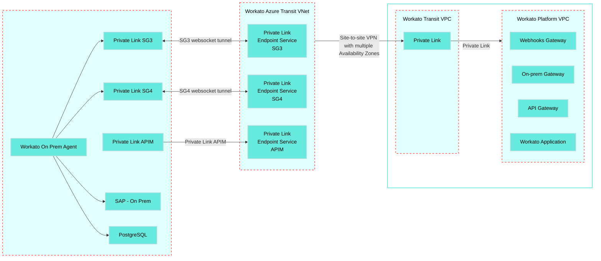

<!-- source: https://docs.workato.com/en/security/data-protection/private-link-azure | lastmod: 2026-10-07 -->
> Configure Azure Private Link to create a private connection between the Workato cloud and an Azure virtual network, isolated from the public internet.

# Azure Private Link

[Azure Private Link](https://learn.microsoft.com/en-us/azure/private-link/private-link-overview) connections provide secure access to OPA-capable connectors and Workato's API platform by ensuring that network traffic to your environments remains isolated from the public internet.

Use this guide to configure a private connection between the Workato multi-tenant cloud and an Azure Virtual Network (VNet) using Azure Private Link.

> **FEATURE AVAILABILITY**
> 
> Azure Private Link connectivity is available to customers on specific pricing plans. Refer to your pricing plan and contract to learn more.

> **VIRTUAL PRIVATE WORKATO (VPW) CUSTOMERS**
> 
> This feature requires configuration steps that are specific to your Virtual Private Workato (VPW) instance. If you are a VPW customer, refer to your VPW private documentation for the configuration details for your instances.

## Connection structure

Azure Private Link connections to Workato use a three-tier architecture:

1. A consumer VNet connects through either a Private Link APIM gateway (`apim.workatopc.com`) or an on-prem agent that creates websocket tunnels using private SG3/SG4 gateways.
   
2. The Transit VNet uses a site-to-site VPN that spans multiple Availability Zones to connect to the Workato Transit Virtual Private Cloud (VPC).
   
3. The Transit VPC connects to the Workato Platform VPC using Private Link endpoints.
   

The following diagram shows the connection structure of the consumer VNet to Workato VPC Private Link setup:

Customer Azure VNet

Workato AWS Cloud

  



## Connect a consumer VNet to the Workato VPC

Connecting a consumer VNet to the Workato VPC using Azure Private Link consists of the following steps:

- [Azure Private Link](#azure-private-link)
  - [Connection structure](#connection-structure)
  - [Connect a consumer VNet to the Workato VPC](#connect-a-consumer-vnet-to-the-workato-vpc)
    - [Enable Private Link in Workato](#enable-private-link-in-workato)
    - [Create Azure Private Link endpoints](#create-azure-private-link-endpoints)
    - [Configure an OPA connection](#configure-an-opa-connection)
    - [Configure an API platform connection](#configure-an-api-platform-connection)

### Enable Private Link in Workato

Contact your Customer Success Manager with your Azure subscription ID to enable Private Link. Refer to the Microsoft [Get subscription and tenant IDs in the Azure portal](https://learn.microsoft.com/en-us/azure/azure-portal/get-subscription-tenant-id) guide to retrieve your subscription ID.

Save the Resource IDs and DNS names provided by Workato. For example:

**APIM**

The APIM endpoint allows the consumer VNet access to the Workato API platform. For example:

- Resource ID
- `pconn-production-apim-pls.cb58c7e4-c6c4-407d-8038-b09a8ce0763b.germanywestcentral.azure.privatelinkservice`
- DNS name
- `apim.workatopc.com`

**SG3**

The SG3 endpoint provides the OPA a websocket tunnel to connect the Workato VPC and consumer VNet. For example:

- Resource ID
- `pconn-production-opg3-pls.f8938b4a-030f-44f7-8524-5928f23748fc.germanywestcentral.azure.privatelinkservice`
- DNS name
- `sg3.workatopc.com`

**SG4**

The SG4 endpoint provides the OPA a secondary websocket tunnel to connect the Workato VPC and consumer VNet. For example:

- Resource ID
- `pconn-production-opg4-pls.33fc8fc0-1582-49af-9b62-5da30d6e36fe.germanywestcentral.azure.privatelinkservice`
- DNS name
- `sg4.workatopc.com`

### Create Azure Private Link endpoints

Complete the following steps to create each of the required Azure Private Link endpoints:

1. Open the Microsoft Azure portal and go to **Network foundation > Private Link > Private endpoints**. _Azure **Private endpoints** page_
   
2. Create an endpoint
   
   1. Click **\+ Create**.
      
   2. Select a **Subscription** and **Resource group**. _**Basics** page configuration_
      
   3. Enter a **Name** for the endpoint, such as `APIM`, `SG3`, or `SG4`. The **Network Interface Name** field is filled in automatically.
      
   4. Optional. Edit the **Network Interface Name**. This field is generated automatically based on the provided **Name**.
      
   5. Select the **Region** for your Azure VNet.
      
   6. Click **Next: Resource**.
      
   7. Set the **Connection method** to **Connect to an Azure resource by resource ID or alias**. _**Resource** page configuration_
      
   8. Enter the **Resource ID** provided by Workato.
      
   9. Click **Next: Virtual Network**, then select the **Virtual network** that you plan to use. _**Virtual Network** page configuration_
      
   10. Click **Next: DNS**, then set **Integrate with private DNS zone** to `No`.
       
   11. Go to the **Review + create** tab and ensure the information displayed is correct.
       
   12. Click **Create** to create the endpoint.
       
   
3. Create a private DNS zone
   
   1. Go to **Network foundation > DNS > Private DNS zones**_The **Private DNS zones** page_
      
   2. Click **\+ Create**.
      
   3. Select a **Subscription** and **Resource group**. _**Basics** page configuration_
      
   4. Enter the DNS name provided by Workato in the **Name** field. For example `apim.workatopc.com`.
      
   5. Go to the **Virtual Network Links** tab.
      
   6. Click **\+ Add Virtual Network Link**.
      
   7. Provide the **Link name**, **Subscription**, and **Virtual Network** for the zone.
      
   8. Click **Create**.
      
   9. Go to the **Review + create** tab and ensure the information displayed is correct.
      
   10. Click **Create** to create the zone.
       
   
4. Create a recordset
   
   1. Select the newly created zone. _Select the newly created zone._
      
   2. Go to **DNS Management > Recordsets**. _Go to **DNS Management > Recordsets**._
      
   3. Click **\+ Add**.
      
   4. Enter a **Name** for the recordset and enter the endpoint's **Private IP** in the **IP address** field. You can retrieve an endpoint's **Private IP** on the **Network foundation > Private Link > Private endpoints** page.
      
   5. Click **Add**.
      
   
5. Wait for Workato to accept the endpoints and set them to **Active**. You can view an endpoint's status on the **Network foundation > Private Link > Private endpoints** page. _Pending endpoints_
   

### Configure an OPA connection

Workato uses OPA to create websocket tunnels from the consumer VNet to the Workato Transit VNet using the SG3 and SG4 gateways. Refer to the [Connection structure](#connection-structure) section for more information.

Complete the following steps to configure OPA for Azure Private Link:

1. Install an on-prem agent on a machine within the consumer VNet. Refer to the [Add an agent to an on-prem group](/en/on-prem/groups/add-agent) guide to install an OPA.
   
2. Ensure the machine running the OPA can reach the private SG3 and SG4 gateways over port 443. Firewalls or proxies that block outbound HTTPS can prevent the agent from connecting. Refer to the [Set up proxy access for your on-prem agent](/en/on-prem/agents/proxy) guide for more information about OPA proxy settings.
   
3. Complete the following OS-specific steps to configure the OPA's activation parameters:
   
   **Windows service**
   
   1. Open the Windows **Start** menu.
      
   2. Go to **All apps > Workato**.
      
   3. Click **Service Wrapper Configuration** to open the configuration menu.
      
   4. Go to the **Startup** tab.
      
   5. Enter the SG3 and SG4 Private Link DNS addresses provided by Workato as gateway parameters in the **Arguments** field. For example:
      
      ```
      --gateway=sg3.workatopc.com|sg4.workatopc.com
      ```
      
   
   **Command script**
   
   Include the SG3 and SG4 Private Link DNS addresses provided by Workato as gateway parameters in the activation command. For example:
   
   ```shell
   bin\activate.cmd --gateway=sg3.workatopc.com|sg4.workatopc.com
   ```
   
   **Linux**
   
   Add the SG3 and SG4 Private Link DNS addresses provided by Workato as gateway parameters in the `systemd` service file. For example:
   
   ```
   --gateway=sg3.workatopc.com|sg4.workatopc.com`
   ```
   
   **Docker**
   
   Add the SG3 and SG4 Private Link DNS addresses provided by Workato as gateway parameters in the Docker container. For example:
   
   ```
   args:
   - "--gateway=sg3.workatopc.com|sg4.workatopc.com"
   ```
   
4. Activate the on-prem agent. The agent automatically connects to the SG3 and SG4 private link gateways. Refer to the [Run an on-prem agent](/en/on-prem/agents/run) guide for information about how to activate OPA for your operating system.
   

### Configure an API platform connection

Use the Private Link DNS for your data center to access API endpoints using Private Link. For example, use the `apim.workatopc.com` DNS instead of the standard Workato `apim.workato.com` DNS. Ensure the machine making the request can reach the private APIM gateway. Firewalls or proxies that block outbound HTTPS can cause the request to fail.

---
