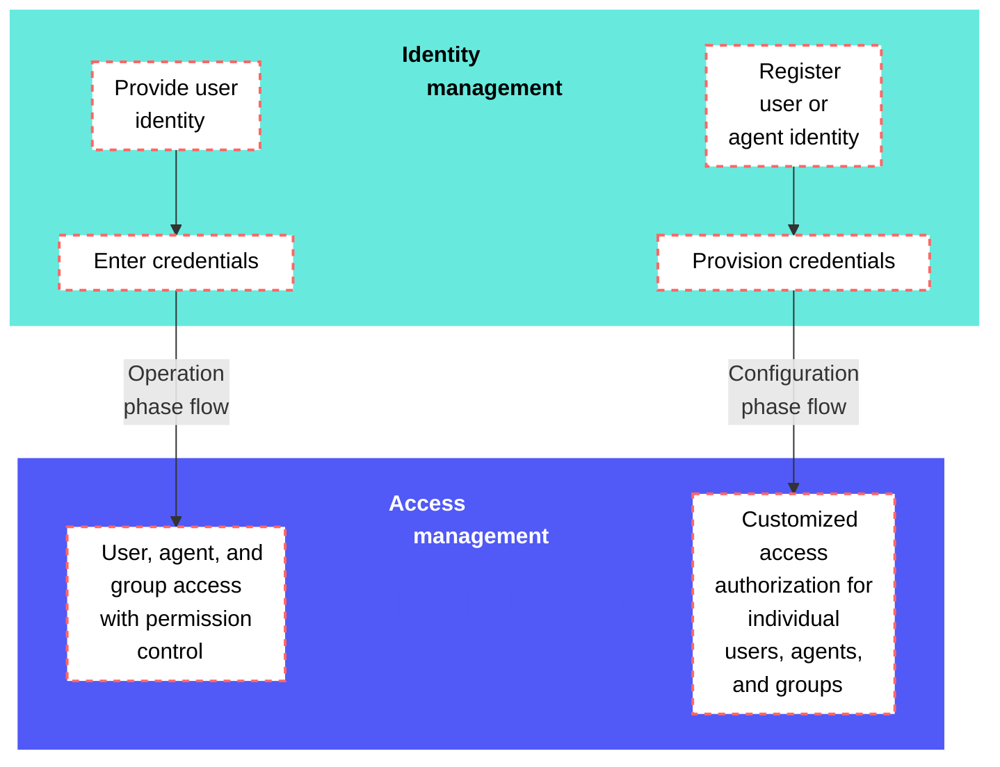

<!-- source: https://docs.workato.com/en/workato-identity | lastmod: 2026-10-29 -->
> Workato Identity is a unified identity and access management system for Workato. Supports SAML SSO, JIT provisioning, and SCIM to manage user and group access.

# Workato Identity

Workato Identity is a unified identity and access management system that lets you control agent and MCP server access and user and group access for [Agent Studio](/en/agentic/agent-studio), [Workato GO](/en/agentic/workato-go), [MCP](/en/mcp), and the [API developer portal](/en/api-mgmt/api-developer-portal) across your entire Workato account. You can use Workato Identity to sync and manage users and groups from your external identity provider (IdP), or manually define users and groups within Workato. Users and groups are managed independently of environments to provide fine-grained control over user access.

> **FEATURE AVAILABILITY**
> 
> Workato Identity is available for [Agent Studio](/en/agentic/agent-studio), [Workato GO](/en/agentic/workato-go), [MCP](/en/mcp), and the [API developer portal](/en/api-mgmt/api-developer-portal).

Workato Identity enables you to:

- Grant individual access for specific environments.
- Grant agents and MCP servers access to specific environments.
- Define groups at the environment level.
- Customize authentication methods for each environment. For example:
  - `Dev: Password auth`
  - `Test: SSO`
  - `Prod: SSO`
- Reuse your IdP across environments or define a customized setup for individual environments.
- Manually manage or sync users and user groups from your identity provider, such as Okta, Microsoft Entra ID, or OneLogin.
- Assign access to specific groups, making it easy for builders to scope access securely.
- View and manage all user identities and group memberships from a centralized interface.

## Authenticated user flows

Workato Identity includes the user’s identity as a signed JSON web token (JWT) at runtime in every interaction. This token is passed along with each message to allow components to verify identity and enforce access control. Each component is responsible for checking whether the authenticated user is authorized to perform the action, based on their group membership and the access policy for the platform feature. This ensures that the user is authorized to access specific functions and data.

## SAML-based SSO

Workato Identity supports SAML-based SSO to provide the following key features:

- Just-in-Time (JIT) Provisioning
  
- You can enable [JIT provisioning](/en/workato-identity/jit-provisioning) to automatically create user accounts when they first sign in through SSO. This eliminates the need for administrators to manually create accounts and keeps user information current.
  
- Customizable attributes
  
- You can configure both your [Identity Provider (IdP)](/en/workato-identity/identity-provider-user-access#configure-your-identity-provider) and Service Provider (SP) to [sync user group](/en/workato-identity/user-group-syncing) information using SAML attributes, such as group memberships.
  
- Selective enforcement
  
- Your organization can choose to enforce SAML-based authentication for all users or [add users manually](/en/workato-identity/add-end-user-manually). This option supports compliance requirements while allowing flexibility for development and testing.
  

Refer to [Workato Identity SAML-based SSO](/en/workato-identity/saml-sso) for more information.

## Quotas

Workato Identity enforces the following quotas across OAuth token issuance, SCIM provisioning, and end-user group changes.

### OAuth token quotas

| Description | Quota | Notes |
| --- | --- | --- |
| Lifetime of an OAuth access token issued by Workato Identity | 1 hour | Refresh tokens don't have a lifetime quota. |

Refer to [SCIM provisioning quotas](/en/workato-identity/scim-provisioning#scim-limits) and [end-user group quotas](/en/workato-identity/user-groups#user-group-limits) for the remaining Workato Identity quotas.

---
