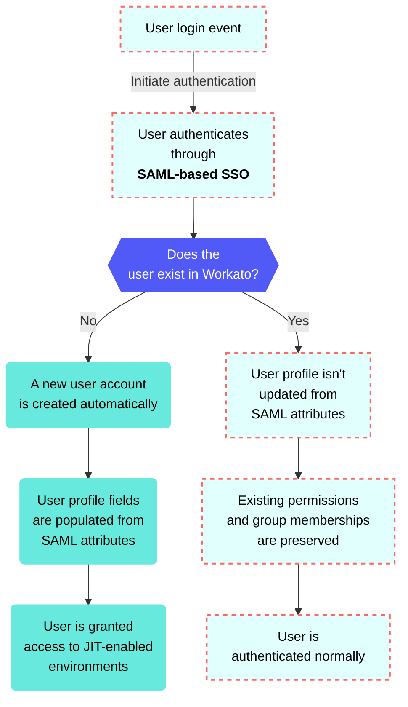

<!-- source: https://docs.workato.com/en/workato-identity/jit-provisioning | lastmod: 2026-10-29 -->
> Configure Just-in-Time (JIT) provisioning in Workato Identity to automatically create and manage user accounts when users first authenticate through SAML-based SSO.

# JIT provisioning

Just-in-Time (JIT) provisioning automatically creates user accounts when users first authenticate through SAML-based single sign-on. This eliminates the need for administrators to manually pre-create accounts and ensures user information stays current with your identity provider.

## JIT provisioning behavior scenarios

Workato behaves differently depending on whether the user already exists in the workspace: When a user who doesn't exist in Workato signs in for the first time:

- A new user account is created automatically
- User name and email fields are populated from SAML attributes
- User is granted access to JIT-enabled environments

When a user account already exists in Workato:

- Workato doesn't update the user profile from SAML attributes
- Existing permissions and group memberships are preserved
- User is authenticated normally

## Default user permissions

JIT-provisioned users receive the following default settings:

- **Account status**: Active
- **Authentication method**: SAML-based SSO (required)
- **Environment access**: All environments where JIT provisioning is enabled
- **Group membership**: SAML group memberships are synced on initial creation
- **Permissions**: Based on the environment's default end-user permissions

## Enable JIT provisioning

You can configure Just-in-Time (JIT) provisioning and select which users require SAML-based authentication. You can customize authentication methods for each environment. For example:

- `Dev: Password auth`
- `Test: SSO`
- `Prod: SSO`

> **NOT FOR WORKFLOW APPS SAML-BASED SSO**
> 
> This documentation is specific to Workato Identity. Refer to [SAML-based single sign-on authentication](/en/workflow-apps/saml) to configure SAML authentication for [Workflow apps](/en/workflow-apps).

Complete the following steps to configure SAML settings for your environment authentication:

1. Sign in to your Workato account.
   
2. Go to **Workspace admin**. The **Access control** page displays.
   
3. Go to the **Solutions access** section and click **SAML identity providers**.
   
4. Click **\+ Set up new provider**.
   
5. Provide a name for your IdP in the **Identity provider (IdP) name** field. For example: `Okta Prod`.
   
   _Configure SAML authentication_
   
6. Go to the **Enforce SAML authentication for** section and select **All domains** or **Selected domains**.
   
7. Click **Next**.
   
8. Copy the **Specify Single sign-on URL** and **Service provider (SP) entity ID** values and paste each value into your IdP to enable access to Workato-powered apps and services.
   
   _Copy the **Specify Single sign-on URL** and **Service provider (SP) entity ID** values_
   
9. Click **Next**.
   
10. Locate the **Do you have your identity provider metadata URL?** field and select **Yes** or **No** depending on whether you have access to your IdP metadata URL.
    
    **Yes: you have your IdP metadata URL**
    
    1. Provide your metadata URL in the **Metadata URL** field.
       
       _Provide your metadata URL_
       
    
    **No: you don't have your IdP metadata URL**
    
    1. Provide your IdP SSO URL in the **Identity provider single sign-on URL** field.
       
       _Provide your IdP information_
       
    2. Provide the unique identifier of your IdP in the **Identity provider issuer** field.
       
    3. Provide the IdP X.509 certificate your IdP uses for request validations in the **X.509 certificate** field.
       
    
11. Click **Set up**.
    
12. Click the option menu (...) icon for the IdP.
    
13. Select **Provisioning**.
    
14. Click **JIT provisioning** in the **Provisioning** modal.
    
    _Select **JIT provisioning**_
    
15. Use the **Create accounts at first login** toggle to enable or disable account creation on first login.
    
    > **AUTOMATED ACCOUNT ENVIRONMENT ACCESS**
    > 
    > User accounts are created with access to the environments you selected in the preceding steps by default.
    
16. Click the **Sync group memberships** toggle to update user groups from your identity provider. Refer to [User group syncing](/en/workato-identity/user-group-syncing) for more information.
    
    > **GROUP MEMBERSHIP SYNCING ONLY SUPPORTED BY WORKATO GO**
    > 
    > [User group syncing](/en/workato-identity/user-group-syncing) is only available in Workato GO. The sync process triggers when users log in. Slack and Microsoft Teams users remain authenticated through their platform sessions without re-login prompts, preventing the user group sync from triggering.

---
