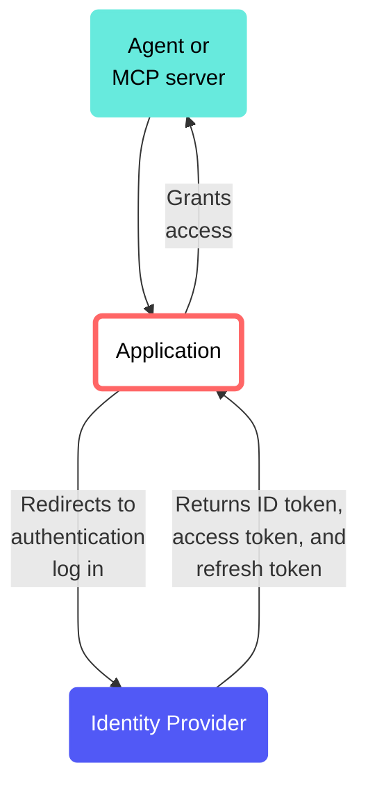

<!-- source: https://docs.workato.com/en/workato-identity/oidc/oidc-overview | lastmod: 2026-10-29 -->
> OpenID Connect (OIDC) enables authentication and profile retrieval for agents, MCP servers, and other agentic apps.

# OIDC

OpenID Connect (OIDC) is an identity verification layer built on top of OAuth 2.0 protocol. OIDC enables authentication and profile retrieval without managing passwords.

Workato OIDC lets you configure which agents, MCP servers, and other agentic apps Workato Identity is allowed to authenticate. You must create an OIDC configuration for each profile and audience in a workspace. You can share OIDC configurations across environments.

## How OIDC works with Workato Identity

Workato Identity supports the following authentication patterns for agents:

- **Machine-to-machine (M2M)**: Agent authenticates as itself with your identity provider using the client credentials grant. This pattern is recommended for [headless](/en/agentic/agent-studio/chat-interface/headless-api) agents.
  
- **An agent acting on behalf of a signed in user**: The agent, such as Claude or Copilot Studio, uses the authorization code grant to sign a user in through your identity provider and presents the user's token to Workato.
  

### Key components

Each OIDC configuration requires the following key components:

- **OIDC server discovery URL**: Workato uses this URL to retrieve your identity provider's JSON Web Key Set (JWKS). The JWKS is a set of public keys that let Workato validate the signature on each OIDC token locally.
  
- **Required audiences**: Workato checks the audience claim on every token against this list. This step confirms that the token was minted for the correct application.

---
