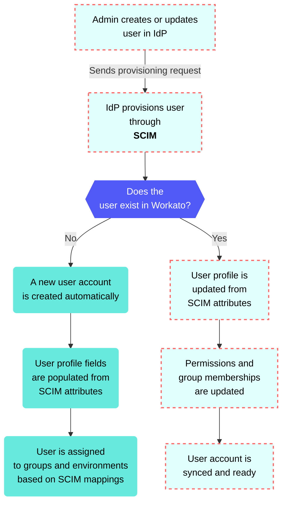

<!-- source: https://docs.workato.com/en/workato-identity/scim-provisioning | lastmod: 2026-09-09 -->
> Configure SCIM provisioning in Workato Identity to automatically sync users and groups from your IdP.

# SCIM provisioning

SCIM (System for Cross-domain Identity Management) provisioning automatically synchronizes user accounts and groups between your identity provider and Workato. This eliminates the need for administrators to manually create or update accounts, and allows you to manage Workato users and groups entirely from your existing identity provider.

## SCIM provisioning behavior scenarios

Workato behaves differently depending on whether the user already exists in the workspace:

An administrator creates a new user in your identity provider:

- A new user account is created automatically in Workato
- User name and email fields are populated from SCIM attributes
- User is assigned to groups and environments based on SCIM mappings

An administrator updates an existing user in your identity provider:

- Workato updates the user profile from SCIM attributes
- Permissions and group memberships are updated to match the identity provider
- Changes are synced immediately without requiring user login

> **GROUP OVERWRITES CAN CAUSE LOSS OF MEMBERSHIP CONTROL**
> 
> Custom group IDs are preserved when group changes are pushed from your IdP through SCIM. Changes that overwrite a local group can result in immediate loss of membership control over that group in Workato Identity. Ensure your groups are configured correctly in your IdP before pushing changes to prevent unintended loss of membership control over local groups in Workato Identity.

## Enable SCIM provisioning

You can configure SCIM provisioning and select which environments require SAML-based authentication. You can customize authentication methods for each environment. For example:

- `Dev: Password auth`
- `Test: SSO`
- `Prod: SSO`

> **NOT FOR WORKFLOW APPS SAML-BASED SSO**
> 
> This documentation is specific to Workato Identity. Refer to [SAML-based single sign-on authentication](/en/workflow-apps/saml) to configure SAML authentication for [Workflow apps](/en/workflow-apps).

Complete the following steps to configure SCIM provisioning and SAML settings for your environment authentication:

1. Sign in to your Workato account and go to **Workspace admin**.
   
2. Click **Authentication & Groups** in the sidebar.
   
3. Select the environment you plan to configure. The environment **End-user group** page displays by default.
   
   > **ENVIRONMENT AVAILABILITY**
   > 
   > Workspaces without [Environments](/en/features/environments) provisioned only have one environment available.
   
4. Select the **Authentication** tab.
   
5. Ensure that the **SAML-based SSO authentication** toggle is enabled.
   
   _Ensure the **SAML-based SSO authentication** toggle is enabled_
   
6. Go to the **Select an identity provider (IdP)** section and click **\+ Set up new provider**.
   
7. Provide a name for your IdP in the **Identity provider (IdP) name** field. For example: `Okta Dev`.
   
8. Go to the **Enforce SAML authentication for** section and select **All domains** or **Selected domains**.
   
9. Click **Next**.
   
10. Copy the **Specify Single sign-on URL** and **Service provider (SP) entity ID** values and paste each value into your IdP to enable access to Workato-powered apps and services.
    
    _Copy the **Specify Single sign-on URL** and **Service provider (SP) entity ID** values_
    
11. Locate the **Do you have your identity provider metadata URL?** field and select **Yes** or **No** depending on whether you have access to your IdP metadata URL.
    
    **Yes: you have your IdP metadata URL**
    
    1. Provide your metadata URL in the **Metadata URL** field.
       
       _Provide your metadata URL_
       
    
    **No: you don't have your IdP metadata URL**
    
    1. Provide your IdP SSO URL in the **Identity provider single sign-on URL** field.
       
       _Provide your IdP information_
       
    2. Provide the unique identifier of your IdP in the **Identity provider issuer** field.
       
    3. Provide the IdP X.509 certificate your IdP uses for request validations in the **X.509 certificate** field.
       
    
12. Click **Set up**. You are redirected to the **Authentication** tab where your configured IdP displays.
    
13. Go to the IdP you configured in the preceding steps and click **Set up**.
    
    _Click **Set up**._
    
14. Click **SCIM provisioning** in the **Provisioning** modal.
    
    _Select **SCIM provisioning**._
    
15. Copy the **Base URL** and **SCIM token**. Use these values to give your IdP permission to provision end users and optionally sync groups. End-user and group data may be overwritten by your IdP with this configuration.
    
    > **GROUP OVERWRITES CAN CAUSE LOSS OF MEMBERSHIP CONTROL**
    > 
    > Custom group IDs are preserved when group changes are pushed from your IdP through SCIM. Changes that overwrite a local group can result in immediate loss of membership control over that group in Workato Identity. Ensure your groups are configured correctly in your IdP before pushing changes to prevent unintended loss of membership control over local groups in Workato Identity.
    
16. Click **Save**.
    

## Set up SCIM in your IdP

You must configure your IdP to use SCIM with the **Base URL** and **SCIM token** provided in the End user and group provisioning configuration.

> **SCIM TOKENS**
> 
> SCIM tokens must be sent in the header with `Authorization: Bearer [TOKEN]`.

Complete the following steps to obtain your **Base URL** and **SCIM token**:

1. Go to the **Authentication** tab in Workato Identity.
   
2. Click the ellipsis menu for the IdP you plan to use.
   
3. Select **End user & group provisioning**.
   
4. Copy the **Base URL** and **SCIM token** values.
   
5. Refer to the following IdP resources for IdP-specific SCIM provisioning configuration information and examples:
   
   - [SCIM provisioning in Okta](https://help.okta.com/en-us/content/topics/apps/apps_app_integration_wizard_scim.htm)
     - You must have the **Create Users** setting enabled in Okta. Refer to the [Matching user not found](/en/workato-identity/scim-provisioning#matching-user-not-found) section for more information.
   - [SCIM provisioning in Microsoft Entra ID (Azure Active Directory)](https://learn.microsoft.com/en-us/entra/identity/app-provisioning/use-scim-to-provision-users-and-groups#getting-started)
   - [SCIM provisioning in OneLogin](https://developers.onelogin.com/scim/define-user-schema)

## SCIM quotas

| Description | Quota | Notes |
| --- | --- | --- |
| Maximum users per add-to-group or remove-from-group API request | 100 users per request | SCIM provisioning has no request rate limit. The batch quota applies only to the number of users you can include in a single group-membership API request. |

## Troubleshoot errors

### Unable to update Group Push mapping target App group

You may receive the following error in your Okta SCIM account if you attempt to sync a group from your IdP that already exists within Workato Identity:

`Unable to update Group Push mapping target App group`

Rename either the Okta group or the existing Workato Identity group to resolve this error.

_Existing group error_

### Matching user not found

You may receive this error if the **Create Users** setting is not enabled.

Complete the following steps to resolve this error:

1. Go to your Okta SCIM account.
   
2. Click **Settings**.
   
3. Select **To App > Provisioning**.
   
4. Go to the **Create Users** section and select the **Enable** checkbox.
   
   _Enable **Create Users**_
   

### Unique identifier field

Okta requires a unique identifier field during SCIM configuration. Workato recommends that you use **email** as the value for the **Unique identifier field for users** field.

_Use **email** as the value for the **Unique identifier field for users** field_

### HTTP header authorization failure

Ensure that you set the authentication method for the HTTP Header when configuring SCIM in Okta. Workato's SCIM endpoint authenticates requests using the SCIM token generated during provisioning setup. You must provide this Workato token as the bearer token value in Okta.

---
