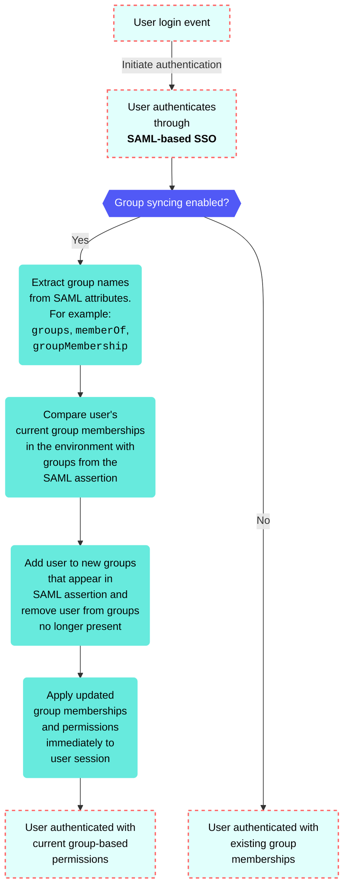

<!-- source: https://docs.workato.com/en/workato-identity/user-group-syncing | lastmod: 2026-06-17 -->
> Configure user group syncing in Workato Identity to keep group memberships and access permissions automatically in sync with your identity provider on every SAML-based SSO login.

# User group syncing

Group syncing automatically updates user group memberships in Workato based on group information from your identity provider. This ensures access permissions remain synchronized with your organization's directory.

> **WORKATO GO REQUIREMENT**
> 
> Group syncing is only available when using Workato GO. Users accessing applications through Slack or Microsoft Teams may not trigger group syncs due to their platform's persistent authentication sessions.

## User group sync workflow

Workato syncs user groups using the following workflow:

- **Initiation**: The user signs in to a Workato application using SAML-based SSO.
- **IdP authentication**: Workato redirects the user to the configured IdP to enter credentials.
- **SAML assertion generation**: The IdP validates the user's credentials and generates a SAML assertion containing user attributes and group membership information.
- **Group extraction**: Workato receives the SAML assertion and extracts group names from the configured group attribute, such as `groups`, `memberOf`, or `groupMembership`.
- **Membership comparison**: Workato compares the user's current group memberships in the environment with the groups provided in the SAML assertion.
- **Sync group memberships**: Workato adds the user to new groups that appear in the SAML assertion and removes the user from groups that are no longer present.
- **Apply permissions**: Updated group memberships and associated permissions take effect immediately for the user's session.
- **Complete authentication**: The user is logged in and redirected to the requested Workato application with current group-based permissions.

The following diagram illustrates the group syncing workflow:

## Enable user group syncing

Complete the following steps to enable user group syncing:

1. Sign in to your Workato account and go to **Workspace admin**.
   
2. Click **Authentication & Groups** in the sidebar.
   
3. Select the environment you plan to configure. The environment **End-user group** page displays by default.
   
   > **ENVIRONMENT AVAILABILITY**
   > 
   > Workspaces without [Environments](/en/features/environments) provisioned only have one environment available.
   
4. Select the **Authentication** tab.
   
5. Ensure that the **SAML-based SSO authentication** toggle is enabled.
   
   _Ensure the **SAML-based SSO authentication** toggle is enabled_
   
6. Go to the **Select an identity provider (IdP)** section and click **\+ Set up new provider**.
   
7. Click the **Enable end-user groups syncing** toggle to update user groups from your identity provider.
   
   _Click the **Enable end-user groups syncing** toggle_

---
