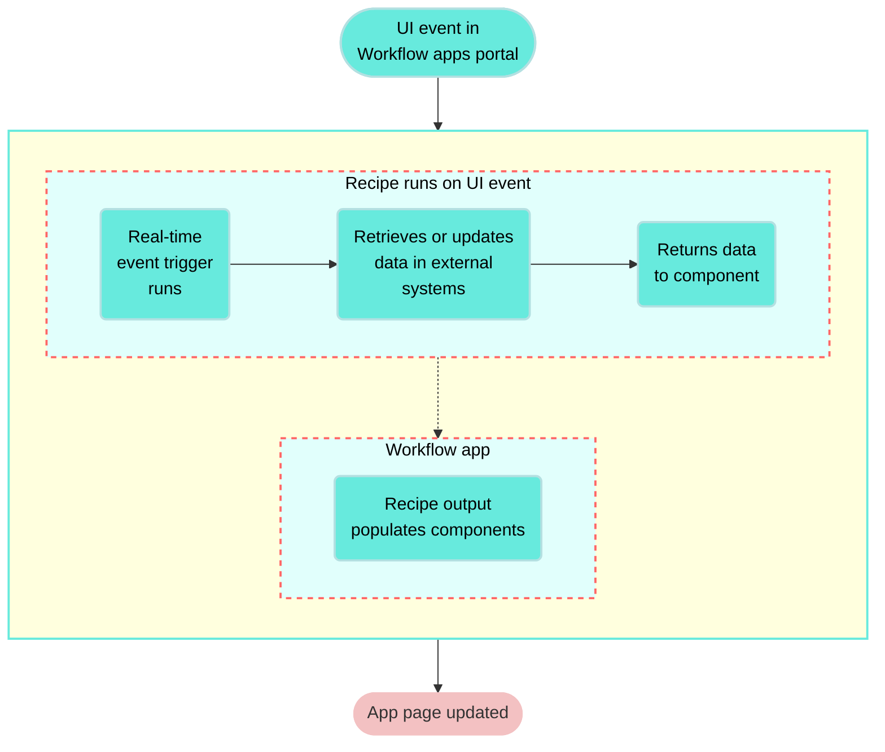
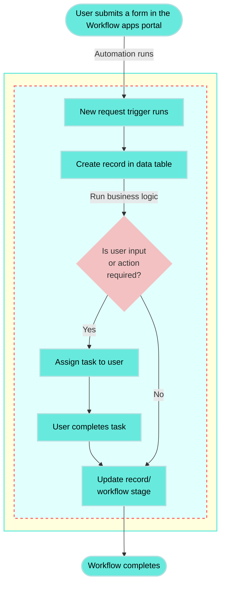

<!-- source: https://docs.workato.com/en/workflow-apps | lastmod: 2026-08-21 -->
> Workato Workflow apps provide a no-code, visual builder for creating interactive apps that combine user actions, approvals, and automated service steps.

# Workflow apps

[Workflow apps](https://www.workato.com/platform/workflow-apps?utm_source=docs&utm_medium=referral&utm_campaign=workflow-apps) provide a no‑code, visual development environment for building interactive and integrated applications that combine user actions and automated service steps. Workflow apps include a drag‑and‑drop app builder, a fully brandable apps portal, and built‑in and extensible data storage.

> **FEATURE AVAILABILITY**
> 
> Workflow apps is available to customers on specific pricing plans. Refer to your pricing plan and contract to learn more.
> 
> Workflow apps aren't available to workspaces in the China data center. This reflects local regulatory requirements and applies to our multi-tenant and [Virtual Private Workato (VPW)](/en/cloud-hosting-editions/hosting-editions#virtual-private-workato) offerings.

## Key components

The Workato web user interface supports all development and configuration work for Workflow apps. Workflow apps are powered by the following key components.

### Data storage

Workflow apps integrate seamlessly with your business applications using [workflow recipes](/en/recipes#what-types-of-recipes-can-i-create). Page components can use [recipes as data sources](/en/workflow-apps/dropdown-recipe-data-source), allowing your app to work with data from external systems in real-time.

Apps with request and approval functionality include a primary [data table](/en/data-tables) for storing records such as invoices, PTO requests, or sales quotes. You can add linked tables to support complex data relationships. Data table records are accessible and editable through the [Workflow apps connector](/en/workflow-apps/workflow-apps-connector).

### Application user interface

Workato automatically generates much of an application's UI experience through the [Workflow apps portal](/en/workflow-apps/portal-homepage). For example, Workato generates the list of requests, app navigation, and history trail of requests with support for [custom task status labels](/en/workflow-apps/tasks#custom-task-status). The Workflow apps portal has a responsive design and can be used on mobile, tablet, and desktop devices. You can brand the app portal to match your organization.

You can customize the user experience of your app by creating and customizing [Pages](/en/workflow-apps/pages-customize), which support custom forms and dashboards. Pages use a drag-and-drop editor and a broad set of [components](/en/workflow-apps/page-components) enabling you to design apps according to your business requirements.

Additionally, Workflow apps support the following advanced UI behaviors:

- [Conditional logic](/en/workflow-apps/page-components): Control the visibility or editability of page components using IF conditions.
- [Component actions](/en/workflow-apps/component-actions): Save data, trigger recipes, reload components, open external links, or complete tasks.
- [Validation](/en/workflow-apps/built-in-field-validation): Enforce built-in validation for certain components or define custom validation using regex.
- [Form prefilling](/en/workflow-apps/prefill-forms): Auto-populate fields using URL parameters.
- [Public forms](/en/workflow-apps/public-links): Create forms that accept input from unauthenticated users, allowing external users to submit data.

### Business logic

[Workflow recipes](/en/recipes#what-types-of-recipes-can-i-create) orchestrate application behavior and user interaction. This enables you to design workflows across time, systems, users, and interfaces. Recipes can manage logic such as routing, approvals, data updates, and system integrations.

Apps with request and approval functionality have recipes that use the [Workflow apps connector New request trigger](/en/workflow-apps/workflow-apps-connector/new-request-trigger) and can include user input/action, workflow state transitions and task handling. In certain scenarios, workflows are triggered by an event from another service, such as an email or message in a messaging platform, but a request in a Workflow app must be created or fetched to implement a request and approval workflow.

## Example use cases

You can use Workflow apps to build out solutions for the following use cases:

- Departmental management
  
- Build tailored workflows for HR, Finance, IT, and other teams. Automate tasks like employee onboarding, offboarding, ticketing, and request triage.
  
- Exception handling
  
- Insert user input or review steps into automated processes when business exceptions occur. For example, pause an integration to collect missing data or resolve a flagged issue before proceeding.
  
- Request routing and approvals
  
- Manage approval flows for invoices, purchase orders, and similar requests. Use conditional logic and role-based routing to support complex approval chains.
  
- Custom applications
  
- Use Workflow apps to build custom applications such as a front-end for a headless system.
  

## Example application flow

The following diagram visualizes an example application flow:

Example request and approval app flow

The following diagram visualizes the flow for an application that supports a request and approval workflow:

## Video inspiration

Refer to the following videos for Workflow apps inspiration:

**Workflow apps video guide**

[Video](https://www.youtube.com/embed/usoEC-0C0oM?rel=0&si=43nartjwomjlJc69)

**Manage marketing assets requests**

[Video](https://www.youtube.com/embed/TGdtmkSUH2M?rel=0&si=B_0KwjeROxw3gNQt)

**Drive customer onboarding experiences**

[Video](https://www.youtube.com/embed/NdBJZbHVPi8?rel=0&si=jXN88k23yXarxN3t)

  

> **FURTHER READING**
> 
> Refer to the following guides for more information on building and managing Workflow apps:
> 
> - [Portal settings](/en/workflow-apps/portal-settings): Understand workspace-level configuration of the Workflow apps portal
> - [Builder experience](/en/workflow-apps/builder-experience): Learn about the app building experience in Workato
> - [FAQ](/en/workflow-apps/faq): Find answers to frequently asked questions about Workflow apps

---
