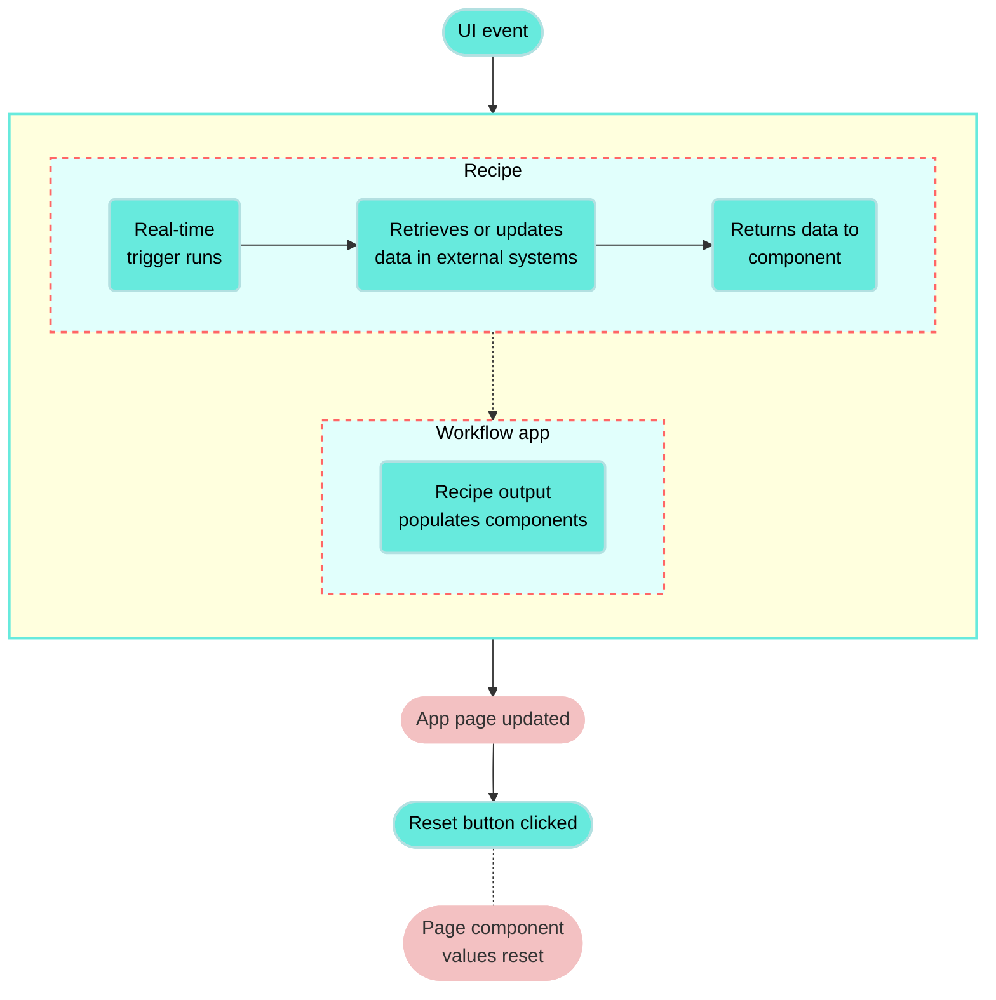

<!-- source: https://docs.workato.com/en/workflow-apps/component-actions/reset-components | lastmod: 2026-10-07 -->
> Configure Reset/reload components actions to clear or refresh page components in a Workflow app after users submit data.

# Reset/reload components

You can configure your page to reset or reload page components as required. For example, you can configure your application to clear all values after a user submits data so that the app can be used again.

## How it works

**Reset/reload components** actions can be configured to clear the entire page or only specific components. This action can be set up as a follow-up action for components configured with another primary action or as the primary action for button components.

The following diagram explains how follow-up actions work in conjunction with **Run recipe** actions.

## Compatible components

The following table describes reset/reload actions, trigger events, and compatible components:

| Component | Trigger event | Action description |
| --- | --- | --- |
| Page | Follow up action | Reset/reload components after a primary action completes. |
| Button | Button click (primary action), Follow up action | Configure a button to reset/reload components as its primary action or reset/reload components after another primary action completes. |
| Single-select and multi-select drop-down components | Follow up action | Reset/reload components after a primary action completes. |
| Table | Follow up action | Reset/reload components after a primary action completes. |
| File | Follow up action | Reset/reload components after a primary action completes. |

## Reset/reload components

Complete the following steps to configure a follow-up action that resets/reloads component values:

1. Select a component configured with a **Run recipe** action, such as a **drop-down**, **table**, or **button**.
   
2. Go to the **Action** panel.
   
3. Use the **Follow up action** drop-down to select `Reset/reload components`.
   
4. Use the **Components** field to select one or more component values to reset or reload.
   
   _Reset/reload a component_
   
5. Click **Save**.

---
