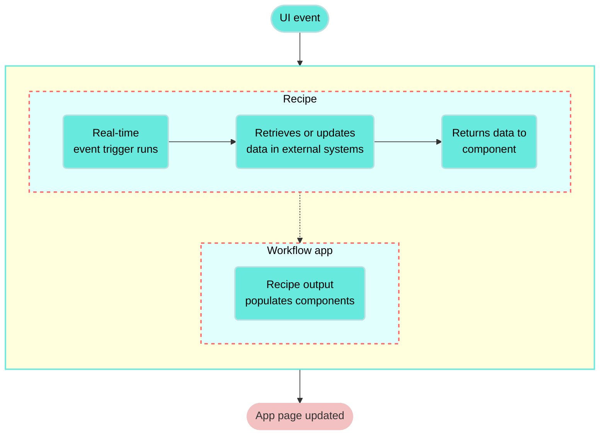

<!-- source: https://docs.workato.com/en/workflow-apps/component-actions/run-recipe | lastmod: 2026-10-08 -->
> Use Run recipe actions in Workflow apps to retrieve or modify data in external systems and update components based on user behavior.

# Run recipe action

The **Run recipe** action enables you to retrieve or modify data in a third-party application and return it to your Workflow app dynamically based on user behavior. This allows end users of your applications to complete tasks involving external systems directly within the app interface and enables instant responses to user input, dynamic updates to components, and seamless integration with external systems within Workflow apps’ low-code environment.

_Recipe outline_

## Key features

- **Dynamic UI events**: Trigger actions on page load, button click, drop-down value changes, or table row selection.
- **Recipe-powered responses**: Connect to external systems seamlessly and run recipes in real-time based on user actions.
- **Custom behaviors**: Update page components, modify input values, manage transitions, show or hide elements, and update or retrieve data from external systems.
- **Compatible with verified user access**: Ensure that recipes perform actions using the identity and permissions of the individual user accessing the app.

## Example use cases

The **Run recipe** action supports a range of business process automation (BPA) and business process management (BPM) use cases, such as:

- [Build a front-end application for a CRM](/en/workflow-apps/component-actions/crm-app)
- [Translation app](/en/workflow-apps/component-actions/translation-app)
- PTO request app
- Ticketing app

## How it works

Run recipe actions are triggered by a UI event in the Workflow apps portal, such as page load, button click, or drop-down value changes, or table row selection. When this event happens, the recipe runs, retrieves or modifies data in an external system and returns the data to the application.

## Compatible components

The following table describes **Run recipe** actions, trigger events, and compatible components:

| Component | Trigger event | Action description |
| --- | --- | --- |
| **Page** | Page load | Configure a recipe to retrieve information from an external system and surface it in your app when the page loads. |
| **Button** | Button click | Configure a recipe to take action in an external system and return data to your app when a button is clicked. |
| **Single-select** and **multi-select drop-down** components | Drop-down value change | Configure a recipe to take action in an external system and return data to your app when an option is selected from a drop-down component. |
| **Table** | Table row selection | Configure a recipe to take action in an external system and return data to your app when a table row is selected. |
| **File** | File value change | Configure a recipe to take action in an external system and return data to your app when a file is uploaded or downloaded. |

## Limitations

**Run recipe** actions have the following limitations during the limited access release:

- Recipes triggered by **Run recipe** actions have a maximum run time of 60 seconds
- [Long-running actions](/en/recipes/long-actions) aren't supported in recipes
- [Runtime user connections](/en/features/runtime-user-connections) aren't supported
- [Public (anonymous) pages](/en/workflow-apps/public-links) don’t support **Run recipe** actions

---
