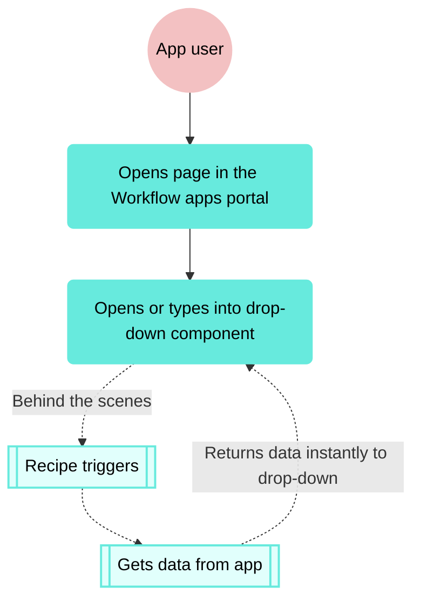

<!-- source: https://docs.workato.com/en/workflow-apps/dropdown-recipe-data-source | lastmod: 2026-10-28 -->
> Use recipes as a data source to dynamically populate single and multi-select drop-down components in Workflow apps.

# Drop-downs with recipe data source

Workflow apps enable you to use [recipes](/en/workato-concepts#recipes) as a data source for [single and multi-select drop-down components](/en/workflow-apps/page-components#choices). This allows you to dynamically populate drop-down components with data from your other applications. This ensures data consistency and reduces manual effort. You can use your existing recipes to fetch data from your apps or create new apps directly from the [page editor](/en/workflow-apps/pages-customize).

_Drop-down component with a recipe as its data source in the Workflow apps portal_

## How it works

This feature works behind the scenes to surface data from your other applications in your Workflow apps pages. At a high level, this feature uses the following logic:



## Use cases

The following use cases provide examples of how you can use this feature to address your business objectives.

### Customer support

- **Scenario**: A customer support workflow requires updating customer account information from a Workflow app page drop-down, which is dynamically populated based on data from a CRM system.
- **Solution**: A recipe retrieves a list of customer accounts from Salesforce in real-time, ensuring the drop-down reflects the most up-to-date data. The employee can then update the account using a Workflow apps page. Submitting the page triggers an additional recipe that updates the account in the CRM.

### Sales order processing

- **Scenario**: Sales representatives must select products from a drop-down when creating sales orders. The product list is stored in an inventory management system and changes frequently.
- **Solution**: A recipe fetches the latest product list from the inventory system, ensuring sales representatives have access to the current product offerings.

### HR onboarding

- **Scenario**: An HR team needs to assign new hires to various departments, which are stored in a database and frequently updated.
- **Solution**: A recipe fetches the latest list of departments from the database whenever the drop-down is accessed, ensuring the HR team sees the most current options.

## How to set up recipes as a data source

Complete the following steps to set up this functionality in your Workflow app.

1. Sign in to Workato and [create a Workflow app](/en/workflow-apps/getting-started#app-create) or select one of your existing Workflow apps.
   
2. [Create a new page](/en/workflow-apps/pages-create) or [edit an existing page](/en/workflow-apps/pages-customize).
   
3. Add a **Drop-down** component to your page and select **Recipe** as the data source.
   
   _Recipe as a data source_
   
4. If existing recipes in your Workflow apps project contain the **New component event (Drop-down)** trigger, Workato displays them here. Otherwise, you can create a new recipe.
   
   Create new recipe
   
   This recipe fetches accounts from Salesforce and returns it to your Workflow app. Refer to the [recipes](#recipes) section of this documentation for additional sample Salesforce, Jira, Okta, and HTTP recipes you can use to populate your drop-down components.
   
   1. Click **Create recipe**.
      
   2. Name your recipe. Workato names the recipe **Get data from drop-down** by default. We recommend giving this recipe a unique name to differentiate it from others in your project. For example, **Get data from drop-down (Account ID)**.
      
      _Select recipe as the data source_
      
   3. Click **Start building**.
      
   4. Workato automatically creates a recipe skeleton with the **New component event (Drop-down)** trigger and **Return data to component** action. Combined, they run the workflow when a user expands the drop-down component. The recipe searches your third-party application for data that matches the configuration and instantly returns the data to your drop-down component.
      
      _Recipe skeleton_
      
   5. Configure the trigger.
      
      - Use recipe to find search results?
      - Select **Yes** in most situations where the number of records in the target system is high and must be searched using the recipe. When **Yes** is selected, Workato requires you to map the Search query (Step 1) datapill into the corresponding fetch action. Select **No** when the number of records in your target system is fewer than `1000`. When **No** is selected, you can perform the search locally in Workato after the records are retrieved.
      
      In our example, we select **No** because the number of records is a known low amount.
      
      _Set use recipe to find search results to No_
      
   6. Click **`+` Add step** to add an app and action to **Step 2**. This example uses **Salesforce** and the **Search records (Account)** action, which enables us to surface customer accounts in our page.
      
      _Add an app and action to Step 2_
      
   7. Select the connection type you plan to use for this action.
      
      _Choose a connection type_
      
      - **End user's connection**: Workflow apps recipes perform actions based on the identity and permissions of the user who connects to the application. End users authenticate with their own credentials to retrieve or modify data in an external app.
      - **This recipe's connection**: This option uses the connection established by the recipe builder and follows the same principles as normal app connections.
      
      **_Only app connections that use OAuth 2.0 authorization code grant are available for end user's connection. Refer to [Verified user access](/en/agentic/agent-studio/verified-user-access) for more information._**
      
   8. Select an existing connection or click **\+ New connection** to [create a new connection](/en/connectors/salesforce#how-to-connect-to-salesforce-on-workato).
      
   9. Configure the Salesforce action.
      
      - Search for
        
      - Select the Salesforce object you plan to search for. For example, **Account**.
        
      - Fields to retrieve
        
      - Improve recipe performance by selecting only the fields relevant for your use case. Otherwise, all fields in the selected object are returned to the data tree if left blank. For example, enter **Account ID** and **Account name** only.
        
      - Quota
        
      - Enter the maximum number of records you plan to return. Set `1000` as the maximum.
        
      - Active
        
      - Select **Yes** to search for only active accounts.
        
      
      _Configure the Salesforce action_
      
   10. Configure the **Return data to drop-down** action by mapping datapills into the following fields:
       
       - Drop-down options list source
         
       - Map the Accounts (Step 2) datapill.
         
       - Value
         
       - This is the unique ID that corresponds to the account. Workato stores this value in your Workflow app's data table. Map the Account ID (Step 2) datapill.
         
       - Label
         
       - This is the value Workato displays to your app users on your page. Map the Account ID (Step 2) datapill.
         
       
       _Configure the Return data to drop-down action_
       
   11. Click **Save**, and **Exit**. Then, return to your page to finish setting up this component.
       
   
   Use existing recipe
   
   1. Select a recipe from the drop-down. Workflow apps displays whether the recipe is **active** or **inactive**. If the recipe is **inactive**, Workato shows an error message indicating that the drop-down doesn't contain any options.
      
      _Select a recipe from the drop-down_
      
   
5. Save the **Selected value** and **Selected label** (**Value** and **Label**, respectively) to data columns. Saving the **Selected value** is required, as Workato uses this value in your recipes. Saving the **Selected label** is optional.
   
   _Save value and label to data columns_
   
6. View and test your page in the [Workflow apps portal](/en/workflow-apps/portal-settings).
   
   _View and test your page in the Workflow apps portal_
   

## Example recipes

The following recipes demonstrate how to fetch data from your applications for use in drop-down [components](/en/workflow-apps/page-components) in your Workflow apps [pages](/en/workflow-apps/pages-create). The recipes in this section are examples only. Additional customization can be necessary depending on your applications and use case.

- [Salesforce: Get data for multiple drop-downs](#salesforce)
- [Salesforce: Get data for multi-value drop-downs](#salesforce-multi-value)
- [Jira: Get data using JQL](#jira)
- [Okta: Get users for drop-down](#okta)
- [HTTP: Get data from an API](#http)

### Salesforce: Get data using multiple drop-downs

This example demonstrates how to configure pages with interdependent drop-downs. In this scenario, customer support representatives plan to update customer account details during a deal renewal cycle. The page includes separate **Account** and **Opportunities** drop-downs, each with its own recipe that fetches data from Salesforce and returns it to our app. The second recipe filters opportunities by **Account ID**. This enables customer support representatives to select an account and view opportunities specific to that account.

**Workflow apps page**

_Get data from Salesforce for drop-down recipe_

**Recipe: Get data for drop-down (Account ID)**

_Get data from Salesforce for drop-down recipe_

**Recipe: Get data for drop-down (Opportunities)**

_Get data from Salesforce for drop-down recipe_

#### Set up this recipe

Complete the following steps to set up the recipe.

1. Add an additional **Drop-down** to your page. Give this component a unique name, such as **Opportunities** and select **Recipe** as the data source.
   
2. Click **Create recipe** and name your recipe appropriately. Workato automatically generates a recipe skeleton with the **New open or search event** trigger and the **Return data to drop-down** action.
   
   _Recipe skeleton_
   
3. Configure the New open or search event from a drop-down trigger
   
   1. Provide one or more **input parameters**. Input parameters enable you to set up custom variables that control trigger behavior. In this situation, we plan to filter opportunities by **Account ID**, so we define that as a parameter.
      
   2. Specify the **Name** and **Data type** for each input parameter. For example, **account\_id** and **string**.
      
      _Add input parameters_
      
   3. Set the **Use recipe to find search results?** field to **No**.
      
      _Set use recipe to find search results to No_
      
   
4. Click **Select an app and action** to add an app and action to Step 2. In our example, we've selected the **Salesforce Search for records** action.
   
5. Select the connection type you plan to use for this action.
   
   _Choose a connection type_
   
   - **End user's connection**: Workflow apps recipes perform actions based on the identity and permissions of the user who connects to the application. End users authenticate with their own credentials to retrieve or modify data in an external app.
   - **This recipe's connection**: This option uses the connection established by the recipe builder and follows the same principles as normal app connections.
   
   **_Only app connections that use OAuth 2.0 authorization code grant are available for end user's connection. Refer to [Verified user access](/en/agentic/agent-studio/verified-user-access) for more information._**
   
6. Select an existing connection or click **\+ New connection** to [create a new connection](/en/connectors/salesforce#how-to-connect-to-salesforce-on-workato).
   
7. Configure the Search for Opportunities in Salesforce action
   
   1. Specify the Salesforce object you plan to retrieve in the **Search for** field. For example, **Opportunity**.
      
   2. In **Fields to retrieve**, select the fields relevant to your use case. Otherwise, all fields in the selected object are returned to the data tree if left blank. For example, select **Opportunity ID** and **Name**.
      
   3. In the **Limit** field, enter the maximum number of records you plan to return. For example, `150`.
      
   4. Set **Closed** to **No**.
      
      _Configure the Search Opportunities action_
      
   
8. Configure the Return data to drop-down action
   
   1. Map the Opportunities (Step 2) datapill to the **Drop-down options list source** field.
      
   2. In the **Value** field, map the Opportunities ID (Step 2) datapill. This is the unique ID that corresponds to the account. Workato stores this value in your Workflow app's data table.
      
   3. In the **Label** field, map the Name (Step 2) datapill. This is the value Workato displays to your app users on your page.
      
      _Configure the return data to drop-down action_
      
   
9. Click **Save**, and **Exit**. Then, return to your page to finish setting up this component.
   
10. In the **Recipe input parameters** field, map the Selected value (Account ID) datapill. This ensures that the **Opportunities** drop-down is populated with opportunities corresponding only to the account your user selects.
    
    _Configure the return data to drop-down action_
    
11. Save the **Selected value** and **Selected label** (**Value** and **Label**, respectively) to data columns. Saving the **Selected value** is required, as Workato uses this value in your recipes. Saving the **Selected label** is optional.
    
    _Save value and label to data columns_
    
12. View and test your page in the [Workflow apps portal](/en/workflow-apps/portal-settings). In this example, only opportunities associated with the **United Oil & Gas Corp.** account are displayed.
    
    _View and test your page in the Workflow apps portal_
    

* * *

> **PREREQUISITES**
> 
> Before proceeding, ensure you have completed all steps in the [How to configure recipes as a data source](#how-to) section, as this describes how to set up the first recipe required to configure interdependent drop-down components.

### Salesforce: Get data for multi-value drop-downs

This example demonstrates how to retrieve a list of users from Salesforce and return them to a drop-down component that supports multi-value selection in your Workflow apps pages. This allows your users to select multiple options simultaneously.

**Workflow apps page**

_Multi-select choice component in the Workflow apps portal_

**Recipe: Get data for drop-down (Accounts)**

_Get data from Salesforce for drop-down recipe_

1. Add a **Multi-select** drop-down to your page. Give this component a unique name, such as **Accounts** and select **Recipe** as the data source.
   
   _Multi-select component_
   
2. Click **Create recipe** and name your recipe appropriately. Workato automatically generates a recipe skeleton with the **New open or search event** trigger and the **Return data to drop-down** action.
   
   _Recipe skeleton_
   
3. Configure the New open or search event from a drop-down trigger
   
   1. Set the **Use recipe to find search results?** field to **Yes**.
      
      _Set use recipe to find search results to Yes_
      
   2. _Optional_. Use the **Minimum search characters to trigger the recipe** field to set how many characters a user must type before search is triggered. The default is `3`. Alternatively, type `0` to run the recipe immediately when the drop-down component opens without requiring any user input.
      
      _Set minimum characters to trigger search_
      
   
4. Click **`+` Add step** to add an app and action to **Step 2**. This example uses **Salesforce** and the **Search records (Account)** action, which enables you to surface customer accounts within the page.
   
   _Add an app and action to Step 2_
   
5. Select the connection type you plan to use for this action.
   
   _Choose a connection type_
   
   - **End user's connection**: Workflow apps recipes perform actions based on the identity and permissions of the user who connects to the application. End users authenticate with their own credentials to retrieve or modify data in an external app.
   - **This recipe's connection**: This option uses the connection established by the recipe builder and follows the same principles as normal app connections.
   
   **_Only app connections that use OAuth 2.0 authorization code grant are available for end user's connection. Refer to [Verified user access](/en/agentic/agent-studio/verified-user-access) for more information._**
   
6. Select an existing connection or click **\+ New connection** to [create a new connection](/en/connectors/salesforce#how-to-connect-to-salesforce-on-workato).
   
7. Configure the Salesforce Search for accounts action
   
   1. Specify the Salesforce object you plan to retrieve in the **Search for** field. For example, **Account**.
      
   2. Use the **Fields to retrieve** drop-down menu to select the fields relevant to your use case. If left blank, all fields in the object you select are returned to the data tree. For example, select **Account ID** and **Account name**.
      
   3. Enter the maximum number of records you plan to return in the **Limit** field. For example, `150`. The maximum is `1000`.
      
   4. Add the **Active** and select **Yes**.
      
      _Configure the Salesforce action_
      
   
8. Configure the Return data to drop-down action
   
   1. Map the Accounts (Step 2) datapill to the **Drop-down options list source** field.
      
   2. Map the Account ID (Step 2) datapill to the **Value** field. This is the unique ID that corresponds to the account. Workato stores this value in your Workflow app's data table.
      
      The value must be unique, as Workflow apps omits lines with non-unique values.
      
   3. Map the Account Name (Step 2) datapill to the **Label** field. This is the value Workato displays to your app users on your page.
      
      We recommend using a unique label to improve the user experience. If the label is empty or non-unique, Workflow apps appends the **Value** to the label in parentheses. For example:
      
      - `ACME Automations (id88555)`
      - `ACME Automations (id556666)`
      
      Additionally, empty label fields are replaced by the corresponding value.
      
      _Configure the return data to drop-down action_
      
   
9. Click **Save > Exit**, and then return to your page to finish the component setup.
   
10. Save the **Selected value** and **Selected label** (**Value** and **Label**, respectively) to data columns. Saving the **Selected value** is required, as Workato uses this value in your recipes. Saving the **Selected label** is optional.
    
    _Save value and label to data columns_
    
11. View and test your page in the [Workflow apps portal](/en/workflow-apps/portal-settings).
    
    _View and test your page in the Workflow apps portal_
    

### Jira: Get data using JQL

This example demonstrates how to fetch issues from Jira and return them to a drop-down component in your Workflow app pages. The recipe supports type-ahead search, enabling users to search for Jira tickets in real-time. If no search query is provided, the recipe fetches all issues in Jira and returns the name and ID of the first issue.

**Workflow apps page**

_Get data from Jira for drop-down_

**Recipe: Get data for drop-down using JQL**

_Get data from Jira for drop-down recipe_

#### Set up this recipe

Complete the following steps to set up the recipe.

1. Add a **Drop-down** to your page. Give this component a unique name, such as **Issues** and select **Recipe** as the data source.
   
2. Click **Create recipe** and name the corresponding recipe appropriately. Workato generates a recipe skeleton with the **New open or search event** trigger and the **Return data to drop-down** action automatically.
   
   _Recipe skeleton_
   
3. Configure the New open or search event from a drop-down trigger
   
   1. Set **Use recipe to find search results?** to **Yes**.
      
      This is the appropriate choice in most situations where the number of records in the target system is high and must be searched using the recipe. When **Yes** is selected, Workato requires you to map the Search query (Step 1) datapill into the corresponding fetch action. Select **No** when the number of records in your target system is fewer than `1000`.
      
      _Select yes to use the recipe to find search results_
      
   2. _Optional_. Use the **Minimum search characters to trigger the recipe** field to set how many characters a user must type before search is triggered. The default is `3`. Alternatively, type `0` to run the recipe immediately when the drop-down component opens without requiring any user input.
      
      _Set minimum characters to trigger search_
      
   
4. Set up an is Search query present IF condition in Step 2.
   
   _**This portion of the recipe enables type-ahead search**_.
   
   1. Map the Search query (Step 1) datapill into the **Data field**.
      
   2. Select **is present** from the **Condition** drop-down.
      
      _Configure an IF condition_
      
   
5. Click **`+` Add step** to add an app and action to the **Yes** portion of the IF condition. Select **Jira** and the **Search issues by JQL** action.
   
6. Select the connection type you plan to use for this action.
   
   _Choose a connection type_
   
   - **End user's connection**: Workflow apps recipes perform actions based on the identity and permissions of the user who connects to the application. End users authenticate with their own credentials to retrieve or modify data in an external app.
   - **This recipe's connection**: This option uses the connection established by the recipe builder and follows the same principles as normal app connections.
   
   **_Only app connections that use OAuth 2.0 authorization code grant are available for end user's connection. Refer to [Verified user access](/en/agentic/agent-studio/verified-user-access) for more information._**
   
7. Select an existing connection or click **\+ New connection** to [create a new connection](/en/connectors/jira#how-to-connect-to-jira-on-workato).
   
8. Configure the Search issues by JQL action
   
   _**Upon user input, this portion of the recipe searches Jira for issues**_.
   
   1. Configure a **JQL query string** to search for data matching your criteria in Jira. For example:
      
      ```JQL
      summary ~ "\"SEARCH_QUERY_DATAPILL\"" order by summary desc
      ```
      
      Learn more about [JQL](https://support.atlassian.com/jira-software-cloud/docs/what-is-advanced-search-in-jira-cloud/).
      
   2. Replace the following section of the query:
      
      - _`SEARCH_QUERY_DATAPILL`_: Map the Search query (Step 1) datapill.
      
      _Enter a JQL query_
      
   
9. Click **`+` Add step** to add an action to the **Yes** section of your IF condition. Select the **Workflow apps Return data to component** action.
   
10. Configure the Return data to drop-down action
    
    1. Map the Issues (Step 3) datapill into the **Drop-down options list source** field.
       
    2. In the **Value** field, map the Summary (Step 3) and Key (Step 3) datapills. This is the unique ID that corresponds to the account. Workato stores this value in your Workflow app's data table.
       
       _Configure the Return data to drop-down action_
       
    
11. Click **`+` Add step** to add an **ELSE IF** condition to the **No** condition. _**If there are no results matching the search query, this portion of the recipe returns the first issue**_.
    
12. Click **`+` Add step** to add an action from an app. Select **Custom action in Jira**.
    
13. Set up your Custom action in Jira. Refer to our page on creating a [custom action](/en/developing-connectors/custom-actions#app-support-for-custom-actions) to learn more.
    
14. Click **`+` Add step** to add an action from an app. Select the **Variables by Workato** **Create empty list** action.
    
15. Set up your Create empty list action
    
    1. Provide a **List name**. For example, **Issues**.
       
    2. Define your **list item schema**. You can provide sample JSON or add fields manually. In our example, we have added the **Label** field because we plan to display the corresponding issue label to our end users.
       
    
16. Click **`+` Add step** to add an action from an app. Select the **Workflow apps Return data to component** action.
    
17. Click **Save**, and **Exit**. Then, return to your page to finish setting up this component.
    
18. Save the **Selected value** and **Selected label** (**Value** and **Label**, respectively) to data columns. Saving the **Selected value** is required, as Workato uses this value in your recipes. Saving the **Selected label** is optional.
    
    _Save value and label to data columns_
    
19. View and test your page in the [Workflow apps portal](/en/workflow-apps/portal-settings).
    

* * *

### Okta: Get users for drop-down

This recipe demonstrates how to retrieve user profiles from Okta and return them to your Workflow apps pages. It supports type-ahead search, enabling users to search for Okta profiles in real-time. When a search query is provided, the recipe splits it into first and last name parts, searches Okta for users whose first name starts with the first part and last name starts with the second part, and returns the first matching user's details. If no matches are found, it returns an empty response to the drop-down.

**Workflow apps page**

_HR onboarding page_

**Recipe: Get data for drop-down (Users)**

_Get users from Okta recipe_

#### Set up this recipe

Complete the following steps to set up the recipe.

1. Add a **Drop-down** to your page. Give this component a unique name, such as **Users** and select **Recipe** as the data source.
   
2. Click **Create recipe** and name the corresponding recipe appropriately. Workato automatically generates a recipe skeleton with the **New open or search event** trigger and the **Return data to drop-down** action.
   
   _Recipe skeleton_
   
3. Configure the New open or search event trigger
   
   1. Set **Use recipe to find search results?** to **Yes**.
      
      This is the appropriate choice in most situations where the number of records in the target system is high and must be searched using the recipe. When **Yes** is selected, Workato requires you to map the Search query (Step 1) datapill into the corresponding fetch action.
      
      _Select yes to use the recipe to find search results_
      
   2. _Optional_. Use the **Minimum search characters to trigger the recipe** field to set how many characters a user must type before search is triggered. The default is `3`. Alternatively, type `0` to run the recipe immediately when the drop-down component opens without requiring any user input.
      
      _Set minimum characters to trigger search_
      
   
4. Set up an is Search query present IF condition in Step 2.
   
   _**This portion of the recipe enables type-ahead search**_.
   
   1. Map the Search query (Step 1) datapill into the **Data field**.
      
   2. Select **is present** from the **Condition** drop-down.
      
      _Configure an IF condition_
      
   
5. Click **`+` Add step** to add an additional action to the **Yes** section of your IF condition. Select **Variables by Workato** and the **Create variable** action.
   
6. Set up your first variable
   
   _**This portion of the recipe splits the search query into two parts and creates a variable for the user's first name**_.
   
   1. Click **Add a variable**. Provide a unique **Label** and **Data type** for the variable. For example, **FirstPart**, and **String**.
      
      _Add a variable_
      
   2. Click **Formula** to define the variable using formula mode.
      
   3. Map the Search query (Step 1) datapill into the formula. Use the `.split` formula to divide the search query into two parts, using a space (`" "`) as the delimiter. Add `[0]` to indicate you're selecting the first part of the search query.
      
      _Use `.split` to create a variable from the first part of the datapill_
      
   
7. Click **`+` Add step** to add an additional action to the **Yes** section of your IF condition. Select **Variables by Workato** and the **Create variable** action.
   
8. Set up another variable
   
   _**This portion of the recipe splits the search query into two parts and creates a variable for the user's last name**_.
   
   1. Click **Add a variable**. Provide a unique **Label** and **Data type** for the variable. For example, **SecondPart**, and **String**.
      
      _Add a variable_
      
   2. Click **Formula** to define the variable using formula mode.
      
   3. Map the Search query (Step 1) datapill into the formula. Use the `.split` formula to divide the search query into two parts, using a space (`" "`) as the delimiter. Add `[1]` to indicate you're selecting the second part of the search query.
      
      _Use `.split` to create a variable from the second part of the datapill_
      
   
9. Click **`+` Add step** to add an action to the **Yes** section of your IF condition. Select **Okta** and the **Search users** action.
   
10. Select the connection type you plan to use for this action.
    
    - **End user's connection**: Workflow apps recipes perform actions based on the identity and permissions of the user who connects to the application. End users authenticate with their own credentials to populate components with recipe data.
    - **This recipe's connection**: This option uses the connection established by the recipe builder and follows the same principles as normal app connections.
    
    **_Only app connections that use OAuth 2.0 authorization code grant are available for end user's connection. Refer to [Verified user access](/en/agentic/agent-studio/verified-user-access) for more information._**
    
11. Select an existing connection or click **\+ New connection** to [create a new connection](/en/connectors/okta#how-to-connect-to-okta).
    
12. Set up the Search query
    
    1. Use the following search query:
       
       ```
       profile.firstName sw "FIRSTPART_DATAPILL" and profile.lastName sw "SECONDPART_DATAPILL"
       ```
       
       Learn more about [filtering expressions](https://developer.okta.com/docs/reference/core-okta-api/#filter) in Okta.
       
    2. Replace the following:
       
       - _`FIRSTPART_DATAPILL`_: Map the FirstPart (Step 4) datapill.
       - _`SECONDPART_DATAPILL`_: Map the FirstPart (Step 4) datapill.
    
13. Click **`+` Add step** to add an action to the **Yes** section of your IF condition. Select **Workflow apps** and the **Return data to drop-down** action.
    
14. Configure the Return data to drop-down action
    
    1. Map the Users (Step 6) datapill into the **Drop-down options list source**.
       
    2. Enter the following into the **Value** field. This is the unique ID that corresponds to the records Workato stores this value to your Workflow app's data table.
       
       ```
       User ID is ID_DATAPILL | User status is STATUS_DATAPILL | Last update STATUS_CHANGED_DATAPILL | FIRSTNAME_DATAPILL LASTNAME_DATAPILL (USERNAME_DATAPILL) | Password = VALUE_DATAPILL
       ```
       
       Replace the following:
       
       - _`ID_DATAPILL`_: Map the Users (Step 6) datapill.
       - _`STATUS_DATAPILL`_: Map the Status (Step 6) datapill.
       - _`STATUS_CHANGED_DATAPILL`_: Map the Status changed time (Step 6) datapill.
       - _`FIRSTNAME_DATAPILL`_: Map the First name (Step 6) datapill.
       - _`LASTNAME_DATAPILL`_: Map the Last name (Step 6) datapill.
       - _`USERNAME_DATAPILL`_: Map theUsername (Step 6) datapill.
       - _`VALUE_DATAPILL`_: Map the Value (Step 6) datapill.
    3. Map the First name (Step 6) and Last name (Step 6) datapills into the **Label** field.
       
    
15. Click **`+` Add step** to add an action. Select the **Else** action. If there are no results matching the search query, this portion of the recipe returns an empty value to your drop-down.
    
16. Click **`+` Add step** to add an action from an app. Select the **Workflow apps Return data to drop-down** action.
    
17. Click **Save**, and **Exit**. Then, return to your page to finish setting up this component.
    
18. Save the **Selected value** and **Selected label** (**Value** and **Label**, respectively) to data columns. Saving the **Selected value** is required, as Workato uses this value in your recipes. Saving the **Selected label** is optional.
    
    _Save value and label to data columns_
    
19. View and test your page in the [Workflow apps portal](/en/workflow-apps/portal-settings).
    

### HTTP: Get data from an API

This recipe demonstrates how to fetch locations based on a user's search query and return the result to your Workflow apps page. It uses the [HTTP connector](/en/developing-connectors/http-v2) to send a custom GET request to the Geoapify Location Platform API. The recipe supports type-ahead search, enabling users to search for locations in real-time. It returns a list of matching locations and formats the first result into a readable address, which is then returned to your page.

**Workflow apps page**

_Get data for drop-down using HTTP connector_

**Recipe: Get data from an API request**

_Get data for drop-down using HTTP connector_

#### Set up this recipe

Complete the following steps to set up the recipe.

1. Add a **Drop-down** to your page. Give this component a unique name, such as **Addresses** and select **Recipe** as the data source.
   
2. Click **Create recipe** and name the corresponding recipe appropriately. Workato automatically generates a recipe skeleton with the **New open or search event** trigger and the **Return data to drop-down** action.
   
   _Recipe skeleton_
   
3. Configure the New open or search event trigger
   
   1. Set **Use recipe to find search results?** to **Yes**.
      
      This is the appropriate choice in most situations where the number of records in the target system is high and must be searched using the recipe. When **Yes** is selected, Workato requires you to map the Search query (Step 1) datapill into the corresponding fetch action. Select **No** when the number of records in your target system is fewer than `1000`.
      
      _Select yes to use the recipe to find search results_
      
   2. _Optional_. Use the **Minimum search characters to trigger the recipe** field to set how many characters a user must type before search is triggered. The default is `3`. Alternatively, type `0` to run the recipe immediately when the drop-down component opens without requiring any user input.
      
      _Set minimum characters to trigger search_
      
   
4. Set up an is Search query present IF condition in Step 2.
   
   _**This portion of the recipe enables type-ahead search**_.
   
   1. Map the Search query (Step 1) datapill from Step 1 into the **Data field**.
      
   2. Select **is present** from the **Condition** drop-down.
      
      _Configure an IF condition_
      
   
5. Click **`+` Add step** to add an action to the **Yes** section of your IF condition. Select the **HTTP Send request** action.
   
6. Configure your Send request action
   
   1. Provide a **Request name**. Workato uses this value to name your action.
      
   2. Click **Start guided setup**.
      
   3. Select **GET** as the HTTP **Method**.
      
   4. Provide the **Request URL**. This is the URL from which you plan to make requests. For example, `https://api.geoapify.com/v1/geocode/autocomplete`.
      
      _Provide the request URL_
      
   5. Click **Next**.
      
   6. Under **Request URL parameters**, click **Show**. Then click **Add URL parameter**.
      
   7. Enter `text` for the **Parameter name** and a sample location, such as `Springville` in the **Value** field.
      
      _Add a parameter_
      
   8. In the **Response** section, ensure the **Response content type** and **Encoding** fields are set to **JSON** and **UTF-8**, respectively.
      
   9. Click **Send request**.
      
   10. Review the **HTTP configuration**. Workato uses the **Response** from this call to auto-generate the response schema for this action.
       
   11. Click **Apply configuration**.
       
   12. In the **Request URL parameters** field, remove your sample location, `Springville`, and map the Search query (Step 1) datapill. This enables the recipe to query the API for the location your user types into the field.
       
       _Map in the Search query (Step 1) datapill_
       
   13. Leave all other fields at their default values.
       
   
7. Click **`+` Add step** to add an app and action. Select the **Workflow apps Return data to component** action.
   
8. Configure the Return data to component action
   
   1. In the **Drop-down options source list** field, map the Features (Step 4) datapill.
      
   2. In the **Value** field, map the Features (Step 4) datapill.
      
   3. In the **Label** field, map the Address line 1 (Step 4), Address line 2 (Step 4), City (Step 4), State (Step 4), and Region (Step 4) datapills.
      
      _Map in datapills_
      
   
9. Click **`+` Add step** to add an action. Select the **Else** action. If no results match the search query, this portion of the recipe returns an empty value to your drop-down.
   
10. Click **Save**, and **Exit**. Then, return to your page to finish setting up this component.
    
11. Save the **Selected value** and **Selected label** (**Value** and **Label**, respectively) to data columns. Saving the **Selected value** is required, as Workato uses this value in your recipes. Saving the **Selected label** is optional.
    
    _Save value and label to data columns_
    
12. View and test your page in the [Workflow apps portal](/en/workflow-apps/portal-settings).
    

* * *

## Limitations

Not all recipes can serve as a data source for drop-down components. Workflow apps support recipes as a data source if the recipe's total run time is ten seconds or less. This means this feature _**isn't compatible**_ with recipes that use [long-running actions](/en/recipes/long-actions). This quota prevents timeouts in your Workflow apps pages.

Additionally, during the limited access release, this feature is subject to the following limitations:

- Workflow apps displays recipes for the project in which the app exists only. If you plan to use recipes from a separate project, you must move them into the same project as your app.
  
- Workflow apps' [preview mode](/en/workflow-apps/pages-preview) does not support recipe drop-downs. This means that you must test recipe functionality in the Workflow apps portal itself.

---
