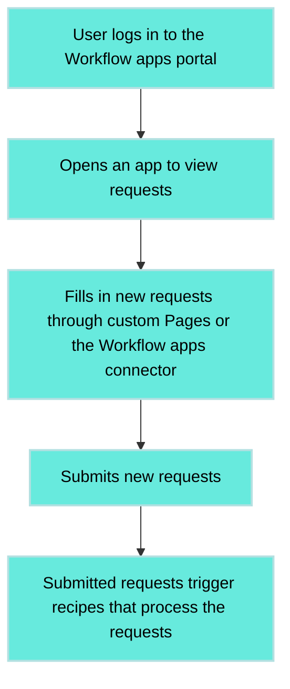

<!-- source: https://docs.workato.com/en/workflow-apps/faq | lastmod: 2026-09-08 -->
> Find answers to common questions about Workato Workflow apps, including application components, the user interface, and the Workflow apps portal.

# Workflow apps - FAQ

Get answers to frequently asked questions about Workflow apps.

## General

How does Workato support application development?

Workato supports [application development](/en/workflow-apps) by providing tools for data storage, user interfaces, and business logic implementation.

What are the key components of an application in Workato?

An application in Workato consists of [three key components](/en/workflow-apps#key-components):

- **Data storage:** Data is stored in data tables and accessed through the Workflow apps connector.
- **UI:** User interface for business users, created partially by Workato and customized through Pages.
- **Business Logic:** Implemented using Workato recipes.

What is the role of the user interface in Workato applications?

The [user interface in Workato applications](/en/workflow-apps#application-user-interface) provides a platform for business users to interact with the app. Workato auto-generates part of this UI, including features like the list of requests and navigation, while custom Pages allows you to further customize the UI.

What is the Workflow apps portal in Workato and who can access it?

The [Workflow apps portal](/en/workflow-apps/portal-homepage) in Workato is a web application where business users can access all applications to which they have been granted access. The Workflow apps portal is responsive for mobile and tablet devices and can be customized.

How many end users can I authorize to use apps created with Workflow apps?

The number of end users allowed to interact with Workflow apps depends on your platform plan and any additional capacity you've purchased.

Go to **Platform > Workflow apps portal** or use the [Usage dashboard](/en/pricing/usage) to track the number of authorized end users.

Is there a limit to the number of builders or apps that can be created?

No, there is no limit to the number of builders or apps that can be created on the platform. Builders can create as many apps as needed without restrictions.

What is a typical application flow in Workato?

A typical [application flow in Workato](/en/workflow-apps#example-application-flow) involves a user logging into the Workflow apps portal, navigating to an application to view requests, filling in new requests through custom Pages or the Workflow apps connector, and submitting these requests. Submitted requests trigger recipes that process the requests, which may include tasks assigned to users or automated steps.

## Authentication and authorization

Do I have to be a Workato user to log in to the Workflow apps portal?

No. The Workflow apps portal is designed for business users inside your organization and beyond and has separate [user and group management](/en/workflow-apps/app-user-groups#organize-users-groups).

Can I add users and groups from my Identity Provider (for example, Okta or Microsoft Entra ID)?

Yes. You can set up SAML SSO with your identity provider, enable Just-In-Time (JIT) provisioning so that the users are created automatically in the system when they first log in, and set up additional SAML attributes so that users land in the appropriate group. Refer to our [SAML administration guide](/en/workflow-apps/saml) for more information.

Can I capture data from unauthorized users?

Yes, you can use [public submission forms](/en/workflow-apps/public-links) to collect submissions and requests from users that don't have a Workflow apps account.

## Deployment and distribution

Are mobile apps available?

Workflow apps does not allow you to create native mobile apps, however, all [portal pages](/en/workflow-apps/pages-create), both custom and built-in, have responsive layouts and render properly on mobile and tablet devices.

Can Workflow apps pages be added to my internal websites or business apps as an iFrame?

Yes. You can embed the entire Workflow apps portal, a specific app, or even a page using an [`iframe`](/en/workflow-apps#use-cases). This requires explicit enablement by Workato Customer Support.

Can I customize the URL of my application?

You can [provide your subdomain](/en/workflow-apps/portal-settings#general) on your `workato.app` domain (all applications reside on `https://{your-domain}.workato.app`).

Is Workflow apps available for Embedded customers?

The Workflow apps portal is available only to direct customers. Contact your Customer Success Manager for more information.

Can a Workato application have a chain of approvals for the same request?

Yes. It's possible to set up a chain of approvals for the same request in a Workato application by initiating multiple [user tasks](/en/workflow-apps/workflow-apps-connector/assign-task-to-users-action#assign-task-to-users-action) with the same Record ID.

How does a user submit a request in a Workato application?

Users can submit a request either through a custom-defined Page in the application or by using the [Create request action](/en/workflow-apps/workflow-apps-connector/create-request-action) through the Workflow apps connector in Workato.

What happens when a new request is submitted in Workato?

A [new request submission](/en/workflow-apps/application-page#submit-a-request) triggers a recipe in Workato. This recipe, depending on its configuration, processes the request, which could include data enrichment, manual review, and other actions.

How are tasks assigned and managed in Workato applications?

Tasks are assigned through the [Assign task to users](/en/workflow-apps/workflow-apps-connector/assign-task-to-users-action#assign-task-to-users-action) action in the recipe. This determines the following:

- UI Page for the task
- Record ID
- Task name
- Assignee
- Expiration period

The assignee receives an email with a link to the task, which can be accessed through the Workflow apps portal.

Is it possible to complete tasks in Workato using external platforms like Slack or Microsoft Teams?

Yes. Tasks can be completed using external platforms through integrations like [Workbot for Slack](/en/workbot/workbot#workbot-for-slack) or [Workbot for Microsoft Teams](/en/workbot-for-teams/workbot).

## Data

How do data tables work in Workato?

Apps with request and approval functionality use [Data tables](/en/data-tables#data-tables) for structured data storage. Users can define data tables in projects, with each application typically having one main data table for storing relevant information, such as invoices or PTO requests.

What are the quotas on data storage?

[Workflow apps data storage quotas](/en/data-tables/data-table-limits#limits) include the following:

**General data tables quotas**:

| Description | Quota |
| --- | --- |
| Maximum number of data tables per workspace | 100 |
| Maximum number of rows per table | 1,000,000 |
| Maximum number of rows in a data table that can be [exported](/en/recipe-development-lifecycle/export.html#export-a-manifest-as-a-package) or [deployed](/en/features/environments/deployment.html#what-can-be-deployed) | 10,000 |
| Maximum number of columns per table | 100 |
| Maximum number of **Link to a table** column types per table | 20 |
| Maximum number of **Multi-value** column types per table | 20 |
| Maximum record size | 100,000 bytes |
| Maximum table size | 1,000,000,000 bytes |
| Maximum number of visible records (rows) at one time in the data tables UI | 200 |
| Maximum number of filters that can be applied simultaneously to a table in the data tables UI. Note that each additional filter is treated as an `AND` operand. | 10 |
| Maximum number of filters that can be applied to a field/column | 1 |

**Data tables column quotas**:

| Column type | Description | Quota | Example |
| --- | --- | --- | --- |
| Short text | Text field used to store small strings or textual data. Typically, this data type is for names, short descriptions, status codes, or small identifiers. | Maximum of 10,000 characters. Sorting and filtering is supported for only the first 756 characters. | `A very short description`, `user@example.com`, `John Doe` |
| Long text | Multi-line text field. Typically, this data type is for large amounts of text, such as descriptions, comments, or any large block of text. | Maximum of 10,000 characters. Sorting and filtering is supported for only the first 756 characters. | `A long description or comment that can span many lines…` |
| Integer | Whole numbers without any fractional or decimal parts. Integers can represent both positive and negative values, including zero. | Integers are 64-bit (8-byte) and can range between `-9223372036854775808` and `9223372036854775807`. | `5000`, `100000`, `2147483647` |
| Decimal | IEEE-754 floating-point numbers. Commonly used for precise calculations involving fractional numbers, such as percentages or scientific measurements. | Floating-point numbers do not enforce a fixed number of decimal places. Precision is determined by the number’s range. For example, smaller values can represent more decimal places accurately, while larger values lose precision due to spacing between representable values. | `0.1`, `3.141592653589793`, `1.7976931348623157 × 10³⁰⁸` |
| Boolean | A true/false value. | NA | `TRUE`, `FALSE` |
| Date | Calendar dates (such as, year, month, and day) without time information. Useful for fields such as birthdates, event dates, or transaction dates. Date columns inherit the timezone and date and time format of your workspace. This means that the exact date format can vary, depending on your settings. | Supports a range of dates between 262,145 BCE and 262,143 CE. | `13/11/2024`, `11/13/2024` |
| DateTime | Date and time (including hours, minutes, seconds). Used to track exact moments of events, transactions, or logs. DateTime columns inherit the timezone and date and time format of your workspace. This means that the exact date and time format can vary, depending on your settings. | Follows RFC 3339 protocol. | `13/11/2024 00:00:00`, `11/13/2024 12:00 AM` |
| File | Allows you to upload or download files to/from your data tables. | Maximum file size: `500 MB`. File names can have up to `255` characters. | NA |
| Link to a table | Display data from a different data table in your workspace. Choose a **Linked data table** to select another data table to link to your current table and **Display data from** to determine which column from the data table you have selected displays as a dropdown. | Each data table can link to a maximum of `20` data tables. Data tables supports linking to **short text** and **long text** column types. | NA |
| Multi-value | This column supports storing multiple values in a single cell. Multi-value columns do not support nulls, empty strings, or duplicate values. Sorting columns is not supported. Supported value types include short **Text**, **Integer**, **Decimal**, **Date**, **DateTime**, and **Link to a table**. | Each data table can have a maximum of `20` multi-value columns. Each cell within a multi-value column can store up to `20` values. | NA |

Can my data storage (for example, MySQL or Snowflake) be used for storage for app data?

The data for apps with request and approval functionality is stored in [data tables](/en/data-tables#data-tables). You can use recipes to sync data between data tables and other storage / apps.

Generic apps, or apps without request and approval functionality, use recipes to connect directly to external systems and can pull in live or contextual data using [Run recipe actions](/en/workflow-apps/component-actions/run-recipe).

Is it possible to validate the data submitted?

All [pages](/en/workflow-apps/application-page#application-page) automatically perform simple validations, including ensuring that required fields are filled in and that all inputs match their data type.

Workflow apps include [built-in client-side field validation](/en/workflow-apps/built-in-field-validation) for the following components:

- Email
- URL
- Phone numbers
- Number

Additionally, Workflow apps offer [custom client-side field validation](/en/workflow-apps/custom-field-validation) for specific page components. It supports the following types of custom validation:

- Limit input length
- Limit input value
- Pattern matching with regex

You can also perform validations in the recipe after the record has been created and change the workflow stage to `In Error` if it fails.

## Application logic

How do I troubleshoot application errors?

Application logic is implemented as Workato recipes, so all [troubleshooting](/en/troubleshooting) tools and practices apply.

How are Workato recipes used in workflow automation?

Workato recipes are used to coordinate users and services. This allows you to design workflows that span across time, various services, user personas, and UIs. Recipes often use the [Workflow apps connector](/en/workflow-apps/workflow-apps-connector#app-workflows) to implement user steps and change workflow stages.

---
