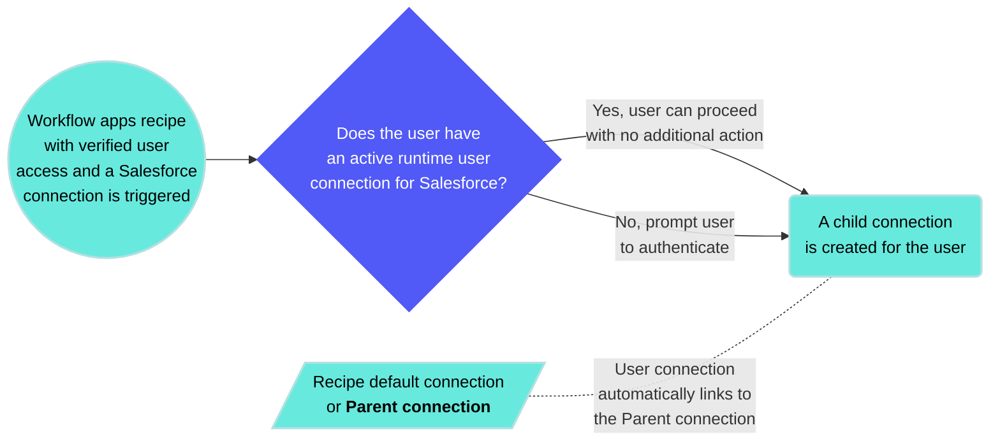
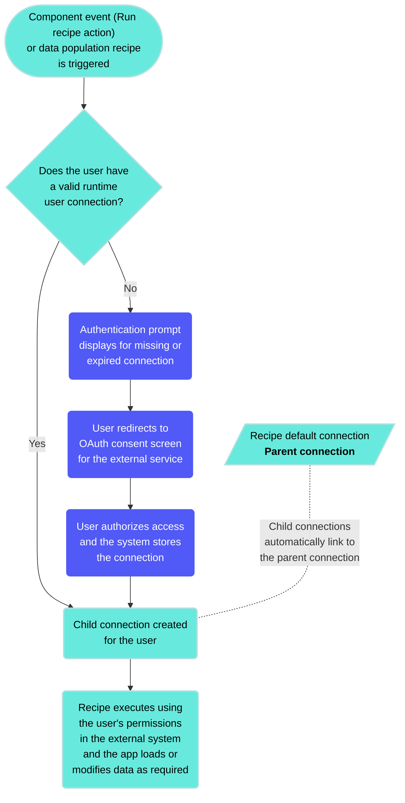

<!-- source: https://docs.workato.com/en/workflow-apps/verified-user-access | lastmod: 2026-09-14 -->
> Learn how verified user access lets each Workflow app user authenticate with their own credentials to access external systems.

# Workflow apps verified user access

Verified user access works through [runtime user connections](/en/features/runtime-user-connections) and allows each end user to authenticate with their own credentials when using a Workflow app to retrieve or modify information in an external system. This ensures that recipes perform actions using the identity and permissions of the individual user accessing the app.

Verified user actions is compatible with the following types of Workflow app recipes:

- Data population recipes: Ensure that [table](/en/workflow-apps/table-recipe-data-source) and [drop-down](/en/workflow-apps/dropdown-recipe-data-source) components that use recipes as a data source retrieve only data scoped to the end user's permissions in the external system.
- [Component event (Run recipe action) recipes](/en/workflow-apps/component-actions/run-recipe): Ensure actions performed in external apps are scoped to the end user's permissions in that app.

You can also [add verified user access to recipe functions](#recipe-functions-vua) invoked by compatible Workflow apps recipes.

## Parent connections

Parent connections act as templates that runtime user connections inherit. The system checks for an existing runtime connection linked to the parent when a user triggers an eligible Workflow apps recipe. Users are prompted to authenticate if no runtime connections are found.

User connections link to the parent connection in Workato when you use verified user access to create connections at runtime. The app invokes a recipe that uses the parent connection when an end-user interacts with a page and triggers a recipe. The app handles runtime user connections in the following ways:

- **Connection prompt**: Workflow apps prompts the user to click **Connect** if they don't have an established runtime user connection. The Workflow apps recipe executes using this child connection.
  
- **No action required**: If the user already has an active runtime user connection, Workflow apps recipes execute using the child connection and the pages and components load normally without additional user action.
  

_Connect prompt in the Workflow apps portal_

For example, when you open a Workflow apps page that's configured with page components or run recipe actions that depend on a Salesforce connection that requires verified user access, it creates a child connection for the user. This new connection links to the recipe's default Salesforce connection as its parent.

## App behavior

When recipes configured with verified user access are used in a Workflow apps page, users must authenticate before certain elements load or function. If the app has multiple connections requiring verified user access, users must authenticate to each one.

- **Data population recipes**: Users must authenticate before the following components load:
  
  - Drop-down components (single-select and multi-select) populated with recipe data
  - Table components populated with recipe data
- **Component event recipes**: Users must authenticate before the following UI events can trigger recipes:
  
  - Page load
  - Button click
  - Drop-down value change
  - Table row selection

## Add verified user access to Workflow apps recipes

You can add verified user access to eligible Workflow apps recipes during the recipe building process.

Verified user actions is compatible with the following types of Workflow app recipes:

- [Data population recipes](/en/workflow-apps/dropdown-recipe-data-source)
- [Component event (Run recipe action) recipes](/en/workflow-apps/component-actions/run-recipe)

> **VERIFIED USER ACCESS AUTHENTICATION REQUIREMENTS**
> 
> Verified user access requires OAuth 2.0 authorization code grant. Other OAuth 2.0 grant types, such as client credentials, password grant, and refresh token grant, are not currently supported.

Complete the following steps to add verified user access to an eligible Workflow apps recipe:

1. Go to the Workflow apps recipe where you plan to add verified user access.
   
2. Click **Select an app and action** step in the recipe.
   
3. Search for and select the app you plan to use. A list of available actions for the app displays.
   
4. Select the action you plan to use.
   
5. Select the connection type you plan to use for the recipe.
   
   - **End user's connection**: Workflow apps recipes perform actions based on the identity and permissions of the user who connects to the application. Users authenticate with their own credentials to populate page components with data or view, get, or modify data in an external app.
   - **This recipe's connection**: This option uses the connection established by the recipe builder and follows the same principles as normal app connections.
   
   _Select **End user's connection** to enable verified user access_
   
6. Select an existing connection or click **\+ New connection** to [create a new connection](/en/connections#create-connections).
   

## Add verified user access to recipe functions

You can configure recipe functions called from Workflow app recipes with verified user access to ensure the recipe function inherits the authenticated user's connection credentials. Add the [RecipeOps List connections action](/en/connectors/recipeops/actions/list-connections) to your recipe to retrieve the associated connection ID and pass it to the recipe function.

Complete the following steps to configure verified user access for recipe functions:

1. Open a Workflow apps recipe configured with verified user access.
   
2. Go to the **Return data to component** action and click **\+ Add step** to add a step before this action.
   
3. Search for and select **RecipeOps by Workato** as your app.
   
4. Set up your RecipeOps by Workato connection
   
   Complete the following steps to set up your RecipeOps connection:
   
   1. Click **Create > Connection** or press C twice.
      
   2. Search for and select `RecipeOps` on the **New connection** page.
      
   3. Provide a name for your connection in the **Connection name** field.
      
      _RecipeOps connection setup_
      
   4. Use the **Location** drop-down menu to select the project where you plan to store the connection.
      
   5. Use the **Whose account are you managing?** drop-down menu to select **My account**.
      
   6. Click **Connect**.
      
   
   > **CONNECTION PRIVILEGES**
   > 
   > RecipeOps connections configured to monitor **My account** have admin privileges and access to all RecipeOps actions and triggers in your workspace, regardless of the role of the user creating the connection.
   
5. Select **List connections (batch)** as the action.
   
6. Configure the List connections (batch) action
   
   Complete the following steps to configure the **List connections (batch)** action:
   
   1. Use the **Parent connection name** drop-down menu to select the parent connection name. Alternatively, you can supply the parent connection ID.
      
   2. Use the **Search for child connections** drop-down menu to select `Yes`.
      
   3. Map the **New component event** User ID (Step 1) datapill to the **External ID** field.
      
      _Map the New component event User ID (Step 1) datapill to the **External ID** field_
      
   
7. Click **\+ Add step** and select **Action in app**.
   
8. Search for and select **Recipe function by Workato** as your app.
   
9. Select **Call a recipe function (asynchronous)** or **Call a recipe function (synchronous)** as your action.
   
10. Set up your Call a recipe function action
    
    Complete the following steps to set up your **Call a recipe function** action:
    
    1. Use the **Recipe function** drop-down to select the recipe function you plan to call.
       
    2. Go to **Connection overrides** and map in the **List connections** Connection ID (Step 14) datapill.
       
       _Map in the List connections Connection ID (Step 14) datapill_
       
    
11. Click **Save** and **Exit**.
    
12. Open the recipe function that your recipe calls.
    
13. Select the **Action in an app** that you plan to use with verified user access.
    
14. Go to the **Connection** tab and ensure the app is configured to use the **Calling recipe's connection**.
    
    _Ensure the app connection uses the **Calling recipe's connection**_
    
15. Click **Save**.
    

## Manage personal connections

You can manage personal connections are managed in the following places:

- **Workato**: Builders can manage runtime user connections by going to **Tools > Runtime user connections**. This page lists all connections created at runtime. Users must have the **View Verified user access at runtime** privilege to access this page.
- **Workflow apps portal**: End users can manage their personal connections in the Workflow apps portal in the **Connections** section of their profile settings.

### Manage personal connections in the Workflow apps portal

Workflow apps users can manage their personal connections in the Workflow apps portal:

- [View personal connections](#apps-personal-connections-view)
- [Delete personal connections](#apps-personal-connections-delete)

#### View personal connections

Complete the following steps to view personal connections in the Workflow apps portal:

1. Sign in to the Workflow apps portal.
   
2. Click your profile icon and select **Manage your account**.
   
3. Click **Connections**.
   
4. View active and disconnected personal connections.
   
   _View personal connections_
   

#### Delete personal connections

Complete the following steps to delete personal connections in the Workflow apps portal:

1. Sign in to the Workflow apps portal.
   
2. Click your profile icon and select **Manage your account**.
   
3. Click **Connections**.
   
4. Click the **...** (ellipses) next to the connection you plan to delete.
   
5. Click **Delete**.
   
   _Delete a personal connection_
   

## Quotas

Your workspace has a combined runtime user connection (RUC) and verified user access (VUA) quota of 100,000 per workspace. The parent connection quota is 500 per workspace.

---
